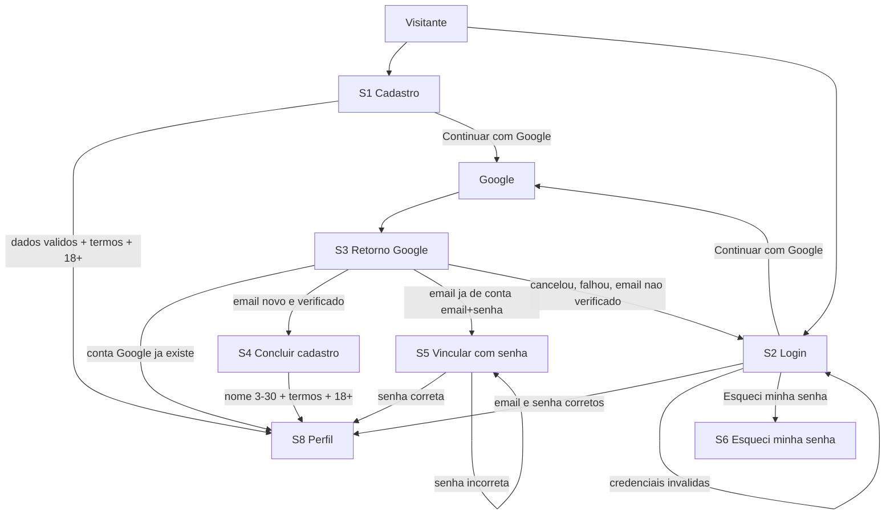
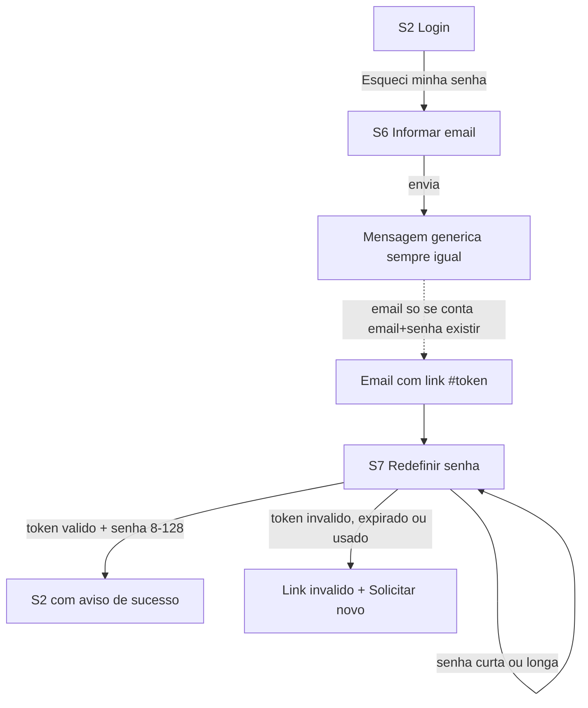
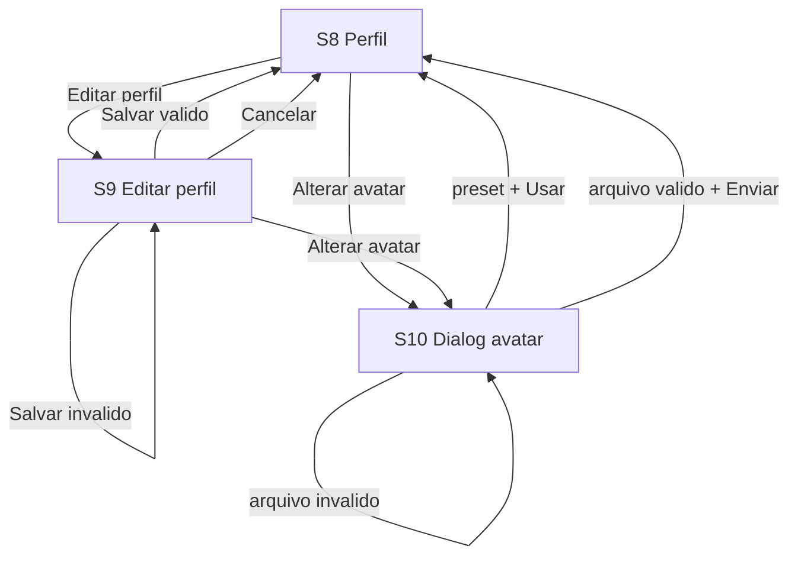
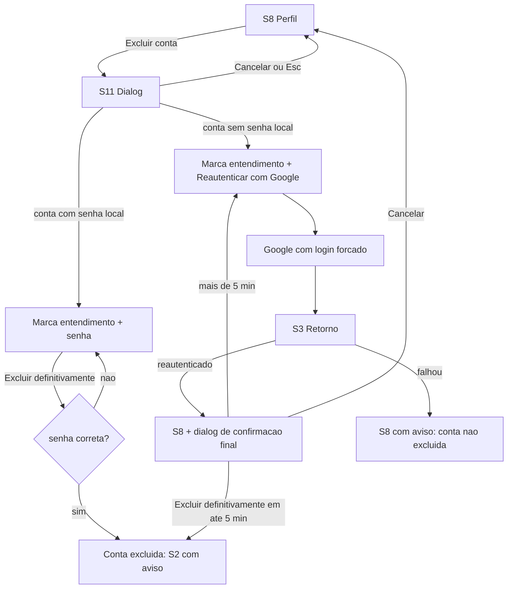

# Design: conta-jogador

Status: Approved | Date: 2026-10-23 | Approved by: dono do projeto (NowItMakesSense) (2026-10-23; reaprovado após a emenda de controle de acesso ao banco - ADR-0015)

> **Emenda de 2026-10-23 - controle de acesso ao banco (ADR-0015).** Por ordem do usuário ("corrija tudo"), após a revisão do orquestrador sobre T-005, foram acrescentados: papéis do PostgreSQL e matriz de privilégio mínimo (`Database/roles/`), endurecimento padrão, proibição de DDL/migração em tempo de execução, TLS no transporte do banco, limites por papel, decisão de não adotar RLS agora e ponteiro para backups/LGPD. Seções novas ou alteradas: "Decisões desta fase > Decisões do architect sobre controle de acesso ao banco" (DB1-DB12), "Objetos de `Database/` afetados", "System design" (Deployment topology, Resilience), **"Controle de acesso ao banco"** (nova), "Configuração", "Error handling and observability" (evento 1021, métrica de erros de banco, alerta), "Threat model" (linhas novas e ajustadas), "Test strategy" (testes estáticos novos e limites do SQLite) e "ADRs". Nenhum requisito, tela, contrato HTTP, tabela, coluna, chave ou índice mudou. O design volta a Draft até a reaprovação do usuário; o restante do conteúdo permanece como aprovado.

Fonte da verdade: `requirements.md` (REQ-001..REQ-048, D1-D14; REQ-038..REQ-048 acrescentados pelo `planner` em 2026-10-23 a partir das decisões abaixo). Insumos: `domain-draft.md` (domain), `ux-draft.md` e `docs/design-system.md` (designer). As questões abertas dos rascunhos foram resolvidas pelo usuário em 2026-10-22 e 2026-10-23 (tabelas abaixo) e não são repetidas aqui.

## Decisões desta fase

### Decisões do usuário aplicadas (2026-10-22)

| # | Decisão | REQ | Onde se reflete |
|---|---|---|---|
| U1 | Nome do Google fora de 3-30: S4 mostra o nome **editável**, validado 3-30 (sem truncar) | REQ-039 | UX S4, `CompleteGoogleSignup` |
| U2 | Aceite de termos + 18+ no caminho Google: na S4, após o retorno, só para conta nova; exige estado transitório no servidor | REQ-039 | `accounts.pending_google_auth`, ADR-0004 |
| U3 | Exclusão via Google: login Google nos últimos 5 min + confirmação final | REQ-042 | `player_session.reauthenticated_at`, UX S11 |
| U4 | Catálogo de Formatos é do contexto Sugestão de Deck; flag "ativo"; preferências para Formato inativo mantidas e ignoradas na leitura | REQ-046 | ADR-0007, `deck_suggestion.format` |
| U5 | Senha com no máximo 128 caracteres | REQ-038 | `Password`, ADR-0003 |
| U6 | Vínculo Google Pendente: TTL 10 min, uso único | REQ-039 (pendência), REQ-036 | ADR-0004 |
| U7 | Dados de rate limit (IP, hash da chave de conta) retidos ~24 h e apagados na exclusão | REQ-047 | ADR-0005, `accounts.access_attempt` |
| U8 | Declaração de 18+ persistida em `TermsAcceptance` como evidência (validação jurídica pendente, D13) | REQ-048 | `accounts.player.adult_declared` |
| U9 | TCG favorito padrão Magic na criação | REQ-044 | `Player` fábricas |
| U10 | Nome de exibição contado após `trim`, em elementos de texto Unicode (grapheme clusters) | REQ-039, REQ-015 | `DisplayName` |
| U11 | 8 a 12 avatares preset neutros; catálogo de presets é dado | REQ-018, REQ-022 | `accounts.avatar_preset`, ADR-0007 |
| U12 | Email não é exibido no perfil nem nas respostas de leitura do perfil | REQ-045 | UX S8, contrato `GET`/`PUT /me/profile` |
| U13 | Sem confirmação de descarte ao cancelar a edição do perfil (MVP) | REQ-014 | UX S9 |
| U14 | Aviso de atraso após 2 s, sem dica de tempo devolvida | REQ-032 | UX A.5, ADR-0005 |
| U15 | Botão Google com SVG local, sem recurso externo | REQ-006 | UX, CSP |
| U16 | Identidade visual: primária #1D4ED8, fonte do sistema, só tema claro, wordmark em texto | NFR Acessibilidade | `docs/design-system.md` (marcações "neutro-padrão" viram decisão) |

Acréscimos de validação propostos pelo architect e aprovados como requisitos: rejeição de caracteres de controle em nome e bio (REQ-040), atraso progressivo por IP em cadastro recusado por email em uso (REQ-041), recusa de versão de termos divergente (REQ-043).

### Decisões técnicas do architect (justificadas; ADR quando significativas)

| # | Decisão | Justificativa | ADR |
|---|---|---|---|
| A1 | Monólito modular, Clean Architecture, um PostgreSQL com schema por contexto | Custo, equipe pequena, exclusão atômica com Decks | ADR-0001 |
| A2 | Sessão no servidor, token opaco em cookie `__Host-` HttpOnly, CSRF por antiforgery + `Origin` | Revogação imediata exigida (REQ-010/030/024) | ADR-0002 |
| A3 | PBKDF2-HMAC-SHA256 600k iterações (BCL), formato versionado | Sem dependência de terceiros; migração via rehash | ADR-0003 |
| A4 | Google OIDC com PKCE/state/nonce, callback no backend, pendências no servidor | Exigências de segurança e fluxos S4/S5/reauth | ADR-0004 |
| A5 | Atraso progressivo: janela 15 min, teto 10 s, timeout do cliente 20 s, contadores HMAC no PostgreSQL | REQ-032 sem bloqueio, retenção curta | ADR-0005 |
| A6 | Exclusão de conta, avatar e Decks numa única transação (com o avatar no PostgreSQL, P2, não resta nada a remover após o commit) | Atomicidade com um banco (domain Q2) | ADR-0006, ADR-0009 |
| A7 | Catálogos de Formato e de presets como dados com flag de ativo | REQ-037, REQ-046, U11 | ADR-0007 |
| A8 | Rotas finais do frontend = rotas propostas pelo designer; API em `/api/v1` | Ver "Contracts" | - |
| A9 | Token de redefinição no **fragmento** do link (`/redefinir-senha#token=...`), removido por `history.replaceState`; `Referrer-Policy: no-referrer` em todo o frontend | Fragmento não vai a servidor, proxy nem `Referer` | - |
| A10 | Parâmetro `retorno` aceita só caminho interno conhecido (validado no cliente e no servidor) | Evita open redirect | - |
| A11 | Nome e bio sempre renderizados como texto (React sem `dangerouslySetInnerHTML`), CSP restritiva | XSS | - |
| A12 | Envio do email de redefinição assíncrono em fila em memória do processo (token em claro nunca persistido) | Tempo de resposta igual exista ou não a conta (REQ-028) | - |

### Decisões do usuário sobre infraestrutura e ferramentas (2026-10-23)

Propostas pelo architect como P1-P5 e decididas pelo usuário. As alternativas consideradas estão nas ADRs 0008-0012.

| # | Tema | Escolha do usuário | ADR |
|---|---|---|---|
| P1 | Layout do repositório e comandos TEST/LINT/BUILD | (a) Monorepo com `backend/` (`Deckloom.sln`, `src/Modules/Accounts/...`, `tests/`) e `frontend/` (Vite). Os comandos ficam como **proposta** para `/amend-constitution` (o `CLAUDE.md` não é editado aqui) | [ADR-0008](../../adr/0008-layout-monorepo-backend-frontend.md) |
| P2 | Armazenamento do avatar customizado | (a) PostgreSQL `bytea` em `accounts.avatar_image` | [ADR-0009](../../adr/0009-avatar-customizado-no-postgresql.md) |
| P3 | Envio do email de redefinição | (a) SMTP genérico via MailKit; Mailpit no dev local; provedor real escolhido na fase 8 | [ADR-0010](../../adr/0010-email-smtp-mailkit-mailpit.md) |
| P4 | Biblioteca de processamento de imagem | (b) **SkiaSharp** (MIT, código nativo) | [ADR-0011](../../adr/0011-processamento-de-imagem-skiasharp.md) |
| P5 | Testes dos adapters EF Core | (a) SQLite em memória para os adapters EF Core (constraints/cascatas) + fakes no restante; nunca o banco do sistema | [ADR-0012](../../adr/0012-testes-adapters-ef-sqlite-em-memoria.md) |

Consequências principais:

**P2 - Avatar no PostgreSQL**: `PostgresAvatarStorage` grava a imagem já reencodada (WebP 256x256, ~10-40 KB, no máximo 256 KB) em `accounts.avatar_image`. A troca de avatar (REQ-021) e a exclusão de conta (REQ-024) acontecem na mesma transação que altera o Jogador; não há remoção pós-commit nem varredura de órfãos. O banco cresce ~250 MB para 10.000 Jogadores com avatar; servir a imagem passa pela API (`GET /me/avatar/custom`, com cache privado imutável).

**P3 - Email**: adapter `SmtpPasswordResetSender` (MailKit) atrás da fila em memória de `IPasswordResetNotifier`; no Docker Compose do dev, o serviço `mail` (Mailpit) captura os emails numa interface local e nada sai da máquina. O provedor de produção (com SMTP e TLS obrigatório) é escolhido na fase 8 e trocado só por configuração (`Email:Smtp:*`).

**P4 - SkiaSharp**: ver "Contracts > Processamento do avatar" e o Threat model. Por ser código nativo, o pacote (e seus binários nativos Linux) fica com versão fixada, a assinatura de bytes e o tamanho são validados antes de qualquer decodificação e as dimensões são verificadas pelo cabeçalho antes de decodificar os pixels.

**P5 - SQLite em memória**: ver "Test strategy > Limites do SQLite" para os comportamentos do PostgreSQL que esses testes não verificam.

### Decisões do architect sobre controle de acesso ao banco (emenda 2026-10-23, pendentes de reaprovação)

Correção das lacunas apontadas pela revisão do orquestrador e aprovadas pelo usuário para correção. Detalhes em "Controle de acesso ao banco" e na [ADR-0015](../../adr/0015-papeis-e-privilegios-do-banco.md) (alternativas consideradas). Itens marcados com (U) foram confirmados pelo usuário em 2026-10-23 (ver "Controle de acesso ao banco > Decisões do usuário sobre o controle de acesso"); a emenda inteira ainda depende da reaprovação do `design.md`.

| # | Decisão | Lacuna corrigida | Onde |
|---|---|---|---|
| DB1 | Quatro papéis: `postgres` (bootstrap/administração, nunca a API), `deckloom_owner` (`NOLOGIN`, dono de schemas e objetos), `deckloom_migrator` (login humano para migrações, membro do dono com `INHERIT FALSE, SET TRUE` e `SET role` padrão) e `deckloom_app` (único papel da API) | Superusuário usado pela API (Alta) | `Database/roles/`, ADR-0015 |
| DB2 | Um único papel de aplicação para todos os módulos, com `GRANT` por tabela, por causa da transação única da exclusão de conta + Decks (ADR-0006) | Papéis | ADR-0015 |
| DB3 | Matriz de privilégio mínimo por tabela; `UPDATE` por coluna em `player`, `player_session` e `password_reset_token`; tabelas de eventos/consumo único sem `UPDATE`; catálogos só `SELECT`; nenhuma sequência concedida (U, UA1) | Matriz de privilégios | `Database/roles/privilege-matrix.md` |
| DB4 | `GRANT` de tabela dentro da migração que cria a tabela (texto literal); `ALTER DEFAULT PRIVILEGES` só para revogar | Matriz / endurecimento | T-066 (via `planner`) |
| DB5 | Endurecimento: `REVOKE ALL ON DATABASE deckloom FROM PUBLIC`, `REVOKE ALL ON SCHEMA public FROM PUBLIC`, `EXECUTE` em funções revogado de `PUBLIC` por padrão, `search_path = pg_catalog` por papel, histórico de migração em schema explícito | Endurecimento | Bootstrap, migrações |
| DB6 | Nenhuma DDL em tempo de execução: proibidos `Migrate`/`MigrateAsync`/`EnsureCreated`/`EnsureDeleted`/`GetPendingMigrations` em `backend/src` (regra de arquitetura); credencial do migrador nunca na configuração da API | Migração na inicialização | T-002/T-094 (via `planner`) |
| DB7 | Verificação de papel na inicialização: a API se recusa a subir se o papel conectado for superusuário, `CREATEROLE`, `CREATEDB`, `BYPASSRLS`, tiver `CREATE` no banco/schemas ou for dono de objeto (U, UA2) | Superusuário usado pela API | Composição (via `planner`) |
| DB8 | TLS: `SSL Mode=VerifyFull` + `Root Certificate` obrigatórios fora de `Development` (validação de opções na inicialização); `hostssl` + `scram-sha-256` no servidor; exceção explícita só para a rede interna do compose de dev (U, UA3) | TLS | "Controle de acesso ao banco", fase 8 |
| DB9 | Limites por papel: `deckloom_app` `statement_timeout 5s`, `lock_timeout 2s`, `idle_in_transaction_session_timeout 15s`, `CONNECTION LIMIT 30`, pool 20; `deckloom_migrator` `5min`/`5s`/`5min`, `CONNECTION LIMIT 2`; nenhuma espera longa com transação aberta; job de limpeza em lotes (U, UA3) | Limites | Arquivos de papel, "Resilience" |
| DB10 | Bootstrap do compose: superusuário `postgres` com `POSTGRES_PASSWORD`, script `db/init/01-roles.sh` (shell, não `.sql`) com senhas de `DECKLOOM_APP_DB_PASSWORD`/`DECKLOOM_MIGRATOR_DB_PASSWORD`; API como `deckloom_app`; connection string montada pelo compose a partir de `DECKLOOM_APP_DB_PASSWORD` (U, UA4) | Superusuário usado pela API | T-005 (via `planner`) |
| DB11 | Row-Level Security **não** adotada agora; J10 + testes de IDOR bastam; `deckloom_app` fica `NOBYPASSRLS` e não dono para permitir adoção futura | RLS | ADR-0015 |
| DB12 | Backups x contas excluídas (LGPD). Decisão do usuário de 2026-10-31: retenção de 30 dias; após restaurar um backup, as exclusões de conta posteriores a ele são reaplicadas antes de liberar o acesso; a reaplicação é registrada em log sem dado pessoal (requisito documentado, procedimento não implementado). Criptografia, papel de backup e aviso ao titular seguem para D12/D13 e fase 8 | Backups | "Controle de acesso ao banco", Threat model |

## Bounded context and ubiquitous language

### Contexto delimitado

**Conta/Perfil** (`accounts`). Responsabilidade: identidade do Jogador (cadastro, autenticação, sessão, redefinição de senha), consentimento LGPD (aceite de termos e maioridade declarada), Perfil (nome de exibição, bio, avatar, TCG favorito, Formatos preferidos) e exclusão de conta com remoção de dados pessoais.

Módulos internos (mesmo contexto, mesmo projeto): **Identidade e Acesso** (credenciais, Identidade Externa Google, Sessão, Redefinição de Senha, Atraso Progressivo) e **Perfil** (apresentação, preferências, Avatar). Ambos compartilham o agregado `Player`. Identidade e Acesso é o candidato a virar contexto próprio se surgirem outros provedores ou 2FA (fora do MVP).

### Context map

| Contexto / sistema | Relação | Detalhe |
|---|---|---|
| Sugestão de Deck (dono de Deck e do Catálogo de Formatos) | Conta/Perfil é upstream para identidade; Sugestão de Deck é upstream para o Catálogo de Formatos | Deck referencia o Jogador só por `PlayerId`. Conta/Perfil referencia Formato só por `FormatId` e lê o catálogo pela porta `IFormatCatalog` (camada anticorrupção). Exclusão de conta exclui os Decks pela porta `IPlayerDecksPurger`, na mesma transação (ADR-0006). |
| Comparação de Preço | Sem relação nesta feature | Loja não é ator. |
| Google (OpenID Connect) | Sistema externo, anticorrupção | Resultado convertido em `GoogleVerifiedIdentity` (subject, email, emailVerified, nome). Foto e tokens do Google não entram no sistema (REQ-022). |
| Provedor de email | Sistema externo, porta de saída `IPasswordResetNotifier` | Só o link de redefinição (REQ-028). SMTP genérico via MailKit; Mailpit no dev; provedor de produção na fase 8 (ADR-0010). |
| Armazenamento de avatar | Porta de saída `IAvatarStorage` | PostgreSQL `bytea`, tabela `accounts.avatar_image` do próprio contexto (ADR-0009). |

### Linguagem ubíqua

Definições completas em `docs/glossary.md`. Identificadores de código em inglês.

| Termo (pt-BR) | Identificador | Tipo | Resumo |
|---|---|---|---|
| Jogador | `Player` | Agregado raiz | Conta + Perfil de uma pessoa |
| Visitante | `Visitor` | Conceito não persistido | Pessoa sem sessão |
| Conta | `Account` | Aspecto do Jogador (não é agregado) | Email, credenciais, Aceite |
| Perfil | `Profile` | Value object composto | Nome, bio, avatar, TCG favorito, Formatos preferidos |
| Email | `Email` | Value object | Normalizado, único entre Jogadores existentes |
| Senha / Hash de Senha | `Password` (transitório) / `PasswordHash` | Value objects | 8 a 128 caracteres; só o hash é guardado |
| Identidade Externa | `ExternalIdentity` | Value object | Provedor Google + `subject` |
| Nome de Exibição | `DisplayName` | Value object | 3 a 30 elementos de texto após `trim`, não único |
| Bio | `Bio` | Value object | Até 280 elementos de texto, opcional |
| Avatar / Avatar Preset / Avatar Customizado | `Avatar` / `PresetAvatar` / `CustomAvatar` | Value object (soma) | Exatamente um por Jogador |
| TCG Favorito | `FavoriteTcg` | Value object (enumeração extensível) | Hoje só `mtg` (Magic: The Gathering); padrão na criação |
| Formato Preferido | `FormatId` | Referência | Ao catálogo do contexto Sugestão de Deck |
| Catálogo de Formatos | `IFormatCatalog` | Porta | Formatos ativos selecionáveis |
| Aceite de Termos / Maioridade Declarada | `TermsAcceptance` (`TermsVersion`, `AcceptedAt`, `AdultDeclared`) | Value object imutável | Evidência de aceite e de 18+ |
| Sessão / Lembrar-me | `Session` / `RememberMe` | Agregado raiz / atributo | 30 min de inatividade ou 30 dias |
| Token de Redefinição | `PasswordResetToken` | Entidade interna do `Player` (0..1) | 60 min, uso único, só hash |
| Vínculo Google Pendente | `PendingGoogleLink` | Estado transitório da aplicação | Aguarda a senha (S5), 10 min, uso único |
| Cadastro Google Pendente | `PendingGoogleSignup` | Estado transitório da aplicação | **Termo novo**: identidade Google verificada sem conta aguardando nome, aceite e 18+ (S4), 10 min, uso único. A incluir no glossário pelo `domain`/`knowledge-graph` |
| Atraso Progressivo | `ProgressiveDelayPolicy`, `IAccessAttemptStore` | Política de domínio + porta | Sem bloqueio |
| Reautenticação | `Reauthentication` (`PasswordProof` ou `RecentGoogleLogin`) | Value object (prova) | Exigida na exclusão |
| Exclusão de Conta | evento `PlayerDeleted` | Evento de domínio | Física, imediata, irreversível |

Nomenclatura: o conflito sinalizado pelo `domain` sobre Formato foi resolvido pela decisão U4 (Formato é entidade de catálogo do contexto Sugestão de Deck; Conta/Perfil guarda só `FormatId`). "Conta" continua sendo aspecto do Jogador, não agregado separado.

## Domain model

Camada de domínio sem framework, IO ou persistência; relógio (`TimeProvider`), aleatoriedade, hashing, rede e armazenamento entram por portas. Exceção: identificadores de agregado (`Guid`, ex.: `PlayerId`) são gerados no próprio domínio; a porta de aleatoriedade vale para valores com papel de segurança (tokens, salts) (emenda 2026-10-23, aprovada pelo usuário na revisão de T-001..T-015).

### Agregados

| Agregado | Raiz | Contém | Ciclo de vida |
|---|---|---|---|
| `Player` | `Player` | `Email`, `PasswordHash?`, `ExternalIdentity?` (Google, 0..1), `Profile` (`DisplayName`, `Bio?`, `Avatar`, `FavoriteTcg`, `FormatIds`), `TermsAcceptance`, `PasswordResetToken?` (0..1) | Criado no cadastro, removido fisicamente na exclusão |
| `Session` | `Session` | `SessionId`, `TokenHash`, `PlayerId`, `RememberMe`, `CreatedAt`, `LastSeenAt`, `ExpiresAt`, `RevokedAt?`, `ReauthenticatedAt?` | Criada em autenticação bem-sucedida; revogada, expirada ou removida na exclusão |

Fora de agregado: `ProgressiveDelayPolicy` (função pura), eventos de acesso (`IAccessAttemptStore`), `PendingGoogleSignup` e `PendingGoogleLink` (estado da aplicação, `IPendingGoogleAuthStore`).

### Value objects e regras de validação

Todo value object desta tabela tem igualdade por valor (comparação ordinal; `FormatPreferences` compara como conjunto, sem ordem) - emenda 2026-10-23, aprovada pelo usuário na revisão de T-001..T-015.

| Value object | Regra | REQ |
|---|---|---|
| `Email` | `trim`, minúsculas (invariante), no máximo 254 caracteres, exatamente um `@`, parte local e domínio não vazios, domínio com ao menos um ponto e sem rótulo vazio (`a@.com`, `a@b..com` e `a@b.com.` são `invalid_format`); sem espaços em nenhuma parte (emendas 2026-10-23, aprovadas pelo usuário). `ToString()` devolve uma máscara, nunca o endereço; o valor sai só por `Value` (persistência, envio e leitura do próprio Perfil). Pontos e `+` não são removidos (sem canonicalização por provedor) | 003 |
| `Password` (nunca persistido) | 8 a 128 caracteres contados em code points Unicode; sem regra de composição; sem normalização nem `trim`; colar permitido; o valor em claro só sai por um método explícito (`Reveal()`), sem propriedade pública, para que serializadores e logs estruturados não o capturem (emenda 2026-10-23, aprovada pelo usuário na auditoria pós-T-015) | 003, 030, 031, 038 |
| `PasswordHash` | Formato `v1$pbkdf2-sha256$...` (ADR-0003); nunca exposto em leitura | 001, 013 |
| `DisplayName` | Normalização NFC, `trim` de espaços Unicode nas bordas, comprimento em elementos de texto (grapheme clusters: `StringInfo.LengthInTextElements` no .NET, `Intl.Segmenter` no frontend) de 3 a 30; caracteres de controle (categoria Unicode Cc) rejeitados em qualquer posição, inclusive nas bordas (verificados antes do `trim`, que remove só espaços), com precedência sobre o comprimento; nulo, vazio ou só espaços -> `length` (emenda 2026-10-23, aprovada pelo usuário); repetição entre Jogadores permitida | 015, 037, 039, 040 |
| `Bio` | NFC, `\r\n` vira `\n`, `trim` nas bordas, até 280 elementos de texto; vazia vira ausente; quebra de linha permitida, demais caracteres Cc rejeitados (inclusive `\r` solto e TAB) em qualquer posição, verificados depois de `\r\n` virar `\n` e antes do `trim`, com precedência sobre o comprimento e sobre "vazia vira ausente"; nulo vira ausente (emenda 2026-10-23, aprovada pelo usuário, mesma regra do `DisplayName`) | 015, 016, 040 |
| `FavoriteTcg` | Conjunto suportado `{ mtg }` (rótulo "Magic: The Gathering"); padrão `mtg` na criação; adicionar TCG é acrescentar um valor sem tocar perfis existentes | 015, 017, 044 |
| `FormatIds` | Itens tipados como `FormatId` (`readonly record struct FormatId(string Value)`; emenda 2026-10-23). Conjunto sem repetição (duplicatas enviadas são colapsadas), pode ser vazio; cada item novo deve ser Formato **ativo** do catálogo; referências a Formato inativo já guardadas são preservadas (reenviar um Formato inativo já guardado é aceito e o mantém, pois não é item novo; ids comparadas exatamente, e id nula, vazia ou fora do catálogo é `invalid` - emenda 2026-10-23, aprovada pelo usuário) | 015, 016, 037, 046 |
| `Avatar` | `PresetAvatar(PresetId)` ou `CustomAvatar(StorageKey)`; criação sempre com o preset padrão | 018, 022 |
| `TermsAcceptance` | `TermsVersion` igual à versão vigente (`ITermsVersionProvider`), `AcceptedAt`, `AdultDeclared = true`; imutável; removido com o Jogador. Versão vigente nula ou em branco é erro de configuração (`ArgumentException`), não erro de validação do usuário (emenda 2026-10-23) | 033, 034, 043, 048 |
| `ExternalIdentity` | `Provider = google`, `Subject` não vazio | 006, 007 |
| `Reauthentication` | `PasswordProof` (senha conferida pelo caso de uso) ou `RecentGoogleLogin` (reautenticação Google na sessão há no máximo 5 min) | 023, 042 |

### Invariantes do `Player`

| # | Invariante | REQ |
|---|---|---|
| J1 | `Email` normalizado e único entre Jogadores existentes; verificado pelo caso de uso e reforçado por `ux_player_email` (corridas). Após exclusão, o email fica livre e um novo cadastro gera outro `PlayerId` | 002, 003, 027 |
| J2 | Todo Jogador tem ao menos um método de autenticação (`PasswordHash` e/ou `ExternalIdentity`) | 001, 006 |
| J3 | Senha em claro validada (8 a 128) antes do hash; só `PasswordHash` é guardado; o hash nunca sai em leitura de Perfil | 001, 003, 013, 030, 038 |
| J4 | `TermsAcceptance` (versão vigente + data/hora + 18+) obrigatório na criação, por qualquer via; versão divergente recusa a criação; `FavoriteTcg = mtg` na criação | 033, 034, 043, 044, 048 |
| J5 | Edição de Perfil é tudo ou nada; regras da tabela de value objects; Formatos inativos já referenciados são preservados ao salvar, omitidos na leitura e voltam a aparecer se reativados | 014 a 017, 037, 040, 046 |
| J6 | Exatamente um `Avatar`; criação com preset padrão (foto do Google ignorada); troca a partir de avatar customizado emite `AvatarChanged` com a chave anterior para remoção | 018, 021, 022 |
| J7 | No máximo uma `ExternalIdentity` Google; vínculo a Jogador existente só se ele tem senha local, o email verificado do Google é igual ao `Email` e há `PasswordProof`; `subject` não pode estar em dois Jogadores | 007, 008, 036 |
| J8 | No máximo um `PasswordResetToken`; emitir invalida o anterior; 60 min; uso único; só hash; só para Jogador com senha local; senha curta (ou longa demais) não consome o token; sucesso troca o hash, consome o token e exige revogar todas as sessões | 028 a 031, 038 |
| J9 | Exclusão exige confirmação explícita e `Reauthentication` válida (senha se há senha local; senão Google nos últimos 5 min + confirmação final); efetivada, a remoção é física e irreversível e inclui aceite/18+ e os dados de rate limit ligados ao Jogador | 023 a 027, 042, 047, 048 |
| J10 | Toda operação de Perfil, avatar e exclusão atua só sobre o `PlayerId` da sessão; nenhum comando aceita `PlayerId` alvo do cliente | 011, 013 |

Comportamentos: `Player.RegisterWithPassword(...)`, `Player.RegisterWithGoogle(...)`, `LinkGoogle(identity, verifiedEmail, PasswordProof)`, `IssuePasswordReset(tokenHash, now)`, `ResetPassword(presentedTokenHash, newHash, now)`, `UpdateProfile(displayName, bio, favoriteTcg, formatIds, activeFormatIds)`, `ChooseAvatarPreset(presetId)`, `SetCustomAvatar(storageKey)`, `Delete(confirmed, reauthentication, now)`.

Fábricas de cadastro (emenda 2026-10-23, aprovada pelo usuário na T-015):
- `RegisterWithPassword(Email, PasswordHash, DisplayName, currentTermsVersion, submittedTermsVersion, acceptTerms, adultDeclared, DateTimeOffset now, defaultPresetId)` e `RegisterWithGoogle(Email, ExternalIdentity, DisplayName, ...mesmos dados de aceite, now, defaultPresetId)` recebem value objects já construídos e devolvem `Result<Player>`. Chamam `TermsAcceptance.Create` e repassam os erros sem alterar (mesma ordem fixa); chamam `Avatar.CreateDefault(defaultPresetId)` e falham com `invalid` se o id vier em branco. Com os dois inválidos, o erro do aceite tem precedência sobre o do preset padrão (configuração do servidor). O id padrão vem do `IAvatarPresetCatalog` pela Application; o relógio (`TimeProvider`) fica na Application.
- O nome inicial do Google é um `DisplayName` (as regras ficam no próprio value object, sem fallback); o mapeamento do erro para `Field = displayName` é da Application.
- `PlayerId` é `readonly record struct PlayerId(Guid)`, gerado pela fábrica.
- `Player` deriva de `AggregateRoot` (SharedKernel), que expõe `IReadOnlyCollection<DomainEvent> DomainEvents` e `ClearDomainEvents()`.
- `PlayerRegistered(PlayerId, RegistrationMethod, TermsVersion)`, com `enum RegistrationMethod { Password, Google }`; a serialização `password`/`google` fica na borda.
- Leitura: `Id`, `Email`, `PasswordHash?` e `ExternalIdentity?` (objetos; `PasswordHash` segue opaco e mascarado e nunca sai em leitura de Perfil), `DisplayName`, `Bio?`, `FavoriteTcg`, `Avatar`, `Formats` (`FormatPreferences`), `TermsAcceptance`.

Edição de Perfil (emenda 2026-10-23, aprovada pelo usuário na T-016):
- `UpdateProfile(string? displayName, string? bio, string? favoriteTcg, IEnumerable<FormatId> formatIds, IReadOnlyCollection<FormatId> activeFormatIds) : Result<Player>` (no sucesso, o próprio Jogador) recebe valores brutos (diferente das fábricas de cadastro) porque o agregado valida tudo ou nada (J5): chama `DisplayName.Create`, `Bio.Create`, `FavoriteTcg.Create` e `FormatPreferences.Update` e, se algum falhar, devolve **todos** os erros, cada um com `Field` do contrato (`displayName`, `bio`, `favoriteTcg`, `formatIds`), sem alterar o estado.
- `Result<T>` (SharedKernel) passa a aceitar vários erros: `Failure` recebe uma lista, `Errors` expõe todos e `Error` continua sendo o primeiro.
- `ProfileUpdated(PlayerId, IReadOnlyList<string> ChangedFields)`, com os nomes do contrato na ordem fixa `displayName`, `bio`, `favoriteTcg`, `formatIds`; a comparação usa a igualdade por valor dos value objects. Salvar sem nenhuma mudança é sucesso e não emite evento.
- `activeFormatIds` é o catálogo ativo; Formato inativo ou fora do catálogo enviado como item novo é `invalid` (regra do `FormatIds`).

Avatar (emenda 2026-10-23, aprovada pelo usuário na T-017):
- `ChooseAvatarPreset(string? presetId)` e `SetCustomAvatar(string? storageKey)` recebem texto bruto e devolvem `Result<Player>` (no sucesso, o próprio Jogador). Em branco -> `DomainError("invalid", Field = "avatar")`, sem alterar estado nem emitir evento.
- A validação do preset contra a galeria ativa fica na Application (`IAvatarPresetCatalog`, T-047); o agregado só rejeita em branco.
- Escolher o avatar já definido (mesmo preset ou mesma chave customizada) é sucesso sem evento - emitir com a mesma chave faria o consumidor apagar a imagem recém-gravada.
- Toda troca real emite `AvatarChanged(PlayerId, string? PreviousStorageKey)`: a chave anterior vem só quando o avatar anterior era customizado (preset->preset e preset->custom emitem com chave nula).

Vínculo Google (emenda 2026-10-23, aprovada pelo usuário na T-018):
- `LinkGoogle(ExternalIdentity identity, Email verifiedEmail, PasswordProof? proof) : Result<Player>` (no sucesso, o próprio Jogador). O agregado confere J7 sozinho: senha local, email verificado do Google igual ao `Email` (igualdade por valor do `Email`) e prova de posse.
- `PasswordProof` é um value object do Domain, `sealed`, ligado a um `PlayerId`, com construtor `internal`: só a Application (`InternalsVisibleTo("Deckloom.Accounts.Application")`, que a cria depois de conferir a senha com `IPasswordHasher`) e os testes do Domain conseguem criá-la. Prova de outro Jogador é recusada.
- Falhas devolvem só o primeiro erro, na ordem fixa: `no_local_password` (sem `PasswordHash`) -> `already_linked` (qualquer `ExternalIdentity` já presente, mesmo com o mesmo `subject`) -> `email_mismatch` -> `invalid_proof` (prova nula ou de outro Jogador). `Field` nulo; nada é vinculado e nenhum evento é emitido.
- No sucesso, `ExternalIdentity` passa a ser a identidade informada e é emitido `GoogleIdentityLinked(PlayerId)`. A unicidade do `subject` entre Jogadores (J7) fica na Application/repositório (T-043).

Redefinição de senha (emenda 2026-10-23, aprovada pelo usuário na T-019):
- `TokenHash` (nome dado na T-021; antes `PasswordResetTokenHash`, mesmo comportamento): value object `sealed` do Domain com o SHA-256 de um token opaco (redefinição, sessão e pendências Google) (exatamente 32 bytes, senão `invalid`), cópia defensiva na entrada e na saída, igualdade por valor com comparação em tempo constante e `ToString()` mascarado (mesmo padrão do `PasswordHash`).
- `IssuePasswordReset(TokenHash tokenHash, DateTimeOffset now) : Result<Player>` (no sucesso, o próprio Jogador) substitui o token anterior (no máximo um) por um com `IssuedAt = now` e `ExpiresAt = now + 60 min` (constante de política) e emite `PasswordResetIssued(PlayerId, ExpiresAt)`. Conta sem senha local -> `no_local_password` (constante já existente do `Player`).
- `ResetPassword(TokenHash presentedTokenHash, PasswordHash newHash, DateTimeOffset now) : Result<Player>`: o agregado confere que há token ativo, que ele é o apresentado e que `now < ExpiresAt` (59:59 aceito; 60:00 e depois rejeitados, como o `expires_at > now()` da tabela). Sem token, expirado, já usado ou diferente -> `reset_link_invalid`. No sucesso troca o `PasswordHash`, remove o token (uso único) e emite `PasswordChanged(PlayerId)`; revogar as sessões é do caso de uso (T-036).
- Falhas: `Field` nulo; não alteram estado nem emitem evento.
- Leitura: `PasswordResetToken?` (`TokenHash`, `IssuedAt`, `ExpiresAt`; construtor `internal`) fica público e só de leitura, para o mapeamento do T-058. Só o hash do token é guardado.

Exclusão de conta (emenda 2026-10-23, aprovada pelo usuário na T-020):
- `Reauthentication` é uma `abstract class` do Domain com construtor `private protected` (hierarquia fechada, como o `Avatar`), com duas `sealed class` com igualdade por valor escrita à mão, ambas ligadas a um `PlayerId` e com construtor `internal` (criadas só pela Application e pelos testes do Domain): `PasswordProof(PlayerId)` (deixa de ser record; mesma API) e `RecentGoogleLogin(PlayerId, DateTimeOffset? ReauthenticatedAt)`, que a Application monta a partir do `ReauthenticatedAt` da `Session` (S6).
- `Delete(bool confirmed, Reauthentication? reauthentication, DateTimeOffset now) : Result<Player>` (no sucesso, o próprio Jogador). Falhas devolvem só o primeiro erro, na ordem fixa: (1) `confirmed = false` -> `DomainError("required", Field = "confirm")`; (2) reautenticação de outro Jogador -> `invalid_proof` (constante já existente); (3) conta com senha local sem `PasswordProof` (nula ou `RecentGoogleLogin`) -> `reauth_required`; conta sem senha local sem `RecentGoogleLogin` (nula ou `PasswordProof`) ou com `ReauthenticatedAt` nulo -> `reauth_required`; (4) `ReauthenticatedAt < now - 5 min` -> `reauth_expired` (5:00 exatos aceito, como o contrato `reauthenticatedAt >= now - 5 min`). Nos erros (2) a (4) `Field` é nulo; nenhuma falha altera estado nem emite evento.
- Senha incorreta (`incorrect_password`) é do caso de uso (T-049): ele só cria o `PasswordProof` depois de conferir a senha.
- No sucesso, só emite `PlayerDeleted(PlayerId)`; o agregado não muda outro estado. A remoção física (aceite, 18+, avatar, sessões, Decks, eventos de acesso) é da Application na mesma transação (ADR-0006).
- A janela de 5 min é uma constante pública única de política no Domain (`Reauthentication.Window`); a `Session` não a duplica (T-021): só registra o `ReauthenticatedAt`, e o `Delete` aplica a janela.

### Invariantes da `Session`

| # | Invariante | REQ |
|---|---|---|
| S1 | Nasce só de autenticação bem-sucedida (cadastro, login por senha, Google vinculado, conclusão de cadastro Google, vínculo com senha). Recusa, pendência ou cancelamento não criam sessão | 001, 004 a 009, 036 |
| S2 | Token opaco de 256 bits; o servidor guarda só o SHA-256 | 010 |
| S3 | Sem lembrar-me: válida enquanto `now - LastSeenAt < 30 min`, cada requisição válida renova `LastSeenAt` ("requisição válida" = endpoint protegido ou `GET /auth/session` com sessão válida; ver "Forma de AuthenticateSession e Logout"). Com lembrar-me: válida até `CreatedAt + 30 dias` | 012, 035 |
| S4 | Revogação irreversível; sessão revogada/expirada nunca volta a valer; requisição sem sessão válida é "não autenticada" | 010, 011 |
| S5 | Todas as sessões do Jogador são revogadas na redefinição de senha e removidas na exclusão | 024, 030 |
| S6 | `ReauthenticatedAt` só é marcado por reautenticação Google do mesmo `subject` vinculado; vale 5 min para exclusão | 023, 042 |

Agregado `Session` (emenda 2026-10-23, aprovada pelo usuário na T-021):
- `Session.Start(PlayerId playerId, TokenHash tokenHash, bool rememberMe, DateTimeOffset now) : Session` gera `SessionId` (`readonly record struct SessionId(Guid)`, UUIDv7 por `Guid.CreateVersion7`), define `CreatedAt = LastSeenAt = now` e `ExpiresAt` (sem lembrar-me `now + 30 min`; com lembrar-me `now + 30 dias`, constantes de política) e emite `SessionStarted(SessionId, PlayerId, RememberMe)`. Só o hash do token é guardado (S2).
- `IsValid(now)`: `RevokedAt` nulo e `now < ExpiresAt` (30:00 de inatividade já expirou).
- `Touch(now) : bool`: sessão válida -> renova `LastSeenAt` e, sem lembrar-me, `ExpiresAt = now + 30 min` (com lembrar-me o `ExpiresAt` não muda) e devolve `true`; sessão inválida -> não altera nada e devolve `false` (S4: nunca volta a valer).
- `Revoke(SessionRevocationReason reason, now)`, `enum SessionRevocationReason { Logout, PasswordReset, AccountDeletion }` (motivos do log 1019; `AccountDeletion` acrescentado pelo T-049): a primeira chamada marca `RevokedAt` e emite `SessionRevoked(SessionId, PlayerId, Reason)`, inclusive em sessão já expirada; chamadas seguintes não alteram nada nem emitem evento (idempotente). Revogar todas as sessões de um Jogador é do `ISessionRepository.RevokeAllFor` (T-024, T-057), não do agregado.
- `MarkReauthenticated(ExternalIdentity linked, ExternalIdentity presented, now) : Result<Session>` (S6): sessão inválida -> `session_invalid`; identidades diferentes (igualdade por provider+subject) -> `subject_mismatch`; `Field` nulo, sem alterar estado; sucesso -> `ReauthenticatedAt = now`. `ToRecentGoogleLogin()` devolve `RecentGoogleLogin(PlayerId, ReauthenticatedAt)` para o `Player.Delete`, que aplica a janela de 5 min.
- Estado só com setters privados; leitura: `Id`, `TokenHash`, `PlayerId`, `RememberMe`, `CreatedAt`, `LastSeenAt`, `ExpiresAt`, `RevokedAt?`, `ReauthenticatedAt?`.

### Política de atraso progressivo

`ProgressiveDelayPolicy.DelayFor(accountCount, ipCount, action)` (função pura, ADR-0005): T1 atraso monotonicamente crescente com teto de 10 s, nunca bloqueia; T2 aplica-se a login, solicitação de redefinição, senha no vínculo Google e senha na exclusão, e (só pela chave de IP, sem afetar a chave de conta) a cadastros recusados por email em uso (REQ-041); T3 chave de conta = HMAC do email normalizado, exista ou não a conta; T4 eventos retidos ~24 h; na exclusão, apagados os eventos cuja chave de conta é o HMAC do email do Jogador (REQ-047, ver "Retenção e exclusão dos dados de rate limit" abaixo).

Forma da política (emenda 2026-10-23, aprovada pelo usuário na T-022):
- `ProgressiveDelayOptions` (`Auth:ProgressiveDelay:*`): `AccountThreshold` (padrão 3), `IpThreshold` (padrão 10), `BaseDelay` (padrão 1 s) e `MaxDelay` (padrão 10 s). Atraso de uma chave = 0 abaixo do limiar; senão `BaseDelay x 2^(contagem - limiar)`, limitado a `MaxDelay` - reproduz a tabela da ADR-0005 e é crescente por construção.
- `ProgressiveDelayPolicy` é `sealed class` construída com as opções; opções inválidas (limiar < 1, `BaseDelay` <= 0, `MaxDelay` < `BaseDelay`) lançam `ArgumentException` no construtor.
- `DelayFor(int accountCount, int ipCount, AccessAction action) : TimeSpan` = máximo entre o atraso da conta e o do IP; `enum AccessAction { Login, PasswordResetRequest, GoogleLink, AccountDeletion, Registration }` (nomes da ADR-0005); com `Registration`, a contagem de conta é ignorada (REQ-041). Contagem negativa lança `ArgumentOutOfRangeException`. Não existe resultado "bloqueado".
- Monotonicidade verificada por laço determinístico (contagens 0 a 1000 nas duas chaves), sem biblioteca de property testing.

Chave de IP normalizada (emenda 2026-11-01, SEC-02/SEC-19, aprovada pelo usuário na triagem do retro; ADR-0005, nota de 2026-11-01): o "IP" que entra no HMAC da chave de IP e na partição do limitador de concorrência por IP não é o endereço completo, e sim a chave produzida por `ClientIpKey.From` (`Deckloom.Api.Http`), único ponto da API que lê `Connection.RemoteIpAddress` (garantido por teste de higiene), chamado depois de `UseForwardedHeaders` (ADR-0016):
- IPv4: o endereço inteiro (ex.: `203.0.113.7`).
- IPv4 mapeado em IPv6 (`::ffff:a.b.c.d`): tratado como o IPv4 correspondente, para que o mesmo cliente não tenha duas chaves conforme a pilha.
- IPv6: truncado no prefixo `/64` (os 64 bits finais zerados, sem scope id), no formato `<prefixo>/64` (ex.: `2001:db8:1:2::/64`). Motivo: um cliente comum controla o `/64` inteiro e poderia usar um endereço novo por requisição, anulando o limiar de IP do atraso, o limitador de 4 simultâneas e a mitigação de REQ-041. Efeito aceito: clientes distintos no mesmo `/64` compartilham a chave (mesmo efeito do NAT no IPv4, já coberto pelo limiar de IP mais alto).
- Sem endereço de conexão: a constante `unknown` (todas as requisições nessa condição compartilham a chave).

Os endpoints (`AuthEndpoints`, `GoogleEndpoints`, `MeDeletionEndpoints`) passam essa chave como `ip` ao `AccessThrottle`; o limitador de `/api/v1/auth/**` particiona pela mesma chave. Nada no `AccessThrottle` muda: ele continua aplicando `HMAC(segredo, ip)` ao texto recebido.

#### Retenção e exclusão dos dados de rate limit (REQ-047)

Só hashes são guardados, mas a exclusão consegue localizar as linhas "ligadas ao Jogador": antes de apagar o Jogador, o caso de uso recalcula `account_key_hash = HMAC(segredo, email normalizado do Jogador)` - a mesma função usada ao gravar - e apaga todas as linhas com esse valor, na mesma transação (ADR-0005, ADR-0006). Isso cobre também as tentativas feitas contra esse email antes de a conta existir. Limites conhecidos, registrados para o `security`:
- Linhas só com chave de IP (cadastros recusados, REQ-041) não têm ligação verificável com nenhum Jogador e não são apagadas na exclusão; saem pela retenção de ~24 h. O IP só existe como HMAC.
- O IP de um Jogador continua presente nas linhas de outras chaves de conta (ex.: tentativas contra outros emails a partir da mesma rede) até expirarem em ~24 h; não há como atribuí-las ao Jogador.
- Se o segredo HMAC for trocado, linhas antigas deixam de ser localizáveis pela exclusão; por isso a troca do segredo só pode ocorrer com o descarte de todas as linhas existentes (a perda é só de contadores de 24 h).

### Estado transitório da aplicação (`IPendingGoogleAuthStore`)

`PendingGoogleSignup` (subject, email verificado, nome sugerido) e `PendingGoogleLink` (subject, email verificado, `PlayerId` alvo): emitidos só pelo servidor, token opaco em cookie HttpOnly, TTL 10 min, uso único (consumo atômico só no sucesso), ligados ao `subject`. Persistidos em `accounts.pending_google_auth` (REQ-036, REQ-039).

### Eventos de domínio

Nenhum evento carrega email, senha, hash ou token; só identificadores internos.

| Evento | Origem | Dados | Consumidores |
|---|---|---|---|
| `PlayerRegistered` | fábricas de `Player` | `PlayerId`, `Method` (`password`/`google`), `TermsVersion` | log/auditoria |
| `GoogleIdentityLinked` | `LinkGoogle` | `PlayerId` | log |
| `PasswordResetIssued` | `IssuePasswordReset` | `PlayerId`, `ExpiresAt` | log (o email é enviado pelo caso de uso, não por evento, porque o token em claro não pode trafegar em evento) |
| `PasswordChanged` | `ResetPassword` | `PlayerId` | caso de uso revoga sessões (S5); log |
| `ProfileUpdated` | `UpdateProfile` | `PlayerId`, nomes dos campos alterados | log |
| `AvatarChanged` | `ChooseAvatarPreset` / `SetCustomAvatar` | `PlayerId`, `PreviousStorageKey?` | remoção da imagem anterior na mesma transação (REQ-021) |
| `PlayerDeleted` | `Delete` | `PlayerId` | sessões, avatar, Decks, eventos de acesso (tudo na mesma transação) |
| `SessionStarted` / `SessionRevoked` | `Session` | `SessionId`, `PlayerId`, motivo | log |

Regras dos eventos (emenda 2026-10-23, aprovada pelo usuário na T-023):
- Lista fechada de tipos de propriedade em qualquer `DomainEvent`: `PlayerId`, `SessionId`, enums, `DateTimeOffset`/`DateTimeOffset?` e `bool`. Strings só nas propriedades nomeadas: `PlayerRegistered.TermsVersion`, `ProfileUpdated.ChangedFields` (só nomes de campo do contrato) e `AvatarChanged.PreviousStorageKey` (chave opaca de armazenamento, não é dado pessoal). Nenhuma propriedade de evento pode ter no nome `email`, `password`, `hash`, `token`, `name`, `bio` ou `ip`. Evento novo fora dessas regras exige emenda desta lista.
- `DomainEvent` tem `OccurredAt` (`DateTimeOffset`, sem setter público). O Domain não tem relógio: `AggregateRoot.PullDomainEvents(TimeProvider clock)` carimba os eventos pendentes com `clock.GetUtcNow()`, devolve-os em ordem e limpa a lista; quem chama é a Application/unidade de trabalho ao fim do caso de uso. Nenhuma assinatura de comportamento muda.

Os eventos são despachados em processo pelo caso de uso após a persistência (sem barramento externo); os efeitos obrigatórios da exclusão são chamadas explícitas dentro da mesma unidade de trabalho (ADR-0006), não reações assíncronas.

### Portas

Repositórios (domínio): `IPlayerRepository` (`GetById`, `FindByEmail`, `FindByGoogleSubject`, `FindByResetTokenHash`, `ExistsByEmail`, `Add`, `Save`, `Remove`), `ISessionRepository` (`Add`, `FindByTokenHash`, `Save`, `RevokeAllFor`).

Forma dos repositórios (decisões do usuário, T-024, 2026-10-23):
- Todos os métodos são assíncronos (`Task`/`ValueTask`) com `CancellationToken ct = default` por último.
- Chaves tipadas: `GetById(PlayerId)`, `FindByEmail(Email)`, `ExistsByEmail(Email) : bool`, `FindByResetTokenHash(TokenHash)`, `FindByGoogleSubject(string subject)` (só o subject; Google é o único provider, unicidade no T-043), `FindByTokenHash(TokenHash)`.
- Ausência: `GetById` e `Find*` devolvem `Player?`/`Session?` nulo; o caso de uso decide o erro. `FindByTokenHash` devolve a sessão mesmo revogada ou expirada (a validade é do agregado, `IsValid(now)`).
- `Add` só enfileira e não lança. A violação de unicidade (`ux_player_email` e afins) estoura no `IUnitOfWork.CommitAsync` como `UniqueConstraintViolationException(ConstraintName)`, definida no Domain ao lado das portas; o adaptador EF traduz `DbUpdateException` para ela, e o fake (`InMemoryUnitOfWork` + repositórios) a reproduz no commit.
- `Save`: os fakes guardam referências (como o change tracking do EF); `Save` é no-op, inclusive para entidade não adicionada.
- `Remove`: remoção física; o email fica livre a partir do commit; remover Jogador inexistente é no-op; não remove as sessões do Jogador (cascata é do banco/caso de uso, T-049).
- `RevokeAllFor(PlayerId, SessionRevocationReason, DateTimeOffset now, CancellationToken) : Task<int>`: chama `Session.Revoke(reason, now)` em toda sessão do Jogador ainda não revogada (expiradas inclusive) e devolve quantas foram revogadas agora; os eventos `SessionRevoked` ficam nas sessões e a Application os recolhe com `PullDomainEvents`. Emenda T-027 (2026-10-23): a revogação é mudança pendente (ver "Forma das portas de estado"); a contagem é devolvida na hora, mas `Revoke(reason, now)` só é chamado no `CommitAsync`/`ExecuteAsync`, e o descarte a cancela.
- `IUnitOfWork` fica na Application; a versão mínima (`CommitAsync`) entra no T-024 e o T-027 completa (`ExecuteAsync`, descarte, `IsTransactionOpen`; ver "Forma das portas de estado").
- Fakes: `InMemoryPlayerRepository(uow)` e `InMemorySessionRepository(uow)` recebem o `InMemoryUnitOfWork` no construtor (espelha o `DbContext` compartilhado); `Add`/`Remove` ficam pendentes e o `CommitAsync` aplica e checa a unicidade.
- Commit tudo ou nada: se o `CommitAsync` lança `UniqueConstraintViolationException`, nenhuma mudança daquele commit é aplicada (estado confirmado igual ao de antes) e as pendências são descartadas.
- Não especificado (de propósito): se um `Add`/`Remove` ainda não confirmado aparece nos `Find*`/`ExistsByEmail`; nenhum caso de uso nem teste pode depender disso.

Forma das portas de serviço de segurança, tempo e Termos (decisões do usuário, T-025, 2026-10-23). Interfaces na raiz de `Deckloom.Accounts.Application`; fakes na raiz de `Deckloom.Accounts.Testing`.
- `IPasswordHasher`: `ValueTask<PasswordHash> HashAsync(Password, CancellationToken ct = default)`, `ValueTask<bool> VerifyAsync(Password, PasswordHash, CancellationToken ct = default)`, `bool NeedsRehash(PasswordHash)`. `FakePasswordHasher(int currentIterations)` gera, de forma determinística, `v1$pbkdf2-sha256$<currentIterations>$<salt fixo em base64>$<base64 da senha>` (aceito por `PasswordHash.Parse`); `VerifyAsync` recomputa e compara, e um hash que não saiu do fake devolve `false` sem lançar; `NeedsRehash` é verdadeiro quando as iterações do hash são menores que `currentIterations` (ADR-0003). O fake registra as chamadas (`HashCalls`, `VerifyCalls` com o resultado, `NeedsRehashCalls`) para os testes de anti-enumeração (REQ-005).
- `ISecureTokenGenerator`: `string Generate()` (32 bytes em base64url, sem padding). `SequentialTokenGenerator` devolve `tok-0001`, `tok-0002`, ... (previsível e distinto; consumidores do fake não validam o formato).
- `ITokenHasher`: `TokenHash Hash(string token)`. No Testing, `Sha256TokenHasher` real (só BCL).
- `IKeyedHasher`: `byte[] Hash(string value)`, segredo HMAC passado no construtor da implementação. No Testing, `FakeKeyedHasher(string secret = <segredo fixo>)` com HMAC-SHA256 (só BCL; o parâmetro opcional permite testar contra o vetor RFC 4231).
- `IDelayer`: `Task DelayAsync(TimeSpan delay, CancellationToken ct = default)`. `RecordingDelayer` guarda os atrasos em `Delays`, não espera e lança `OperationCanceledException` se o token já vier cancelado.
- `ITermsVersionProvider`: propriedades `string CurrentVersion`, `Uri TermsUrl`, `Uri PrivacyPolicyUrl`. `FixedTermsVersionProvider(version, termsUrl, privacyPolicyUrl)` devolve o que recebeu e aceita qualquer valor (a validação é do `TermsAcceptance`).
- Tempo: `TimeProvider` da BCL; `FakeTimeProvider` do pacote `Microsoft.Extensions.TimeProvider.Testing` (versão fixada no `Directory.Packages.props`), referenciado só por `Deckloom.Accounts.Application.Tests` e `Deckloom.Accounts.Testing`.

Forma dos catálogos (decisões do usuário, T-026, 2026-10-23). Interfaces na raiz de `Deckloom.Accounts.Application`; fakes na raiz de `Deckloom.Accounts.Testing`. Todos os métodos das portas são assíncronos com `CancellationToken ct = default` por último.
- `IFormatCatalog`: `Task<IReadOnlyList<FormatItem>> ListActiveAsync(ct)` e `Task<bool> ContainsAsync(FormatId, ct)`. `FormatItem(FormatId Id, string Name)` na Application. `ContainsAsync` é verdadeiro só para Formato ativo (a preservação de inativos já salvos é do `FormatPreferences`, REQ-046).
- Ordenação da listagem (formatos e presets): `SortOrder` crescente, desempate por `Id` ordinal. Os fakes recebem `SortOrder` explícito.
- `InMemoryFormatCatalog(IEnumerable<FormatEntry>)`, com `FormatEntry(FormatId Id, string Name, int SortOrder, bool IsActive)`; `Add(FormatEntry)`, `Activate(FormatId)` e `Deactivate(FormatId)` são síncronos; id inexistente em `Activate`/`Deactivate` lança `KeyNotFoundException`.
- `IAvatarPresetCatalog`: `Task<IReadOnlyList<AvatarPresetItem>> ListActiveAsync(ct)`, `Task<AvatarPresetItem> GetDefaultAsync(ct)` e `Task<bool> ContainsActiveAsync(string presetId, ct)`. `AvatarPresetItem(string Id, string Label, string ImagePath, bool IsDefault)`; o padrão aparece na listagem com `IsDefault = true`. Sem `GetByIdAsync`.
- `InMemoryAvatarPresetCatalog(IEnumerable<AvatarPresetEntry>)`, com `AvatarPresetEntry(string Id, string Label, string ImagePath, int SortOrder, bool IsDefault, bool IsActive)`: o construtor lança `ArgumentException` se não houver exatamente uma entrada com `IsDefault = true` e essa entrada não estiver ativa (ADR-0007; emenda do usuário de 2026-10-23 à Q9: o índice único parcial `ux_avatar_preset_single_default`, `WHERE is_default = true`, proíbe dois padrões mesmo que um esteja inativo, então um segundo padrão inativo também é rejeitado). `Activate`/`Deactivate` síncronos; inativar o padrão lança `InvalidOperationException`; id inexistente lança `KeyNotFoundException`. Preset inativo não aparece em `ListActiveAsync` e `ContainsActiveAsync` é falso para ele.
- O catálogo de TCGs favoritos é lista de domínio, não porta.

Forma das portas de estado (decisões do usuário, T-027, 2026-10-23). Interfaces na raiz de `Deckloom.Accounts.Application`; fakes na raiz de `Deckloom.Accounts.Testing`. Todos os métodos das portas são assíncronos com `CancellationToken ct = default` por último.
- `IAccessAttemptStore` e `AccessAttempt(AccessAction Action, byte[] IpKeyHash, byte[]? AccountKeyHash, DateTimeOffset AttemptedAt)` (record na Application). Métodos: `Task RecordAsync(AccessAttempt)`, `Task<int> CountByIpAsync(byte[] ipKeyHash, DateTimeOffset since)`, `Task<int> CountByAccountAsync(byte[] accountKeyHash, DateTimeOffset since)`, `Task<int> DeleteByAccountAsync(byte[] accountKeyHash)` e `Task<int> DeleteOlderThanAsync(DateTimeOffset cutoff)`; os `Delete*` devolvem quantas linhas apagaram. As chaves são `byte[]` (saída do `IKeyedHasher`), comparadas por conteúdo no fake.
- O "agora" é parâmetro (`since`, `cutoff`), não relógio do store: a janela de 15 min e a retenção de 24 h são decisão do `AccessThrottle` (janela) e do job de limpeza (retenção). A janela é inclusiva no início (`AttemptedAt >= since`, como `attempted_at >= :since`); a retenção apaga só `AttemptedAt < cutoff` (um evento com exatamente 24 h é mantido).
- A contagem por IP inclui todas as ações (inclusive `Registration`, REQ-041); a contagem por conta inclui só linhas com aquele `AccountKeyHash` (linhas sem chave de conta nunca casam). Filtro por ação, se houver, é do `AccessThrottle` (T-029).
- `InMemoryAccessAttemptStore(InMemoryUnitOfWork)`: `RecordAsync`, as contagens e `DeleteOlderThanAsync` são imediatos (as falhas de login precisam persistir mesmo se a operação falhar, REQ-032; `RecordAsync`, `DeleteByIdAsync` e `DeleteOlderThanAsync` com unidade de trabalho aberta lançam `InvalidOperationException`, emenda 2026-11-01, T-144, ver "Forma do AccessThrottle"). Só `DeleteByAccountAsync` participa do `IUnitOfWork`: devolve a contagem na hora, apaga no commit e o descarte o cancela (a exclusão de conta apaga `access_attempt` na mesma transação, REQ-047).
- `IPendingGoogleAuthStore`, identificada por `TokenHash` (o token opaco em claro nunca entra no store). `PendingGoogleAuth` (abstrata, na Application: `Guid Id`, `TokenHash`, `GoogleSubject`, `Email`, `CreatedAt`, `ExpiresAt`; `Ttl = 10 min`) com dois derivados: `PendingGoogleSignup` (`SuggestedDisplayName`, `string?`) e `PendingGoogleLink` (`TargetPlayerId`). O tipo garante o check `ck_pending_google_auth_kind_target`. Factories `PendingGoogleSignup.Create(tokenHash, googleSubject, email, suggestedDisplayName, now)` e `PendingGoogleLink.Create(tokenHash, googleSubject, email, targetPlayerId, now)` calculam `ExpiresAt = now + Ttl` e geram o `Id`.
- Métodos: `AddAsync`, `FindAsync(TokenHash) : PendingGoogleAuth?` (lê sem consumir; nulo se desconhecida ou expirada), `ConsumeAsync(TokenHash) : PendingGoogleAuth?` (reserva e devolve a pendência atomicamente sob `lock`, registrando a remoção como mudança pendente do `IUnitOfWork`; nulo se desconhecida, já consumida/reservada por outro contendor ou expirada) e `DeleteExpiredAsync() : int` (para o job de limpeza). Expirada quando `agora >= ExpiresAt` (no instante exato de `ExpiresAt` já está expirada, em `FindAsync`, `ConsumeAsync` e `DeleteExpiredAsync`); o relógio é o `TimeProvider` injetado no `InMemoryPendingGoogleAuthStore(TimeProvider, InMemoryUnitOfWork)` (o `InMemoryUnitOfWork` vem em segundo lugar, emenda T-042).
- "Erro não consome": o caso de uso lê com `FindAsync`, valida tudo (senha, aceite de termos, 18+) e só então chama `ConsumeAsync`; falha de validação não chama `ConsumeAsync` e a pendência segue utilizável até expirar. Emenda T-042 (decisão do usuário/orquestrador, 2026-10-24): o store (fake `InMemoryPendingGoogleAuthStore` e implementação EF) **participa** do mesmo `IUnitOfWork`. O consumo é mudança pendente: só se efetiva no commit e é desfeito no descarte (o rollback restaura a pendência). No EF o `Consume` equivale a `DELETE ... RETURNING` dentro da transação do `ExecuteAsync` (o lock de linha resolve a disputa; o rollback desfaz o delete); a cascata por `target_player_id` é do banco e o fake não a reproduz. A atomicidade entre contendores continua: a disputa é resolvida no próprio `ConsumeAsync`, sob lock, e só um contendor recebe a pendência; os demais recebem nulo. O caso de uso trata nulo de `ConsumeAsync` como `pending_not_found` e `UniqueConstraintViolationException` lançada no commit como `google_not_completed`; nesse caso o descarte restaura a pendência, que continua disponível até expirar (`agora >= ExpiresAt`). Concorrência testada de forma determinística com `Task.WhenAll` e `Barrier` (20 contendores, exatamente um vencedor).
- `IUnitOfWork` ganha `Task ExecuteAsync(Func<CancellationToken, Task> work, ct)` e `Task<T> ExecuteAsync<T>(Func<CancellationToken, Task<T>> work, ct)`; `CommitAsync` permanece. `ExecuteAsync` abre a transação, executa o bloco e confirma ao fim; se o bloco ou o commit lançar (inclusive `UniqueConstraintViolationException`), descarta tudo e relança a mesma exceção.
- Contrato do `ExecuteAsync` (emenda 2026-11-01, T-140, decisão do usuário; achado pela suíte de contrato fake x EF, que o fake e o adapter EF precisam cumprir igual):
  - (a) Token já cancelado antes do bloco: lança `OperationCanceledException` sem chamar o bloco, sem abrir transação e sem gravar nada.
  - (b) Bloco (ou commit) que falha: rollback, e as alterações pendentes do escopo são descartadas. No EF, isso é `ChangeTracker.Clear()` depois do rollback, o que também desanexa as entidades já carregadas no escopo (os objetos continuam na memória do chamador, mas deixam de ser rastreados). Um `ExecuteAsync` seguinte no mesmo escopo não grava nada da execução que falhou; quem precisar dos dados de novo os recarrega. Complementa a regra de rollback abaixo.
  - (c) `ExecuteAsync` aninhado (chamado de dentro do bloco de outro `ExecuteAsync` no mesmo escopo) lança `InvalidOperationException`, sem abrir transação nova.
- `InMemoryUnitOfWork.IsTransactionOpen` (só no fake; no EF a prova é `CurrentTransaction`, T-063): verdadeiro apenas dentro do bloco de `ExecuteAsync`; falso antes de abrir, depois de confirmar e depois de descartar (inclusive se o commit lançou). `TransactionOpenDuringLastCommit` (`bool?`, só no fake) guarda o valor de `IsTransactionOpen` no instante em que o último commit foi aplicado: nulo antes de qualquer commit, verdadeiro para commit feito por `ExecuteAsync`, falso para `CommitAsync` chamado fora de bloco. É a sonda do T-137.
- Rollback por registro de mudanças pendentes: nada que estava pendente (`Add`/`Remove` de repositórios, `DeleteByAccountAsync`, revogações) é aplicado e o estado confirmado não muda. Mutações em agregados já carregados (feitas diretamente pelo caso de uso) não são revertidas; nenhum caso de uso nem teste pode depender disso.
- `ISessionRepository.RevokeAllFor` (acréscimo aprovado): registra a revogação como mudança pendente; devolve a contagem na hora (sessões do Jogador ainda não revogadas, expiradas inclusive, como no T-024); chama `Session.Revoke(reason, now)` só no `CommitAsync`/`ExecuteAsync`; o descarte a cancela. Motivo: a T-049 exige rollback completo (inclusive das sessões) se o purger falhar, igual ao banco real.
- Falha injetada: o bloco lançar é a única forma; sem API de falha programável no `InMemoryUnitOfWork`.

Forma das portas de saída (decisões do usuário, T-028, 2026-10-24). Interfaces e DTOs na raiz de `Deckloom.Accounts.Application`; fakes na raiz de `Deckloom.Accounts.Testing`. Todos os métodos das portas são assíncronos com `CancellationToken ct = default` por último.
- `IPasswordResetNotifier`: `Task NotifyAsync(Email email, string resetLink, ct)`. `RecordingPasswordResetNotifier` grava cada chamada em `Sent` (entradas com `Email` e `Link`, na ordem das chamadas). `FailWith(Exception)` faz `NotifyAsync` lançar a mesma instância da exceção injetada sem gravar nada; token já cancelado lança `OperationCanceledException` sem gravar (REQ-028).
- `IPlayerDecksPurger`: `Task PurgeAsync(PlayerId, ct)`. `RecordingPlayerDecksPurger(InMemoryUnitOfWork)` participa do unit of work (como participante de commit interno do fake, `ICommitParticipant`): o purge é mudança pendente e o `PlayerId` só aparece em `Purged` (na ordem das chamadas) após `CommitAsync`/`ExecuteAsync` bem-sucedido; o descarte (bloco lançou ou `UniqueConstraintViolationException` no commit) o cancela, e purges confirmados antes sobrevivem a um rollback posterior. `FailWith(Exception)` faz `PurgeAsync` lançar a mesma instância e não registra pendência (REQ-025, ADR-0006; é o que a T-049 usa para provar o rollback completo da exclusão de conta).
- `IAvatarStorage`: `Task SaveAsync(string key, byte[] image, ct)`, `Task<byte[]?> ReadAsync(string key, ct)` (nulo se a chave não existe) e `Task RemoveAsync(string key, ct)` (sem efeito se a chave não existe). `Save` em chave existente substitui a imagem. Pré-condições de `SaveAsync` (emenda 2026-11-01, T-146, decisão do usuário; fazem parte do contrato da porta e valem igual no fake e no `PostgresAvatarStorage`, que já as aplicava): (1) imagem acima do limite (262.144 bytes) lança `ArgumentException` (imagem nula lança `ArgumentNullException`, derivada dela); (2) chave nula, vazia ou só com espaços lança `ArgumentException`; (3) chave que não pertence a nenhum Jogador do escopo (nenhum Jogador carregado ou adicionado no mesmo escopo tem avatar customizado com essa chave; a porta não recebe o `PlayerId`) lança `InvalidOperationException`. Nos três casos a exceção sai na própria chamada e nada é gravado nem fica pendente para o commit. `InMemoryAvatarStorage(InMemoryUnitOfWork)` participa do unit of work (decisão do usuário, ADR-0009/P2, coerente com o adapter `PostgresAvatarStorage` na mesma transação do Jogador): `SaveAsync`/`RemoveAsync` são mudanças pendentes; `ReadAsync` enxerga só o estado confirmado, então o efeito aparece após `CommitAsync`/`ExecuteAsync` bem-sucedido e o descarte reverte save e remove juntos (trocar avatar customizado por outro ou por preset, REQ-019/021; exclusão de conta, REQ-024). O fake copia os bytes na entrada e na saída (alterar o array passado ou o devolvido não afeta o armazenado). Chaves são independentes.
- `IAvatarImageProcessor`: `Task<AvatarProcessingResult> ProcessAsync(byte[] original, ct)`. `AvatarProcessingResult` é `abstract record` com dois derivados: `AvatarAccepted(byte[] Image)` (imagem já reencodada, sem metadados) e `AvatarRejected(AvatarRejectionReason Reason)`; `enum AvatarRejectionReason { Size, Type, Content }` (REQ-019, REQ-020, REQ-049). Rejeição é resultado, não exceção. `FakeAvatarImageProcessor`: por padrão aceita devolvendo os bytes recebidos; `AcceptWith(byte[])` e `RejectWith(AvatarRejectionReason)` programam a resposta (a última programação vale); `Received` registra as entradas na ordem.
- `IGoogleIdentityVerifier`: `Task<Uri> BuildAuthorizationUrlAsync(string state, string nonce, string codeChallenge, ct)` e `Task<GoogleVerifiedIdentity?> CompleteAsync(string code, string codeVerifier, string nonce, ct)`. Nulo significa que o Jogador cancelou ou negou o consentimento no Google; falha do provedor ou da validação (assinatura, `nonce`, troca do código) lança `GoogleVerificationFailedException` (Application). `GoogleVerifiedIdentity(string Subject, Email Email, bool EmailVerified, string? Name)` é record com igualdade por valor e sem foto nem tokens do Google (REQ-022). `FakeGoogleIdentityVerifier`: `Returns(GoogleVerifiedIdentity)`, `Cancel()` (nulo) e `Fail()` (lança `GoogleVerificationFailedException`), valendo a última programação; `CompleteCalls` registra `Code`, `CodeVerifier` e `Nonce` de cada chamada; sem programação, `CompleteAsync` lança `InvalidOperationException` (falha alto em vez de inventar identidade). `BuildAuthorizationUrlAsync` do fake devolve URL absoluta com `state`, `nonce` e `code_challenge` na query (REQ-006).
- Acréscimo à regra de rollback do T-027: além de `Add`/`Remove` de repositórios, `DeleteByAccountAsync` e revogações, também são mudanças pendentes descartadas no rollback o `PurgeAsync`, o `SaveAsync`/`RemoveAsync` do avatar e o `ConsumeAsync` do `IPendingGoogleAuthStore` (emenda T-042: o descarte restaura a pendência). `IPasswordResetNotifier`, `IAvatarImageProcessor` e `IGoogleIdentityVerifier` não participam do unit of work (seus fakes não recebem o `InMemoryUnitOfWork`; o adapter do notifier só enfileira num `Channel` em memória, ADR-0010).

Forma do AccessThrottle (decisões do usuário, T-029, 2026-10-24). Tipos na raiz de `Deckloom.Accounts.Application`. Todos os métodos são assíncronos com `CancellationToken ct = default` por último.
- `sealed record AccessAttemptKeys(AccessAction Action, byte[] IpKeyHash, byte[]? AccountKeyHash)`: chaves já calculadas de uma tentativa, devolvidas por `BeforeAttemptAsync` e repassadas pelo caso de uso a `RecordAsync`/`ClearAccountFailuresAsync`.
- `sealed class AccessThrottle(IAccessAttemptStore store, IKeyedHasher hasher, IDelayer delayer, ProgressiveDelayPolicy policy, TimeProvider time)`.
- `Task<AccessAttemptKeys> BeforeAttemptAsync(AccessAction action, string? email, string ip, CancellationToken ct = default)`:
  - `IpKeyHash = hasher.Hash(ip)`. O IP chega como string já normalizada (responsabilidade da API: `ClientIpKey`, IPv6 em `/64`; ver "Chave de IP normalizada", emenda 2026-11-01).
  - `AccountKeyHash = hasher.Hash(email.Trim().ToLowerInvariant())`, calculado mesmo para email inexistente ou inválido (anti-enumeração, T3); é `null` quando `action == Registration` ou `email` é nulo.
  - IP e conta usam o mesmo `IKeyedHasher`, sem prefixo de domínio.
  - Conta os eventos por IP (`CountByIpAsync`) e por conta (`CountByAccountAsync`, só com chave de conta não nula; sem chave, a contagem de conta é 0) desde `time.GetUtcNow() - 15 min` (constante; janela inclusiva no início, como no T-027).
  - Contador único por chave, sem filtro por ação (ADR-0005): a ação só entra na tabela de `ProgressiveDelayPolicy.DelayFor(accountCount, ipCount, action)`. Isso resolve o "filtro por ação, se houver" deixado em aberto no T-027: não há.
  - Chama `delayer.DelayAsync(delay, ct)` só quando o atraso é maior que zero; nunca lança "bloqueado" (T1).
- `Task RecordAsync(AccessAttemptKeys keys, CancellationToken ct = default)`: grava `AccessAttempt(keys.Action, keys.IpKeyHash, keys.AccountKeyHash, time.GetUtcNow())` via `store.RecordAsync` (imediato, fora do unit of work, REQ-032). Quem decide chamar é o caso de uso: login, vínculo Google com senha e exclusão de conta registram as falhas; a solicitação de redefinição registra toda solicitação; o cadastro registra só a chave de IP (`AccountKeyHash` nulo) numa recusa por email em uso (REQ-041).
- `Task ClearAccountFailuresAsync(AccessAttemptKeys keys, CancellationToken ct = default)`: chama `store.DeleteByAccountAsync(keys.AccountKeyHash)`; não faz nada quando `AccountKeyHash` é nulo. É transacional (só agenda a exclusão, como o `DeleteByAccountAsync` do T-027); o caso de uso de login a chama dentro do `IUnitOfWork.ExecuteAsync` do login bem-sucedido.
- A retenção de 24 h (T4) é do job de limpeza (`DeleteOlderThanAsync`), fora do `AccessThrottle`; o `AccessThrottle` só usa a janela de 15 min.

Emenda 2026-10-31 (SEC-01, decisão do usuário; ADR-0005, "Emenda 2026-10-31 (SEC-01)"): limite por conta contado antes da verificação da senha, sem bloqueio de conta (D5 mantido). Substitui, para as ações com chave de conta (`Login`, `PasswordResetRequest`, `GoogleLink`, `AccountDeletion`), a ordem "contar, esperar, verificar, registrar a falha" descrita acima; `Registration` não muda.
- `BeforeAttemptAsync`, nesta ordem: (1) calcula as chaves; (2) grava o evento provisório `AccessAttempt(action, ipKeyHash, accountKeyHash, agora)` **antes** do atraso e da verificação de senha, imediato e fora do `IUnitOfWork`, e obtém o id da linha; (3) só depois conta, incluindo o próprio evento, conta e IP em 15 min e conta em 60 min; (4) se a contagem de 60 min da conta passar do orçamento, apaga o próprio evento e marca a tentativa como acima do orçamento; (5) atraso = `ProgressiveDelayPolicy.DelayFor(conta15 - 1, ip15 - 1, action)` (a tabela continua contando eventos anteriores) e espera, como hoje, também quando acima do orçamento.
- Concorrência: gravar antes de contar faz a i-ésima tentativa gravada ver pelo menos i eventos da conta, vindas de quantos IPs e instâncias forem; não há lock nem limitador por conta em memória. A corrida na fronteira do orçamento só recusa a mais, nunca admite a mais.
- Orçamento: `ProgressiveDelayOptions.AccountHourlyBudget` (`Auth:ProgressiveDelay:AccountHourlyBudget`), padrão **30 tentativas por chave de conta em janela deslizante de 60 min** (constante, como a de 15 min); opções inválidas (< 1 ou > 100, limite da ASVS 2.2.1) lançam `ArgumentException`. Justificativa na emenda da ADR-0005 (E4): sem o orçamento, a tabela admite ~350 tentativas por hora mesmo em série.
- Forma: `AccessAttemptKeys` ganha `long? ReservedAttemptId` (id do evento provisório; nulo em `Registration` e quando acima do orçamento) e `bool BudgetExceeded`. Novo `Task ReleaseAsync(AccessAttemptKeys keys, CancellationToken ct = default)`, que apaga só o evento provisório (sem efeito se o id for nulo). Na porta `IAccessAttemptStore`, `RecordAsync` passa a devolver `Task<long>` (id gravado, durável antes de retornar) e entra `Task<int> DeleteByIdAsync(long id)` (imediato, fora do unit of work); as contagens existentes servem para as duas janelas. Sem mudança de esquema nem de privilégios (`SELECT`, `INSERT`, `DELETE` já concedidos; índices `ix_access_attempt_account_key` e `ix_access_attempt_ip_key` atendem às três contagens).
- Operações imediatas proibidas dentro de unidade de trabalho (emenda 2026-11-01, T-144, decisão do usuário; ADR-0005, nota de 2026-11-01 em E5): `IAccessAttemptStore.RecordAsync`, `IAccessAttemptStore.DeleteByIdAsync` e `IAccessAttemptStore.DeleteOlderThanAsync` (esta incluída por decisão do usuário em 2026-11-01: no EF ela já abre transação própria, e o fake apagava na hora) são imediatas e duráveis, fora do `IUnitOfWork`, e só podem ser chamadas **sem** `ExecuteAsync` aberto no escopo. Chamadas com uma unidade de trabalho aberta lançam `InvalidOperationException`, no fake e no adapter EF, antes de gravar ou apagar qualquer coisa. Motivo: a suíte de contrato fake x EF mostrou que, dentro de um `ExecuteAsync` que falha, o EF desfaz essas operações (mesma transação do `DbContext`) e o fake não, o que tornaria o comportamento do evento provisório dependente do adapter; a regra transforma esse uso em erro nos dois lados, em vez de escolher um dos comportamentos. Detecção: no EF, transação corrente aberta no `DbContext` do escopo (`Database.CurrentTransaction`); no fake, `InMemoryUnitOfWork.IsTransactionOpen`. Os chamadores atuais (`AccessThrottle.BeforeAttemptAsync`, `ReleaseAsync` e `RecordAsync` de `Registration`, e o job de limpeza para `DeleteOlderThanAsync`) já rodam fora de `ExecuteAsync`, inclusive o `RecordAsync` da recusa por email em uso no cadastro, chamado depois que o `ExecuteAsync` falhou. `DeleteByAccountAsync` continua transacional (só agenda; aplica no commit) e `CountByIpAsync`/`CountByAccountAsync` (só leitura) não entram nesta regra.
- Casos de uso: com `BudgetExceeded`, encerram logo após `BeforeAttemptAsync`, sem validar nem verificar senha: login, vínculo Google e exclusão com senha devolvem `429 too_many_attempts` (mensagem genérica, sem `Retry-After`, U14); a exclusão de conta só Google (sem senha local) não passa pelo orçamento, não reserva evento e nunca devolve `429` (ajuste 2026-10-31, SEC-01, decisão do usuário; ADR-0005 E7); solicitação de redefinição devolve o mesmo `202`, sem emitir token nem enviar email. Falha de credencial **não** chama mais `RecordAsync` (o provisório já é a falha); login bem-sucedido continua com `ClearAccountFailuresAsync`; vínculo Google bem-sucedido e erros de validação que hoje não gravam evento chamam `ReleaseAsync`; exclusão efetivada já apaga os eventos da conta na transação (REQ-047); solicitação de redefinição válida mantém o evento. Cancelamento, timeout e exceção não liberam: o evento conta como falha. Emenda 2026-11-01 (SEC-16, decisão do usuário; ADR-0005 E5): a compensação já decidida (`DeleteByIdAsync` na recusa por orçamento e `ReleaseAsync` nos erros de validação e no vínculo concluído) roda sem o token de cancelamento da requisição (`CancellationToken.None` ou token próprio de prazo curto); o cancelamento antes do desfecho continua contando. `RecordAsync` público fica só para `Registration`.
- Anti-enumeração: no login e na solicitação de redefinição, gravação, orçamento e recusa acontecem antes de qualquer consulta ao Jogador e usam o HMAC do email exista ou não a conta (T3); corpo, código e tempo da resposta não dependem da existência da conta. No vínculo Google (email da pendência) e na exclusão (Jogador da sessão) a conta já é conhecida pelo chamador.
- Observabilidade: evento de log 1022 `AccessBudgetExceeded` e `outcome=budget_exceeded` nas métricas de autenticação.

Forma dos casos de uso e de RegisterWithPassword (decisões do usuário, T-030, 2026-10-24). Tipos na raiz de `Deckloom.Accounts.Application`.
- Convenção para todos os casos de uso da Application (tabela "Casos de uso (Application)"): classe concreta `sealed`, sem interface por caso de uso, com um único método `Task<Result<T>> ExecuteAsync(<Command> command, CancellationToken ct = default)`. `Result<T>` é o do SharedKernel. O comando é `sealed record` com os campos crus vindos da API (`string?` para texto); a conversão para value objects e a validação acontecem dentro do caso de uso.
- `sealed record RegisterWithPasswordCommand(string? Email, string? Password, string? DisplayName, bool AcceptTerms, string? TermsVersion, bool AdultDeclaration, string Ip)`. O IP chega já normalizado pela API (como no T-029).
- `sealed class RegisterWithPassword(IPlayerRepository players, ISessionRepository sessions, IUnitOfWork unitOfWork, IPasswordHasher passwordHasher, ISecureTokenGenerator tokenGenerator, ITokenHasher tokenHasher, ITermsVersionProvider termsVersionProvider, IAvatarPresetCatalog avatarPresetCatalog, AccessThrottle throttle, TimeProvider time)`, com `ExecuteAsync(RegisterWithPasswordCommand, ct) : Task<Result<AuthenticatedSession>>`.
- Resultado (records na Application):
  - `AuthenticatedSession(string SessionToken, DateTimeOffset ExpiresAt, SessionSummary Summary)`. É o único ponto em que o token de sessão em claro sai da Application; a API monta o cookie `__Host-dl_session` a partir dele e de `ExpiresAt` (ver "Cookies").
  - `SessionSummary(string DisplayName, AvatarView Avatar, bool HasPassword, bool HasGoogle)`.
  - `AvatarView(string Kind, string? PresetId, string ImageUrl, string Alt)`. Por ora só o caso preset; o avatar customizado entra nas tarefas de avatar. Para preset: `PresetId` é o id do preset, `ImageUrl` é o `ImagePath` do item do catálogo, achado pelo id em `IAvatarPresetCatalog.ListActiveAsync` (não há `GetByIdAsync`, T-026), e `Alt = "Avatar: {Label}"`.
  - O montador de `SessionSummary`/`AvatarView` é extraído no REFACTOR do T-030 e reutilizado pelo caso de uso de login.
- Ordem do fluxo:
  1. `AccessThrottle.BeforeAttemptAsync(AccessAction.Registration, command.Email, command.Ip, ct)` antes de qualquer outra coisa (para `Registration` a chave de conta é nula, T-029).
  2. O hash da senha (`IPasswordHasher.HashAsync`) é calculado fora da transação, antes do `IUnitOfWork.ExecuteAsync`.
  3. `Player` e `Session` são gravados dentro de um único `IUnitOfWork.ExecuteAsync` (tudo ou nada).
  4. Sucesso nunca grava evento de throttle (`AccessThrottle.RecordAsync` não é chamado no caminho feliz).
- Sem verificação de email no cadastro.
- Adiados para tarefas próprias: a corrida de unicidade de email (dois cadastros simultâneos com o mesmo email; T-032) e a emissão dos eventos `PlayerRegistered`/`SessionStarted`.

Validação por campo do cadastro (decisões do usuário, T-031, 2026-10-24). Complementa o bloco do T-030 e a regra de "Erros de domínio por campo" (seção de tratamento de erros).
- `RegisterWithPassword` valida todos os campos antes do hash e da persistência e devolve todos os erros por campo juntos em `Result.Errors` (`DomainError(Code, Field)`), em vez de parar no primeiro.
- Os value objects `Email`, `Password` e `DisplayName` continuam devolvendo `Field = null`; quem preenche o campo é o caso de uso, com os nomes do contrato da API: `email`, `password`, `displayName`. Os erros de `TermsAcceptance` já trazem `acceptTerms`/`adultDeclaration` e são repassados como vieram (`TermsAcceptance` devolve só o primeiro erro, na ordem fixa já definida).
- Ordem em `Result.Errors`: `email`, `password`, `displayName`, termos.
- Nenhum hash é calculado e nada é persistido quando há qualquer erro de validação, inclusive quando o único erro é de Termos.
- `AccessThrottle.BeforeAttemptAsync` continua antes da validação (passo 1 do T-030); uma falha de validação não grava evento de throttle (`AccessThrottle.RecordAsync` não é chamado).
- Casos de borda fixados:
  - Versão de Termos nula, vazia ou divergente da vigente -> `version_mismatch`.
  - Nome de exibição com qualquer caractere de controle (inclui `\n` e DEL) -> `invalid_characters` (diferente da bio, que permite `\n`).
  - Email só com espaços -> `required`; `"ana@"` -> `invalid_format`.
  - Senha com 7 caracteres -> `too_short`; com 129 -> `too_long`; 8 e 128 são aceitas.
  - Emenda 2026-10-31 (SEC-05, decisão do usuário): senha presente na lista local de senhas comuns -> `too_common` (cadastro e redefinição apenas; não vale para login, exclusão de conta nem vínculo do Google; a redefinição rejeitada não consome o token).
- REFACTOR do T-031: o acúmulo de erros por campo (atribuir `Field` ao erro de um value object e juntar na ordem) é extraído num coletor de erros reutilizável pelos demais casos de uso da Application.

Forma de LoginWithPassword (decisões do usuário, T-033, 2026-10-24). Segue a convenção de casos de uso do bloco do T-030; tipos na raiz de `Deckloom.Accounts.Application`.
- `sealed record LoginWithPasswordCommand(string? Email, string? Password, bool RememberMe, string Ip)`. O IP chega já normalizado pela API (como no T-029).
- `sealed class LoginWithPassword(IPlayerRepository players, ISessionRepository sessions, IUnitOfWork unitOfWork, IPasswordHasher passwordHasher, ISecureTokenGenerator tokenGenerator, ITokenHasher tokenHasher, IAvatarPresetCatalog avatarPresetCatalog, AccessThrottle throttle, TimeProvider time)`, com `ExecuteAsync(LoginWithPasswordCommand, ct) : Task<Result<AuthenticatedSession>>`. O resultado é o mesmo `AuthenticatedSession` do cadastro.
- `SessionSummaryFactory` (montador extraído no REFACTOR do T-030) é criado com `new` dentro do caso de uso, como em `RegisterWithPassword`; não é injetado.
- Validação e erros (contrato da API: `400 validation_failed` só para campos vazios; `401 invalid_credentials` para o resto, ver tabela "Endpoints", `POST /auth/login`):
  - Email ou senha vazios -> `DomainError("required", "email")` / `DomainError("required", "password")`.
  - Email não vazio mas malformado, senha com menos de 8 ou mais de 128 caracteres -> o mesmo `DomainError("invalid_credentials")` (sem campo), indistinguível de senha errada; a resposta não revela qual regra falhou.
  - Senha com menos de 8 ou mais de 128 caracteres não chama o hasher.
  - Fora o caso da senha com tamanho inválido (item anterior), toda falha de credencial (senha errada, email inexistente, Jogador só com Google, conta excluída, email malformado) devolve `DomainError("invalid_credentials")` e chama o hasher exatamente uma vez. Para email inexistente, Jogador sem senha local, conta excluída e email malformado, a verificação é feita contra um hash fictício, para que o tempo de resposta não revele a existência da conta. No REFACTOR do T-033, essa decisão (hash real ou fictício, uma verificação só) é isolada num colaborador `CredentialVerifier` da Application.
- Throttle (T-029):
  1. `AccessThrottle.BeforeAttemptAsync(AccessAction.Login, command.Email, command.Ip, ct)` antes de qualquer outra coisa.
  2. Toda falha de credencial chama `AccessThrottle.RecordAsync` com as chaves de conta e de IP, inclusive quando o email não existe.
  3. Sucesso não grava evento de throttle e apaga as falhas da conta com `AccessThrottle.ClearAccountFailuresAsync` dentro do `IUnitOfWork.ExecuteAsync` do login.
- Sessão: um token novo é gerado a cada login (sem fixação de sessão; nenhuma sessão anterior é reaproveitada). Validade de 30 minutos sem lembrar-me e de 30 dias com lembrar-me.
- Rehash (`IPasswordHasher.NeedsRehash`): depois de uma verificação bem-sucedida, se o hash armazenado precisa ser refeito, o caso de uso calcula o novo hash e chama o novo método de domínio `Player.RehashPassword(PasswordHash newHash)`, seguido de `players.Save` dentro do `IUnitOfWork.ExecuteAsync`.
  - `Player.RehashPassword` falha se o Jogador não tem senha local; não emite `PasswordChanged` e não revoga sessões.
  - A forma exata do erro desse método (`Result` ou exceção) fica a confirmar pelo teste de domínio (RED do `test`).
- Fora do T-033: a emissão dos eventos de auditoria 1002 `LoginSucceeded` e 1003 `LoginFailed` (a porta de auditoria ainda não está definida; pendência a decidir depois).

Forma de AuthenticateSession e Logout (decisões do usuário, T-034, 2026-10-24). Segue a convenção de casos de uso do bloco do T-030; tipos na raiz de `Deckloom.Accounts.Application`.
- `sealed record AuthenticateSessionCommand(string? SessionToken)`. O token chega do cookie `__Host-dl_session` (pode faltar ou vir vazio).
- `sealed class AuthenticateSession(ISessionRepository sessions, IPlayerRepository players, IUnitOfWork unitOfWork, ITokenHasher tokenHasher, IAvatarPresetCatalog avatarPresetCatalog, TimeProvider time)`, com `ExecuteAsync(AuthenticateSessionCommand, ct) : Task<Result<AuthenticatedPlayer>>`.
- `sealed record AuthenticatedPlayer(PlayerId PlayerId, SessionId SessionId, SessionSummary Summary)`:
  - É o tipo de entrada comum dos casos de uso protegidos (a identidade do Jogador vem sempre daqui; o `PlayerId` nunca vem do cliente, T-052/T-080).
  - A API projeta só o `Summary` em `GET /auth/session` (`200 SessionSummary`, tabela "Endpoints").
- Falha única: `DomainError("unauthenticated")`, sem campo, sem distinguir a causa (token ausente, vazio, desconhecido, sessão expirada, sessão revogada, Jogador removido) e sem dados no erro.
- Lookup por hash: o caso de uso calcula `ITokenHasher` sobre o token e chama `ISessionRepository.FindByTokenHash`; o token em claro nunca é usado como chave de busca.
- Renovação (`Session.Touch`) dentro do `IUnitOfWork.ExecuteAsync`:
  - `LastSeenAt` é atualizado a cada requisição válida.
  - Quem renova (decisão do usuário, 2026-10-31, R-15; comportamento escolhido): só os endpoints protegidos e `GET /auth/session`, que chamam `AuthenticateSession`. Rotas públicas (`/csrf`, `/catalog/*`, `/legal/terms` e afins) não renovam `LastSeenAt` nem `ExpiresAt`, mesmo com o cookie de sessão, e o `GET /auth/google/callback` também não (T-039).
  - Sem lembrar-me, `ExpiresAt` desliza para `now + 30 min`; com lembrar-me, o `ExpiresAt` é fixo (30 dias a partir do login) e não desliza.
  - Exatamente no instante de `ExpiresAt` a sessão já é expirada (válida só se `now < ExpiresAt`).
  - Requisição recusada não renova nada (nem `LastSeenAt`, nem `ExpiresAt`).
  - Sem otimização de frequência de escrita: toda requisição válida grava a renovação (decisão do usuário, S3).
- `sealed record LogoutCommand(string? SessionToken)`.
- `sealed class Logout(ISessionRepository sessions, IUnitOfWork unitOfWork, ITokenHasher tokenHasher, TimeProvider time)`, com `Task ExecuteAsync(LogoutCommand, CancellationToken ct = default)`. Exceção à convenção do T-030: sem `Result`, porque `POST /auth/logout` responde sempre `204` e não tem erros.
  - Revoga só a sessão apresentada (`Session.Revoke(SessionRevocationReason.Logout, now)`, evento `SessionRevoked`) dentro do `IUnitOfWork.ExecuteAsync`; nunca chama `ISessionRepository.RevokeAllFor`.
  - Idempotente: um segundo logout da mesma sessão mantém o `RevokedAt` do primeiro e não emite um segundo evento (um único `SessionRevoked`).
  - Conclui sem erro quando não há token e quando o token é vazio ou desconhecido (nada é alterado). Sessão encontrada mas já expirada (e não revogada) é revogada normalmente, com `RevokedAt` e o evento `SessionRevoked`, porque `Session.Revoke` vale "inclusive em sessão já expirada" (forma do agregado, S-regras); o logout não falha.
  - Sem throttle: REQ-032 não cobre logout (`AccessThrottle` não é dependência).

Forma de RequestPasswordReset (decisões do orquestrador pela spec, T-035, 2026-10-24). Segue a convenção de casos de uso do bloco do T-030; tipos na raiz de `Deckloom.Accounts.Application`.
- `sealed record RequestPasswordResetCommand(string? Email, string Ip)`. O IP chega já normalizado pela API (como no T-029).
- `sealed record PasswordResetRequestAccepted`: tipo marcador, sem campos. Existe porque não há `Result` não genérico no SharedKernel; `POST /auth/password-reset/request` responde `202` sempre, com corpo vazio (REQ-028), então a API não projeta nada dele.
- `sealed class RequestPasswordReset(IPlayerRepository players, IUnitOfWork unitOfWork, ISecureTokenGenerator tokenGenerator, ITokenHasher tokenHasher, IPasswordResetNotifier notifier, AccessThrottle throttle, PasswordResetOptions options, TimeProvider time)`, com `ExecuteAsync(RequestPasswordResetCommand, ct) : Task<Result<PasswordResetRequestAccepted>>`.
- `sealed record PasswordResetOptions { string PublicBaseUrl { get; init; } = ""; }` na Application, preenchida pela composição (API) a partir de `Auth:PublicOrigin` (decisão do usuário, T-035: fonte única de configuração, sem chave `Auth:PasswordReset:PublicBaseUrl` própria; é a mesma origem usada em CSRF e no redirect do Google). A composição (API) valida que o valor é uma URL absoluta `http`/`https` não vazia; a validação não é do caso de uso.
- Ordem do fluxo:
  1. `AccessThrottle.BeforeAttemptAsync(AccessAction.PasswordResetRequest, command.Email, command.Ip, ct)` antes de qualquer outra coisa.
  2. Validação do email: nulo, vazio ou só com espaços -> `DomainError("required", "email")`; malformado -> `DomainError("invalid_format", "email")`. Com erro de validação nada é enviado, nenhum token é emitido e nenhum evento de throttle é gravado (`AccessThrottle.RecordAsync` não é chamado), consistente com cadastro (T-031) e login (T-033).
  3. Email válido: `AccessThrottle.RecordAsync` é chamado **sempre**, uma vez por solicitação, qualquer que seja o caso (conta existente ou não, conta só com Google ou não, falha do notificador ou não). Diferente do login, o sucesso não apaga o histórico da conta (`ClearAccountFailuresAsync` não é chamado).
  4. Conta com email e senha local: gera o token com `ISecureTokenGenerator`, calcula o hash SHA-256 com `ITokenHasher` e chama `Player.IssuePasswordReset(tokenHash, now)` (TTL de 60 min; substitui o token anterior) seguido de `players.Save`, dentro de `IUnitOfWork.ExecuteAsync`. Só o hash é persistido.
  5. Só **depois** do commit bem-sucedido o caso de uso chama `IPasswordResetNotifier.NotifyAsync(email, link, ct)`, com `link = {PublicBaseUrl sem barra final}/redefinir-senha#token=<token>` (o token vai no fragmento, que o navegador não envia ao servidor nem no `Referer`).
  6. Email inexistente e Jogador só com Google (sem senha local): nenhum token é emitido e nenhum email é enviado; o resultado é o mesmo do caso 4.
- Falha do notificador: qualquer exceção de `NotifyAsync` é engolida e o resultado é o mesmo; o token já confirmado permanece válido. Exceção: `OperationCanceledException` é repassada (cancelamento não é falha do provedor).
- Resultado idêntico em todos os casos com email válido: `Result` de sucesso com `PasswordResetRequestAccepted` (anti-enumeração, REQ-028/T3).
- Sem `ILogger` no caso de uso (nenhum caso de uso da Application tem). "Token nunca em log" é garantido por construção: o token em claro só sai do caso de uso para o notificador; o evento `PasswordResetIssued` carrega só `PlayerId` e `ExpiresAt`, e nenhum tipo do fluxo (comando, resultado, eventos) inclui o token no `ToString`.
- Fora do T-035: a duração mínima fixa de 500 ms da resposta (normalização de tempo entre os casos) é da camada de API (`POST /auth/password-reset/request`, tabela "Endpoints").

Forma de HandleGoogleCallback (decisões do usuário, T-037, 2026-10-24). Segue a convenção de casos de uso do bloco do T-030; tipos na raiz de `Deckloom.Accounts.Application`.
- `sealed record GoogleOAuthCorrelation(string State, string Nonce, string CodeVerifier)`: conteúdo do cookie `__Host-dl_oauth` **já decifrado** pela API. A decifração (Data Protection) é infraestrutura (tabela "Cookies", `__Host-dl_oauth`; ADR-0004 item 1); não há porta nova de decifração na Application. `Intent` e `PlayerId` (reautenticação) entraram no record na T-039 (bloco "Forma da reautenticação Google", adiante).
- `sealed record HandleGoogleCallbackCommand(string? Code, string? State, string? Error, GoogleOAuthCorrelation? Correlation)`. `Code`, `State` e `Error` vêm da query do callback (podem faltar); `Correlation` é nulo quando o cookie de correlação está ausente.
- `sealed class HandleGoogleCallback(IPlayerRepository players, ISessionRepository sessions, IUnitOfWork unitOfWork, IGoogleIdentityVerifier verifier, ISecureTokenGenerator tokenGenerator, ITokenHasher tokenHasher, IAvatarPresetCatalog avatarPresetCatalog, TimeProvider time)`, com `ExecuteAsync(HandleGoogleCallbackCommand, ct) : Task<Result<GoogleCallbackOutcome>>`. O `IPendingGoogleAuthStore` entrou como dependência na T-038 (construtor atualizado no bloco seguinte).
- Resultado como união (`abstract record GoogleCallbackOutcome`), nascendo já com os ramos previstos no contrato de `GET /auth/google/callback` (tabela "Endpoints"):
  - `GoogleCallbackOk(AuthenticatedSession Session)` -> `resultado=ok` (T-037). O `AuthenticatedSession` é o mesmo do cadastro e do login.
  - `GoogleCallbackFailed()`, sem campos -> `resultado=falhou` (T-037).
  - `concluir` e `vincular` (T-038); `reautenticado` e `reautenticacao-falhou` (T-039). Os records desses ramos estão nos blocos seguintes (T-038 e "Forma da reautenticação Google", T-039).
- `falhou` é ramo de **sucesso** do `Result` (o contrato responde `302 ...?resultado=falhou`, não um erro HTTP), idêntico em todas as causas, sem dado que distinga a causa (REQ-009; mensagem única "Google não concluído" da seção A.5). Causas que devolvem `GoogleCallbackFailed`:
  - `Error` preenchido, com qualquer valor (`access_denied` quando o Jogador cancela no Google, `server_error`, `invalid_request` etc.; decisão do orquestrador): o verificador não é chamado.
  - Cookie de correlação ausente (`Correlation` nulo), `State` divergente do `State` do cookie ou `Code` ausente sem `Error`: o verificador não é chamado (nenhuma chamada ao Google com `state`, cookie ou `code` inválidos). A comparação do `State` com o do cookie é em tempo constante (`CryptographicOperations.FixedTimeEquals` sobre os bytes UTF-8, sem lançar com nulo ou comprimentos diferentes).
  - `IGoogleIdentityVerifier.CompleteAsync` devolve nulo (cancelou ou negou o consentimento).
  - `GoogleVerificationFailedException` lançada pelo verificador: é capturada pelo caso de uso e vira `falhou`. `OperationCanceledException` é repassada (como em `RequestPasswordReset`), não vira `falhou`.
  - `subject` sem Jogador vinculado: no T-037 o caso de uso devolvia `falhou` como padrão provisório; **substituído pela T-038** (ramos `concluir`/`vincular`, bloco seguinte).
  - Identidade com `EmailVerified = false`.
  - Em todas essas causas nenhuma conta e nenhuma sessão são criadas e nada é gravado.
- O verificador recebe `CompleteAsync(command.Code, Correlation.CodeVerifier, Correlation.Nonce, ct)`: o `code_verifier` e o `nonce` vêm sempre do cookie, nunca da query.
- Conta existente (ramo `ok`):
  - A busca é feita **primeiro** por `subject` (`IPlayerRepository.FindByGoogleSubject(identity.Subject)`); encontrado o Jogador, a sessão é aberta nessa conta, sem criar segunda conta e sem consultar por email antes (pré-sequestro, T-018).
  - Sessão sem lembrar-me: validade de 30 minutos, deslizante como no T-034 (REQ-012). Um token novo é gerado a cada retorno (sem fixação de sessão); só o hash (`ITokenHasher`) é persistido, e o token em claro sai só no `AuthenticatedSession`.
  - A `Session` é gravada dentro de `IUnitOfWork.ExecuteAsync`.
  - `SessionSummaryFactory` é criado com `new` dentro do caso de uso, como em `RegisterWithPassword` e `LoginWithPassword`.
- Sem `AccessThrottle`: `AccessAction` não tem ação para o callback do Google, e o caso de uso não depende do throttle.
- `returnTo` fica com a API: viaja no cookie de correlação e é validado por ela (open redirect); não entra no `GoogleCallbackOk` nem no comando.
- Degradação graciosa: a indisponibilidade do Google (verificador lançando `GoogleVerificationFailedException`) só produz `falhou` neste caso de uso e não afeta `LoginWithPassword`, que não depende de `IGoogleIdentityVerifier` (ver "Resilience": sem circuit breaker no MVP).

Forma dos ramos concluir e vincular de HandleGoogleCallback (decisões do orquestrador pela spec, T-038, 2026-10-24). Completa o bloco do T-037 e substitui o padrão provisório "`subject` sem Jogador vinculado -> `falhou`" daquele bloco; tipos na raiz de `Deckloom.Accounts.Application`.
- Novos ramos da união `GoogleCallbackOutcome`:
  - `sealed record GoogleCallbackConclude(string PendingToken) : GoogleCallbackOutcome` -> `resultado=concluir`. `PendingToken` é o token opaco **em claro** gerado por `ISecureTokenGenerator`; a API o grava no cookie `__Host-dl_pending` (tabela "Cookies"; estado transitório em "Estado transitório da aplicação (`IPendingGoogleAuthStore`)"). Só o hash (`ITokenHasher`) vai ao store.
  - `sealed record GoogleCallbackLink(string PendingToken) : GoogleCallbackOutcome` -> `resultado=vincular`. Mesmo tratamento do token.
  - Nenhum dos dois carrega email nem nome: a API (e a tela) os obtém por `GetPendingGoogleAuth` (T-040; `GET /auth/google/pending`, tabela "Endpoints").
- Construtor: `sealed class HandleGoogleCallback(IPlayerRepository players, ISessionRepository sessions, IUnitOfWork unitOfWork, IGoogleIdentityVerifier verifier, ISecureTokenGenerator tokenGenerator, ITokenHasher tokenHasher, IAvatarPresetCatalog avatarPresetCatalog, IPendingGoogleAuthStore pendingStore, TimeProvider time)`: `IPendingGoogleAuthStore` entra imediatamente antes do `TimeProvider`.
- Fluxo após a verificação bem-sucedida da identidade (as causas de `falhou` anteriores à busca continuam as do T-037):
  1. Identidade com `EmailVerified = false` -> `falhou`, sem pendência, sem conta e sem sessão. Esta checagem vem **primeiro**, antes da busca por `subject`: qualquer identidade não verificada vira `falhou`, inclusive quando já existe conta com esse `subject` (uniforme, REQ-009). Email do Google que o value object `Email` não aceita -> `falhou`, também sem pendência.
  2. Busca por `subject` (`FindByGoogleSubject`), antes de qualquer busca por email. Encontrado -> ramo `ok` (T-037), sem consultar por email.
  3. Não encontrado -> busca por email (`IPlayerRepository.FindByEmail`).
  4. Sem conta com o email -> `PendingGoogleSignup.Create(tokenHash, subject, email, nomeDoGoogle, now)`, com `nomeDoGoogle` = nome informado pelo Google **sem truncar**, ou nulo quando ausente (é o `suggestedDisplayName` de `GET /auth/google/pending`). TTL de 10 min (`PendingGoogleAuth.Ttl`). Grava a pendência com `IPendingGoogleAuthStore.AddAsync` e devolve `GoogleCallbackConclude`. Nenhuma conta e nenhuma sessão são criadas.
  5. Conta com senha local e **sem** `ExternalIdentity` -> `PendingGoogleLink.Create(tokenHash, subject, email, player.Id, now)` (mesmo TTL), gravada com `AddAsync`, e devolve `GoogleCallbackLink`. Nenhuma sessão é aberta, nenhuma segunda conta é criada e o vínculo **não** é feito aqui: ele só se confirma com a senha (S5, `POST /auth/google/link`, outra tarefa), porque `Player.LinkGoogle` exige `PasswordProof`.
  6. Conta que já tem `ExternalIdentity` com **outro** `subject` (inclusive conta só com Google) -> `falhou`, sem pendência e sem sessão. Vincular exige prova de senha (`PasswordProof`), e o resultado é o mesmo `falhou` uniforme das demais causas, sem distinguir que o email existe (REQ-009, anti-enumeração).
- A gravação da pendência (`AddAsync`, passos 4 e 5) roda dentro de `IUnitOfWork.ExecuteAsync`, como a `Session` do ramo `ok`.
- Conta sem senha local e sem `ExternalIdentity` não tem regra própria: o agregado `Player` não permite esse estado (invariante).
- Token da pendência: um token novo por callback; o token em claro só sai do caso de uso no `PendingToken` do resultado e nunca é persistido nem registrado em log (mesma garantia por construção do T-035).

Forma da reautenticação Google (decisões do usuário e do orquestrador, T-039, 2026-10-24). Completa os blocos do T-037 e do T-038 com os ramos `reautenticado` e `reautenticacao-falhou`; tipos na raiz de `Deckloom.Accounts.Application`. Todas as mudanças de tipos são aditivas (parâmetros novos com padrão), sem quebrar os chamadores do T-037/T-038.
- `enum GoogleAuthIntent { SignIn, Reauth }`.
- `sealed record GoogleOAuthCorrelation(string State, string Nonce, string CodeVerifier, GoogleAuthIntent Intent = GoogleAuthIntent.SignIn, PlayerId? PlayerId = null)`: construtor de 5 argumentos, os dois últimos com padrão. São o intent e o `PlayerId` (reauth) que já constam do conteúdo do cookie `__Host-dl_oauth` (tabela "Cookies").
- `GoogleVerifiedIdentity` (porta `IGoogleIdentityVerifier`, seção "Portas") ganha `DateTimeOffset? AuthTime = null` como último parâmetro: o `auth_time` do ID token do Google, nulo quando o Google não o informa.
- `sealed record HandleGoogleCallbackCommand(string? Code, string? State, string? Error, GoogleOAuthCorrelation? Correlation, string? SessionToken = null)`. **Decisão do usuário**: `SessionToken` é o token **em claro** do cookie `__Host-dl_session`, passado pela API ao caso de uso; a API não chama `AuthenticateSession` nesse passo, para não renovar a sessão (`Touch`). O caso de uso busca a sessão por `ITokenHasher` + `ISessionRepository.FindByTokenHash` (mesma regra de lookup por hash do T-034; o token em claro nunca é chave de busca nem vai a log).
- Novos ramos da união `GoogleCallbackOutcome`, ambos sem campos:
  - `sealed record GoogleCallbackReauthenticated() : GoogleCallbackOutcome` -> `resultado=reautenticado`.
  - `sealed record GoogleCallbackReauthFailed() : GoogleCallbackOutcome` -> `resultado=reautenticacao-falhou`. Como `falhou`, é ramo de **sucesso** do `Result` (o contrato responde `302`), idêntico em todas as causas e sem dado que distinga a causa.
- Comando, correlação e resultados **não** têm `ReturnTo` (o `returnTo` é ignorado na reautenticação e, no `signin`, continua com a API, como no T-037).
- Quem decide o intent é o cookie: sem cookie de correlação (`Correlation` nulo) o intent é desconhecido e o resultado é `falhou` (T-037), nunca `reautenticacao-falhou`. Com `Correlation.Intent = SignIn` o fluxo é o do T-037/T-038 sem mudança (o `SessionToken`, se vier, é ignorado).
- Fluxo com `Correlation.Intent = Reauth` (decisões do orquestrador):
  1. **Antes de qualquer chamada ao Google**, valida a sessão e a posse: `SessionToken` presente; sessão encontrada por hash; `IsValid(now)` (não expirada e não revogada); `Correlation.PlayerId` presente e igual a `session.PlayerId`. Qualquer falha -> `reautenticacao-falhou`, sem chamar o verificador. Evento 1010 (emenda 2026-11-01, R-41): se o callback em si não é aceitável (`Error`, `State` divergente, `Code` ausente), o motivo é o do callback (`cancelled`/`provider_error`/`state_mismatch`), como hoje; se é aceitável e a falha é de sessão ou posse, `stage=callback` e `reason=session_invalid` (antes registrava `subject_mismatch`, embora o `subject` nem tivesse sido verificado). O critério de aceitabilidade é avaliado uma vez só.
  2. Toda falha do callback vira `reautenticacao-falhou` (não `falhou`): `Error` preenchido, `State` divergente (mesma comparação em tempo constante do T-037), `Code` ausente, verificador devolvendo nulo e `GoogleVerificationFailedException`. `OperationCanceledException` continua sendo repassada.
  3. Após a verificação: identidade com `EmailVerified = false` -> `reautenticacao-falhou` (toda falha do callback de reautenticação é uniforme). `AuthTime` nulo ou com mais de 5 min (`now - AuthTime > Reauthentication.Window`, a mesma constante usada por `Player.Delete`; 5:00 exatos aceito, falha só acima de 5 min) -> `reautenticacao-falhou`.
  4. O `subject` apresentado precisa ser o vinculado ao Jogador da sessão. A identidade vinculada vem de `IPlayerRepository.GetById(Correlation.PlayerId)` (não há busca por `FindByGoogleSubject` neste fluxo): Jogador inexistente ou sem `ExternalIdentity` Google (conta só com senha) -> `reautenticacao-falhou`. A comparação é a do agregado, `Session.MarkReauthenticated(linked, presented, now)` (S6): `subject` diferente do vinculado, inclusive `subject` vinculado a **outro** Jogador, resulta em `subject_mismatch`; esse erro e `session_invalid` viram `reautenticacao-falhou`.
  5. Sucesso: `Session.MarkReauthenticated` marca `ReauthenticatedAt = now` na sessão existente, gravada (`ISessionRepository.Save`) dentro de `IUnitOfWork.ExecuteAsync`, e o resultado é `GoogleCallbackReauthenticated`. **Nenhuma sessão nova** é aberta, nenhum token novo é gerado, nenhuma pendência é criada e nenhuma conta é criada ou vinculada.
  6. Em todas as falhas nada é gravado (nem `ReauthenticatedAt`, nem pendência, nem sessão).
- Fica para a API (fora do caso de uso; tabela "Endpoints" e regra `GET /auth/google/start?intent=reauth`): o início `StartGoogleAuth` com `intent=reauth` rejeita visitante sem sessão válida, pede `prompt=login` e `max_age=300` ao Google, grava no cookie `__Host-dl_oauth` o intent e o `PlayerId` da sessão e ignora `returnTo`; no callback, decifra o cookie, lê o cookie de sessão para o `SessionToken` e mapeia os ramos para o `302`.
- Pendência a fixar na API (T-085/T-039 de endpoint), fora desta tarefa: a porta `IGoogleIdentityVerifier.BuildAuthorizationUrlAsync(state, nonce, codeChallenge, ct)` (seção "Portas") ainda não recebe `prompt=login` nem `max_age=300`, que a reautenticação exige. A forma dessa mudança não está decidida.

Forma de LinkGoogleWithPassword (decisões do orquestrador pela spec, T-043, 2026-10-24). Segue a convenção de casos de uso do bloco do T-030; tipos na raiz de `Deckloom.Accounts.Application`. Confirma o vínculo preparado pelo ramo `vincular` do T-038 (S5, `POST /auth/google/link`).
- `sealed record LinkGoogleWithPasswordCommand(string? PendingToken, string? Password, string Ip)`. `PendingToken` é o token **em claro** do cookie `__Host-dl_pending` (pode faltar ou vir vazio); o IP chega já normalizado pela API (como no T-029). O comando não traz email: o corpo de `POST /auth/google/link` é só `{password}`.
- `sealed class LinkGoogleWithPassword(IPlayerRepository players, ISessionRepository sessions, IUnitOfWork unitOfWork, IPasswordHasher passwordHasher, ISecureTokenGenerator tokenGenerator, ITokenHasher tokenHasher, IAvatarPresetCatalog avatarPresetCatalog, IPendingGoogleAuthStore pendingStore, AccessThrottle throttle, TimeProvider time)`, com `ExecuteAsync(LinkGoogleWithPasswordCommand, ct) : Task<Result<AuthenticatedSession>>`. O resultado é o mesmo `AuthenticatedSession` do cadastro e do login; `SessionSummaryFactory` é criado com `new` dentro do caso de uso, como nos demais.
- Ordem do fluxo:
  1. Pendência: `PendingToken` nulo ou vazio, ou `IPendingGoogleAuthStore.FindAsync` (pelo hash do `ITokenHasher`; o token em claro nunca é chave de busca) sem resultado, expirada ou de outro tipo (`PendingGoogleSignup`) -> `DomainError("pending_not_found")`, sem campo. Só `PendingGoogleLink` é aceita. Esta checagem vem **antes** do throttle, porque sem pendência não há email para a chave de conta; nesse caso nada é gravado e o throttle não é consultado nem registrado.
  2. Jogador alvo, ainda antes do throttle e junto com a validação da pendência: carregado por `IPlayerRepository.GetById(pending.TargetPlayerId)`. Inexistente ou excluído -> `DomainError("pending_not_found")`, sem campo, **sem** rodar o hasher e **sem** registrar falha no throttle (o token da pendência é segredo, então não há enumeração a equalizar); a pendência não é consumida.
  3. Throttle: `AccessThrottle.BeforeAttemptAsync(AccessAction.GoogleLink, pending.Email, command.Ip, ct)` antes de qualquer verificação de senha. A chave de conta é o **email da pendência** (o corpo não traz email); o atraso progressivo é aplicado antes da verificação.
  4. Validação da senha (contrato `400 validation_failed`): nula ou vazia -> `DomainError("required", "password")`; mais de 128 caracteres -> `DomainError("too_long", "password")`. Nos dois casos o hasher não é chamado, nenhuma falha de throttle é registrada (`AccessThrottle.RecordAsync` não é chamado), nada é vinculado e a pendência não é consumida.
  5. Conferência da senha com o `CredentialVerifier` (colaborador da Application extraído no REFACTOR do T-033). Senha errada -> `DomainError("incorrect_password")`, sem campo; registra a falha com `AccessThrottle.RecordAsync` (conta = email da pendência, IP = `command.Ip`); a pendência **não** é consumida (continua disponível até expirar).
  6. Sucesso: o `PasswordProof` é criado só **depois** de conferir a senha (construtor `internal`, ver "Vínculo Google" nas invariantes do `Player`). Dentro de **um único** `IUnitOfWork.ExecuteAsync`, nesta ordem: `Player.LinkGoogle(identity, pending.Email, proof)` **antes** do consumo; só com o vínculo aceito, `IPendingGoogleAuthStore.ConsumeAsync` da pendência (uso único, consumo atômico como no T-042) - se `ConsumeAsync` devolver nulo (pendência consumida ou expirada no meio do caminho) -> `DomainError("pending_not_found")`, sem campo, e rollback (nada vinculado, nenhuma sessão); depois `players.Save` e `sessions.Add` de uma sessão nova sem lembrar-me (30 min, deslizante como no T-034; token novo, só o hash persistido). Sucesso **não** grava evento de throttle; apagar as falhas da conta (`ClearAccountFailuresAsync`) não é fixado aqui e fica para o login (T-033).
  7. Falha de `Player.LinkGoogle` depois que a senha confere (estado da conta mudou entre o callback e a confirmação): devolve o código de domínio correspondente (`no_local_password`, `already_linked`, `email_mismatch` ou `invalid_proof`, sem campo, na ordem fixa do agregado), que a API mapeia para `409` com esse código. `invalid_proof` não é esperado neste fluxo (a prova é criada para o próprio Jogador alvo), mas entra no mesmo `409` para nunca vazar como `500` (decisão do orquestrador). Como `LinkGoogle` roda antes de `ConsumeAsync`, nada é gravado sem depender de rollback: a pendência **não** é consumida, nenhuma sessão é aberta e a falha **não** é registrada no throttle (a senha estava certa).
  8. Unicidade do `subject` entre Jogadores (J7): `UniqueConstraintViolationException` no commit (ex.: `ux_player_external_identity_provider_subject`) -> `DomainError("google_not_completed")`, sem campo. A transação é desfeita, então a pendência continua disponível (rollback do consumo), nada é vinculado e nenhuma sessão é aberta, como em `CompleteGoogleSignup` (T-042).
- Contrato (tabela "Endpoints", `POST /auth/google/link`): corpo só `{password}`; `200 SessionSummary` + cookie de sessão; `400 validation_failed` (password `required`/`too_long`); `401 incorrect_password`; `404 pending_not_found`; `409 google_not_completed` (decisão do usuário, T-043: `subject` já vinculado a outro Jogador; pendência não consumida); `409` com o código de domínio `no_local_password`/`already_linked`/`email_mismatch`/`invalid_proof`, sem campo (passo 7; pendência não consumida).

Forma de UpdateMyProfile (decisões do orquestrador pela spec, T-046, 2026-10-24). Segue a convenção de casos de uso do bloco do T-030; tipos na raiz de `Deckloom.Accounts.Application`. Edição do Perfil do próprio Jogador (S9, `PUT /me/profile`; REQ-014 a 017, 037, 040, 045, 046; invariantes J5 e J10).
- `sealed record UpdateMyProfileCommand(AuthenticatedPlayer? Caller, string? DisplayName, string? Bio, string? FavoriteTcg, IReadOnlyList<string>? FormatIds)`. Os campos são os crus do corpo de `PUT /me/profile`; a identidade vem só do `Caller` (o `AuthenticatedPlayer` do `AuthenticateSession`, T-034), e o comando não aceita `PlayerId` alvo do cliente (J10).
- `sealed class UpdateMyProfile(IPlayerRepository players, IFormatCatalog formats, IAvatarPresetCatalog avatarPresetCatalog, IUnitOfWork unitOfWork)`, com `ExecuteAsync(UpdateMyProfileCommand, ct) : Task<Result<Profile>>`. O resultado é o mesmo `Profile` do `GetMyProfile` (T-045; sem email, REQ-045; `preferredFormats` só com Formatos ativos), porque o contrato de `PUT /me/profile` devolve `200 Profile` (tabela "Endpoints").
- Ordem do fluxo:
  1. Identidade: `Caller` nulo, ou Jogador do `Caller.PlayerId` inexistente em `IPlayerRepository.GetById` (removido) -> `DomainError("unauthenticated")`, sem campo, como no `GetMyProfile`. O caso de uso só lê e altera o Jogador do `Caller.PlayerId`.
  2. Validação agregada **antes** de abrir a transação, com o `ValidationErrorCollector` (coletor extraído no REFACTOR do T-031): todos os erros juntos em `Result.Errors`, cada um com `Field` do contrato (`displayName`, `bio`, `favoriteTcg`, `formatIds`), nessa ordem. A validação usa os value objects (`DisplayName`, `Bio`, `FavoriteTcg`, `FormatId`), que são a fonte única das regras e dos códigos (tabela "Value objects e regras de validação"); `Player.UpdateProfile` (T-016) reusa esses mesmos value objects como invariante dentro da transação. Não há duplicação de regra, só de checagem. Com qualquer erro, nada é gravado e o Perfil fica inalterado (J5, tudo ou nada); `IUnitOfWork.ExecuteAsync` não é chamado.
  3. Formatos: `FormatIds` nulo equivale a lista vazia; id nulo ou vazio dentro da lista -> `DomainError("invalid", "formatIds")`. O catálogo ativo vem de `IFormatCatalog.ListActiveAsync` (os ids formam o `activeIds`). Formato inativo que o Jogador já tinha é preservado quando o cliente não o envia (e também quando o reenvia, regra do `FormatIds`); Formato inexistente ou inativo que o Jogador não tinha -> `DomainError("invalid", "formatIds")` (REQ-046).
  4. Escrita: dentro de **um único** `IUnitOfWork.ExecuteAsync`, `Player.UpdateProfile(displayName, bio, favoriteTcg, formatIds, activeIds)` seguido de `players.Save`. Salvar sem nenhuma mudança é sucesso (sem `ProfileUpdated`, regra do T-016).
  5. Resposta: o `Profile` montado a partir do Jogador gravado, como no `GetMyProfile` (avatar pelo `AvatarViewBuilder` com o `IAvatarPresetCatalog`).
- Nome de exibição repetido entre Jogadores é aceito (REQ-014; sem checagem de unicidade nem índice único).
- Concorrência otimista (seção "Resilience", `xmin` no PostgreSQL e token de teste no SQLite, ver "Limites do SQLite em memória" e ADR-0012): o conflito é sinalizado por `ConcurrencyConflictException`, exceção do Domain em `Deckloom.Accounts.Domain`, ao lado de `UniqueConstraintViolationException` (ver "Forma dos repositórios"). O caso de uso a captura em volta de `unitOfWork.ExecuteAsync` e devolve `DomainError("concurrency_conflict")`, sem campo, que a API mapeia para `409 concurrency_conflict`; nunca a deixa escapar como exceção. A transação é desfeita e o Perfil confirmado fica como estava. A tradução de `DbUpdateConcurrencyException` para `ConcurrencyConflictException` é do adaptador EF, fora desta tarefa; o fake `InMemoryUnitOfWork` não muda (o teste usa um `IUnitOfWork` local que lança a exceção no commit).

Forma de DeleteMyAccount com senha (decisões do orquestrador pela spec, T-049, 2026-10-24). Segue a convenção de casos de uso do bloco do T-030; tipos na raiz de `Deckloom.Accounts.Application`. Exclusão da própria conta por Jogador com senha local (S11, `DELETE /me`; REQ-023 a 025, 042, 047; invariantes do `Delete` em "Exclusão de conta" e ADR-0006). O ramo com `RecentGoogleLogin` (conta sem senha local) não é fixado aqui.
- `sealed record DeleteMyAccountCommand(AuthenticatedPlayer? Caller, string? Password, bool Confirmed, string Ip)`. A identidade vem só do `Caller` (o `AuthenticatedPlayer` do `AuthenticateSession`, T-034); o comando não aceita `PlayerId` alvo do cliente (J10). O IP chega já normalizado pela API (como no T-029).
- `sealed record AccountDeleted`: marcador de sucesso, sem dados; a API responde `204` sem corpo.
- `sealed class DeleteMyAccount(IPlayerRepository players, ISessionRepository sessions, IPlayerDecksPurger decksPurger, IAvatarStorage avatarStorage, IUnitOfWork unitOfWork, IPasswordHasher passwordHasher, AccessThrottle throttle, TimeProvider time)`, com `ExecuteAsync(DeleteMyAccountCommand, ct) : Task<Result<AccountDeleted>>`.
- Ordem do fluxo:
  1. Identidade: `Caller` nulo, ou Jogador do `Caller.PlayerId` inexistente em `IPlayerRepository.GetById` (removido) -> `DomainError("unauthenticated")`, sem campo, como no `GetMyProfile`. Nada é gravado e o throttle não é consultado nem registrado.
  2. Throttle: `AccessThrottle.BeforeAttemptAsync(AccessAction.AccountDeletion, <email do Jogador carregado>, command.Ip, ct)` **antes** da validação e de qualquer verificação de senha; o atraso progressivo é aplicado aqui. As `AccessAttemptKeys` devolvidas são reutilizadas nos passos 4 e 6 (sem novo cálculo de HMAC).
  3. Validação agregada, com o `ValidationErrorCollector` (todos os erros juntos em `Result.Errors`, nesta ordem): `Confirmed = false` -> `DomainError("required", "confirm")`; `Password` nula ou vazia -> `DomainError("required", "password")`; mais de 128 caracteres -> `DomainError("too_long", "password")`. Com qualquer erro, o hasher não é chamado, nenhuma falha de throttle é registrada (`AccessThrottle.RecordAsync` não é chamado), `IUnitOfWork.ExecuteAsync` não é chamado e nada é gravado.
  4. Conferência da senha com o `CredentialVerifier` (colaborador da Application extraído no REFACTOR do T-033, sobre o `IPasswordHasher`). Senha com menos de 8 caracteres não é erro de validação: ela é tratada como senha errada, igual ao login, para não distinguir senha em formato inválido de senha errada (decisão do orquestrador). Senha errada -> `AccessThrottle.RecordAsync(keys)` **fora** da unidade de trabalho (imediato, REQ-032) e `DomainError("incorrect_password")`, sem campo; nada mais é gravado.
  5. Domínio: o `PasswordProof` é criado só **depois** de conferir a senha, com `new PasswordProof(player.Id)`; em seguida `Player.Delete(command.Confirmed, proof, time.GetUtcNow())`.
  6. Remoção: dentro de **um único** `IUnitOfWork.ExecuteAsync`, `IPlayerDecksPurger.PurgeAsync` (Decks do Jogador, REQ-025); `AccessThrottle.ClearAccountFailuresAsync(keys)`, que apaga pela chave de conta as tentativas de **todas** as ações (não só `AccountDeletion`), cumprindo REQ-047; remoção do avatar customizado no `IAvatarStorage`, se o Jogador tiver um; `ISessionRepository.RevokeAllFor` com o motivo `SessionRevocationReason.AccountDeletion`; e `players.Remove`. Falha do purger (ou de qualquer passo) propaga com rollback total: o Jogador, as sessões e o histórico de acesso ficam como estavam (por isso o `RevokeAllFor` só aplica a revogação no commit, ver "Forma dos repositórios").
- `SessionRevocationReason` ganha o valor `AccountDeletion` (decisão do orquestrador): as sessões são revogadas com trilha de auditoria (evento `SessionRevoked` com o motivo), e não apenas apagadas, de forma consistente com S5.
- Avatar customizado: a remoção do arquivo segue o mesmo mecanismo do T-047/T-048. Ela fica pendente na unidade de trabalho e é descartada no rollback, então nenhum arquivo é apagado se a transação falhar.
- Fora desta forma (não definidos aqui): o tratamento de erro de concorrência (`ConcurrencyConflictException`) e o mapeamento de falhas do `Player.Delete` (`invalid_proof`, `reauth_required`, `reauth_expired`) para código e status HTTP.
- Pendências:
  - Log 1018 `AccountDeletionRejected`: não entra no T-049 (o caso de uso não tem logger). Os motivos da tabela de logs ainda não cobrem `required`/`too_long` nem `unauthenticated`.
  - Infraestrutura: o adaptador real do `IAvatarStorage` deve apagar o arquivo só depois do commit da transação, nunca antes.

Serviços (aplicação; implementados na infraestrutura):

| Porta | Finalidade | REQ |
|---|---|---|
| `IPasswordHasher` | Hash, verificação em tempo constante, `NeedsRehash` | 001, 004, 038 |
| `ISecureTokenGenerator` / `ITokenHasher` | Tokens de 256 bits e SHA-256; `IKeyedHasher` para HMAC das chaves de rate limit | 029, S2, T3 |
| `TimeProvider` (BCL) | Relógio (substitui `IClock` do domain-draft; `FakeTimeProvider` nos testes) | 012, 029, 035 |
| `IDelayer` | Espera assíncrona do atraso (falso nos testes, sem dormir) | 032 |
| `IGoogleIdentityVerifier` | Monta a URL de autorização e conclui o OIDC, devolvendo `GoogleVerifiedIdentity` | 006 a 009 |
| `IAccessAttemptStore` | Registra, conta e apaga eventos de acesso (por idade e por chave de conta) | 032, 041, 047 |
| `IPasswordResetNotifier` | Enfileira o envio do link de redefinição | 028 |
| `IFormatCatalog` | Formatos ativos e verificação de ids (ACL de Sugestão de Deck) | 037, 046 |
| `IAvatarPresetCatalog` | Galeria ativa e preset padrão | 018, 022 |
| `IAvatarImageProcessor` | Valida por conteúdo, limites de dimensão/animação, redimensiona, reencoda, remove metadados | 019, 020, 049 |
| `IAvatarStorage` | Salva, lê e remove avatar customizado | 019, 021, 024 |
| `ITermsVersionProvider` | Versão vigente dos Termos/Política e URLs | 033, 043 |
| `IPlayerDecksPurger` | Exclui todos os Decks do Jogador na mesma unidade de trabalho | 025 |
| `IPendingGoogleAuthStore` | Cria, lê e consome pendências Google | 006, 008, 036, 039 |
| `IUnitOfWork` | Transação única por caso de uso | 024, 025, 030 |

### Rastreabilidade REQ -> design

| REQ | Modelo | Contrato / componente | UX | Teste (camada principal) |
|---|---|---|---|---|
| REQ-001 | J1-J4, S1 | `POST /auth/register` | S1 | Application, API, E2E |
| REQ-002 | J1 | `409 email_unavailable` | S1 | Application, API |
| REQ-003 | J1, J3, `Email`, `Password` | `400 validation_failed` | S1 | Domain, API |
| REQ-004 | S1 | `POST /auth/login` | S2 | Application, E2E |
| REQ-005 | S1, T3 | `401 invalid_credentials`, hash fictício | S2, UX-01 | Application, API |
| REQ-006 | J2, J4, S1 | OIDC (ADR-0004), `complete-signup` | S3, S4 | Application, adapter OIDC, E2E |
| REQ-007 | J7, S1 | callback `resultado=ok` | S3 | Application |
| REQ-008 | J7 | `PendingGoogleLink`, `resultado=vincular` | S3, S5 | Application |
| REQ-009 | S1 | `resultado=falhou` | S2, S3 | Application, adapter OIDC |
| REQ-010 | S2, S4 | `POST /auth/logout` | AccountMenu, UX-09 | Application, API |
| REQ-011 | S4, J10 | `401 unauthenticated` | S2 aviso | API |
| REQ-012 | S3 | `AuthenticateSession` | A11Y-31 | Domain, Application |
| REQ-013 | J3, J10 | `GET /me/profile` (sem hash, sem email) | S8, UX-05 | API |
| REQ-014 | J5 | `PUT /me/profile` | S9 | Application, E2E |
| REQ-015 | J5, value objects | `400 validation_failed` | S9 | Domain |
| REQ-016 | J5 | `PUT /me/profile` | S8, S9 | Application |
| REQ-017 | `FavoriteTcg` | `GET /catalog/favorite-tcgs` | S9, UX-06 | Domain, API |
| REQ-018 | J6 | `PUT /me/avatar/preset` | S10 | Application |
| REQ-019 | J6 | `POST /me/avatar/custom`, SkiaSharp | S10 | adapter de imagem |
| REQ-020 | J6 | `avatar_rejected` (`size`/`type`/`content` por assinatura ou decodificação) | S10 | adapter de imagem, API |
| REQ-021 | J6 | troca na mesma transação (ADR-0009) | S10 | Application, adapter EF (SQLite) |
| REQ-022 | J6 | preset padrão, foto Google ignorada | - | Application |
| REQ-023 | J9 | `POST /me/deletion` | S11 | Application, E2E |
| REQ-024 | J9, S5 | transação única (ADR-0006), cascatas | S11 | Application, adapter EF (SQLite) |
| REQ-025 | J9 | `IPlayerDecksPurger` | S11 | Application |
| REQ-026 | J9 | `401 incorrect_password`, `403 reauth_required` | S11 | Application |
| REQ-027 | J1, J9 | `401 invalid_credentials` | S2, UX-01 | Application |
| REQ-028 | J8, T3 | `POST /auth/password-reset/request`, fila + SMTP | S6, UX-02 | Application, API |
| REQ-029 | J8 | token 60 min, só hash | S7 | Domain |
| REQ-030 | J8, S5 | `password-reset/confirm` | S7 | Application |
| REQ-031 | J8 | `400 reset_link_invalid` | S7, UX-03 | Application |
| REQ-032 | T1-T3 | ADR-0005, `IDelayer` | A.5 | Domain, Application |
| REQ-033 | J4 | `termsVersion` | S1, S4 | Application |
| REQ-034 | J4 | `adultDeclaration` | S1, S4 | Application |
| REQ-035 | S3 | cookie `Max-Age` 30 dias | S2 | Domain |
| REQ-036 | J7, S1, T2 | `POST /auth/google/link` | S5 | Application |
| REQ-037 | J5, ADR-0007 | `GET /catalog/formats` | S9, UX-06 | Application, API |
| REQ-038 | J3, J8, `Password` | `too_long` em `register`, `password-reset/confirm` (token não consumido) e `google/link` (nada vinculado); no login, senha > 128 = `invalid_credentials` sem calcular hash | S1, S5, S7 | Domain, Application |
| REQ-039 | J4, pendências | `GET /auth/google/pending`, `complete-signup` | S4, UX-04 | Application, E2E |
| REQ-040 | `DisplayName`, `Bio` | `invalid_characters` | S1, S4, S9 | Domain |
| REQ-041 | T2 | ação `registration` (só IP) | S1, A.5 | Application |
| REQ-042 | J9, S6 | `reauth_required`, `reauth_expired` | S11 | Application, E2E |
| REQ-043 | J4 | `version_mismatch` | S1, S4 | Application, API |
| REQ-044 | J4, `FavoriteTcg` | conta nasce com `mtg` | S8 | Domain |
| REQ-045 | J10 | `Profile` sem campo de email | S8, UX-05 | API (verifica a ausência do campo) |
| REQ-046 | J5, ADR-0007 | preservação no `PUT /me/profile`, omissão no `GET` | S8, S9 | Application |
| REQ-047 | T4, J9 | job de retenção, exclusão por `account_key_hash` | - | Application, adapter EF (SQLite) |
| REQ-048 | J4, J9 | `adult_declared` em `accounts.player` | S1, S4 | Application, adapter EF (SQLite) |
| REQ-049 | J6 | "Processamento do avatar" passo 3: animada, lado > 4096 px ou `width * height > 16_777_216` -> `422 avatar_rejected (content)`; 4096 x 4096 aceito | S10 | adapter de imagem (fronteiras 4096x4096 / 4097x4096 / 4096x4097), API |

## Feature diagram

Escopo: só as entidades, tabelas e telas tocadas por `conta-jogador`. O esquema completo do projeto está em `Database/er-diagram.md`.

### Entidades e tabelas desta feature

```
                         +------------------------------+
                         | deck_suggestion.format       |  (dono: Sugestão de Deck)
                         | id PK, name, is_active, sort |
                         +--------------^---------------+
                                        | N (RESTRICT)
+---------------------+   1      N  +---+---------------------------+
| accounts.avatar_    |<------------| accounts.player_preferred_    |
| preset              |  (RESTRICT) | format  (player_id, format_id)|
| id PK, label, image,|             +---^---------------------------+
| is_default, active  |                 | N (CASCADE)
+----------^----------+                 |
           | N                          | 1
           |            +---------------+--------------------------------+
           +------------| accounts.player  (agregado Player)            |
                        | id PK, email UQ, password_hash?, display_name,|
                        | bio?, favorite_tcg, avatar_kind,              |
                        | avatar_preset_id?, custom_avatar_key?,        |
                        | terms_version, terms_accepted_at,             |
                        | adult_declared, created_at, updated_at        |
                        +--+---------+-----------+-----------+----------+
               1 (CASCADE) |         |           |           | 1 (CASCADE)
                 0..1      |  0..1   |    N      |    N      |  0..1
   +-----------------------+  +------+-----+ +---+--------+ +-------------------------+
   | player_external_      |  | password_  | | player_    | | accounts.avatar_image   |
   | identity              |  | reset_token| | session    | | (WebP 256x256, bytea)   |
   | (player_id, provider) |  | player_id  | | id PK,     | | storage_key PK,         |
   | subject UQ c/ provider|  | PK,        | | token_hash | | player_id UQ, content   |
   +-----------------------+  | token_hash | | UQ, ...    | +-------------------------+
                              +------------+ +------------+
   +-------------------------------+     +----------------------------------------+
   | accounts.pending_google_auth  |     | accounts.access_attempt                |
   | id PK, token_hash UQ, kind,   |     | id PK, action, ip_key_hash,            |
   | google_subject, email,        |     | account_key_hash?, attempted_at        |
   | suggested_display_name?,      |     | (sem FK: chaves HMAC, anti-enumeração) |
   | target_player_id? -> player   |     +----------------------------------------+
   | (CASCADE), expires_at         |
   +-------------------------------+
   Futuro (feature 9): deck.player_id -> accounts.player.id (CASCADE) + IPlayerDecksPurger.
```

Entidades de domínio -> tabelas: `Player` -> `player` (+ `player_external_identity`, `player_preferred_format`, `password_reset_token`); `Session` -> `player_session`; `PendingGoogleSignup`/`PendingGoogleLink` -> `pending_google_auth`; eventos de acesso -> `access_attempt`; catálogos -> `avatar_preset`, `deck_suggestion.format`; `CustomAvatar` -> `custom_avatar_key` em `player` + imagem em `avatar_image` (ADR-0009).

### Telas afetadas (todas novas; nenhuma tela existente é alterada)

```
                         +--------------------------+
                         |  AppHeader (todas telas) |
                         |  Visitante: Entrar|Criar |
                         |  Jogador: [avatar] Menu  |
                         +--------------------------+
 VISITANTE
  +-----------+  Criar conta   +--------------+
  | S2 Login  |<-------------->| S1 Cadastro  |
  +-----------+  Entrar        +--------------+
   |   |   +-- Esqueci minha senha --> S6 Esqueci senha --(email com link #token)--> S7 Redefinir senha
   |   +<-- sucesso "Senha alterada" ---------------------------------------------------------+
   +-- Continuar com Google (S1 ou S2) --> [Google] --> backend callback --> S3 Retorno Google
          conta Google existente ------------> S8 Perfil (ou `retorno` interno)
          email novo -------------------------> S4 Concluir cadastro (nome editável + termos + 18+) --> S8
          email de conta email+senha ---------> S5 Vincular com senha --(senha ok)--> S8
          cancelou/falhou/não verificado -----> S2 (aviso)
 JOGADOR AUTENTICADO
  S8 Perfil --Editar--> S9 Editar perfil --Salvar/Cancelar--> S8
  S8/S9 --Alterar avatar--> S10 Dialog avatar (presets | upload)
  S8 --Excluir conta--> S11 Dialog exclusão --senha ok--> S2 ("Sua conta foi excluída.")
                                   \--Google--> [Google, reauth] --> S3 --> S8 + S11 confirmação final --> S2
  AccountMenu > Sair --> S2 ("Você saiu da sua conta.")
 SESSÃO: rota de Jogador sem sessão válida --> S2 ("Sua sessão expirou. Entre novamente.")
```

| ID | Tela | Rota | REQs |
|---|---|---|---|
| S1 | Cadastro | `/cadastro` | 001, 002, 003, 033, 034, 038, 040, 041, 043, 044, 048 |
| S2 | Login | `/entrar` | 004, 005, 009, 032, 035 |
| S3 | Retorno do Google | `/entrar/google/retorno?resultado=...` | 006 a 009, 023, 042 |
| S4 | Concluir cadastro com Google | `/entrar/google/concluir` | 006, 033, 034, 039, 040, 043, 044, 048 |
| S5 | Vincular Google com senha | `/entrar/google/vincular` | 008, 036, 032, 038 |
| S6 | Esqueci minha senha | `/esqueci-senha` | 028, 032 |
| S7 | Redefinir senha | `/redefinir-senha#token=...` | 029 a 031, 038 |
| S8 | Perfil | `/perfil` | 013, 016, 017, 045, 046 |
| S9 | Editar perfil | `/perfil/editar` | 014 a 017, 037, 040, 046 |
| S10 | Dialog alterar avatar | sobre `/perfil` e `/perfil/editar` | 018 a 022, 049 |
| S11 | Dialog excluir conta | sobre `/perfil` (`/perfil?exclusao=confirmar` após reauth Google) | 023 a 027, 042 |

### Objetos de `Database/` afetados (todos novos)

- Tabelas: [`accounts.player`](../../../Database/tables/accounts.player.md), [`accounts.player_external_identity`](../../../Database/tables/accounts.player_external_identity.md), [`accounts.player_preferred_format`](../../../Database/tables/accounts.player_preferred_format.md), [`accounts.password_reset_token`](../../../Database/tables/accounts.password_reset_token.md), [`accounts.player_session`](../../../Database/tables/accounts.player_session.md), [`accounts.pending_google_auth`](../../../Database/tables/accounts.pending_google_auth.md), [`accounts.access_attempt`](../../../Database/tables/accounts.access_attempt.md), [`accounts.avatar_preset`](../../../Database/tables/accounts.avatar_preset.md), [`deck_suggestion.format`](../../../Database/tables/deck_suggestion.format.md), [`accounts.avatar_image`](../../../Database/tables/accounts.avatar_image.md).
- Primary keys: `pk_player`, `pk_player_external_identity`, `pk_player_preferred_format`, `pk_password_reset_token`, `pk_player_session`, `pk_pending_google_auth`, `pk_access_attempt`, `pk_avatar_preset`, `pk_format`, `pk_avatar_image` - em `Database/primary-keys/`.
- Foreign keys: `fk_player_avatar_preset`, `fk_player_external_identity_player`, `fk_player_preferred_format_player`, `fk_player_preferred_format_format`, `fk_password_reset_token_player`, `fk_player_session_player`, `fk_pending_google_auth_target_player`, `fk_avatar_image_player` - em `Database/foreign-keys/`.
- Indexes: `ux_player_email`, `ux_player_external_identity_provider_subject`, `ux_password_reset_token_token_hash`, `ux_player_session_token_hash`, `ix_player_session_player_id`, `ix_player_session_expires_at`, `ux_pending_google_auth_token_hash`, `ix_pending_google_auth_expires_at`, `ix_access_attempt_ip_key`, `ix_access_attempt_account_key`, `ix_access_attempt_attempted_at`, `ix_player_preferred_format_format_id`, `ux_avatar_preset_single_default`, `ux_avatar_image_player_id` - em `Database/indexes/`.
- Todos aprovados com este `design.md` (2026-10-23).
- Packages/functions: nenhum (toda a lógica fica na aplicação).
- Papéis (emenda ADR-0015, aprovados na reaprovação de 2026-10-23): [`postgres`](../../../Database/roles/postgres.md), [`deckloom_owner`](../../../Database/roles/deckloom_owner.md), [`deckloom_migrator`](../../../Database/roles/deckloom_migrator.md), [`deckloom_app`](../../../Database/roles/deckloom_app.md) e a [matriz de privilégios](../../../Database/roles/privilege-matrix.md) - em `Database/roles/`.
- Migrações: **não geradas nesta fase**; serão geradas como arquivo na fase de implementação, para revisão e aplicação por humano.

## UX

Dono: `designer` (consolidado de `ux-draft.md` com as decisões U1-U16 e A8-A11). Tokens e componentes: `docs/design-system.md` v0 (as marcações "neutro-padrão" de cor, tipografia, tema e wordmark passam a ser decisão do usuário, U16). **Emenda ADR-0014:** a direção de arte, os tokens de movimento e superfície e os casos extremos estão em "A.8 Direção de arte e craft" (abaixo de A.7); tokens em `docs/design-system.md` **v0.1**. A.8 só acrescenta; telas, fluxos, textos, A11Y-01..36 e UX-01..14 aprovados não mudam.

### Escopo e premissas
- Web responsivo mobile-first (a partir de 320px), React + TypeScript, WCAG 2.1 AA. `<html lang="pt-BR">`, tratamento "você".
- Destino após cadastro/login: `/perfil` (até existir uma home de decks).
- Termos de Uso e Política de Privacidade: a UI só linka as páginas (URLs vêm de `GET /api/v1/legal/terms`), abrindo em nova aba indicada no texto. O conteúdo é pendência de release.
- Sem recursos de terceiros: fonte do sistema, ícones e logotipo do botão Google em SVG local (U15).

### Arquitetura de informação
- AppHeader: visitante -> wordmark "Deckloom" | Entrar | Criar conta; Jogador -> wordmark | botão de avatar com nome (AccountMenu: "Meu perfil", "Sair"). SkipLink como primeiro foco.
- Rotas: tabela S1-S11 em "Feature diagram".
- Rotas de visitante (S1, S2, S6, S7) acessadas com sessão: redirecionam a `/perfil`.
- Rotas de Jogador sem sessão válida: `/entrar?aviso=sessao-expirada&retorno=<rota>`; `retorno` só é aceito se for caminho interno da lista de rotas do app (começa com `/`, sem `//`, sem `\`, sem esquema), senão é ignorado (A10).
- 401 no cliente de API (emenda 2026-11-01, R-24, aprovada pelo usuário na triagem do retro; T-103): o `apiClient` compartilhado (`shared/api`) aciona o callback `onSessionExpired` (o `SessionProvider` passa o estado a visitante e o guard da rota de Jogador leva ao S2 com `aviso=sessao-expirada`) em toda resposta `401`, **exceto** quando o `code` do Problem Details é `incorrect_password`. Esse 401 é erro de senha ao confirmar uma ação (S11 exclusão com senha, REQ-026; S5 vínculo Google), não fim de sessão: o erro é lançado à tela como os demais e o S11 mantém o dialog aberto com "Senha incorreta. Sua conta não foi excluída." (a sessão continua válida no servidor). Decisão: a exceção fica no cliente compartilhado, por código, em vez de cada tela suprimir o redirecionamento; qualquer novo `401` com significado diferente de "sessão inválida" precisa entrar nessa lista por emenda.
- Logout: encerra a sessão no servidor e vai a `/entrar?aviso=saiu`.
- Não existe rota com identificador de outro Jogador (REQ-013).

### Fluxos

F1 - autenticação:


F2 - Google (REQ-006..009, 036, 039): o botão "Continuar com Google" (mesmo rótulo em S1 e S2) navega para `GET /api/v1/auth/google/start?intent=signin&returnTo=<retorno>`. O backend conclui o OIDC e redireciona a S3 com `resultado`: `ok` -> `retorno` ou `/perfil` (REQ-007); `concluir` -> S4 (conta só criada após nome, aceite e 18+); `vincular` -> S5; `falhou` -> S2 com "Não foi possível concluir o login com Google. Tente de novo ou entre com email e senha." (mensagem única para cancelado, falha e email não verificado). Abandonar S4/S5 não cria nada; a pendência expira em 10 min. Falha do Google não afeta o formulário de email+senha.

F3 - redefinição de senha (REQ-028..032, 038):

Após sucesso o Jogador volta ao login ("Senha alterada. Entre com a nova senha."); todas as sessões foram encerradas e nenhuma nova é iniciada.

F4 - perfil e avatar (REQ-013..022, 040, 045, 046, 049):

O avatar é salvo independentemente do formulário de perfil; alterá-lo em S9 não envia nem descarta os demais campos.

F5 - exclusão de conta (REQ-023..027, 042, 047, 048):

A escolha do caminho usa `hasPassword` do perfil. Nada é excluído sem confirmação final com reautenticação válida.

### Telas: wireframes, campos e estados

Convenções: `[ ]` checkbox, `( )` radio, `[____]` campo, `[ Botão ]`. AppHeader omitido. Formulários em coluna única, largura máxima 28rem.

#### S1 Cadastro (`/cadastro`)
```
<h1> Criar conta
[ErrorSummary - só após envio com erro]
Email                    [____________________]   autocomplete=email, type=email
Senha                    [____________________] [Mostrar]   autocomplete=new-password
  Dica: de 8 a 128 caracteres.
Nome de exibição         [____________________]   autocomplete=nickname
  Dica: de 3 a 30 caracteres. Outros Jogadores podem ter o mesmo nome.
[ ] Li e aceito os Termos de Uso (abre em nova aba) e a Política de Privacidade (abre em nova aba).
[ ] Declaro ter 18 anos ou mais.
[ Criar conta ]
------------- ou -------------
[ G  Continuar com Google ]
Já tem conta? Entrar
```
Estados:
- Inicial: na carga completa da página não há foco programático; o foco fica no início do documento e o primeiro Tab chega ao SkipLink (A11Y-23); ao chegar por transição de rota, foco no `<h1>` (A11Y-34). Emenda de 2026-10-31 (QA-03): antes, "foco no `<h1>`" também na carga. Enviando: botão em loading, sem duplo envio; RateLimitNotice após 2 s (A.5).
- Erros de campo (ErrorSummary com foco + erro por campo): "Informe seu email." | "Informe um email válido, como nome@exemplo.com." | "Informe uma senha." | "A senha precisa ter pelo menos 8 caracteres." | "A senha pode ter no máximo 128 caracteres." (REQ-038) | "O nome de exibição precisa ter de 3 a 30 caracteres." | "O nome de exibição não pode ter quebras de linha nem caracteres de controle." (REQ-040) | "Aceite os Termos de Uso e a Política de Privacidade para criar a conta." | "Os Termos de Uso ou a Política de Privacidade foram atualizados. Revise e aceite novamente." (versão aceita diferente da vigente, REQ-043) | "Confirme que você tem 18 anos ou mais para criar a conta."
- Email já em uso (REQ-002): erro no campo email "Não foi possível usar este email. Tente outro ou entre na sua conta." (exceção de enumeração aceita, ver Threat model). A recusa conta para o atraso progressivo por IP (REQ-041); o aviso de A.5 pode aparecer em envios seguintes.
- A conta nasce com TCG favorito Magic (REQ-044), preset padrão e o registro de aceite com data/hora, versão e 18+ (REQ-033, REQ-048).
- Erro de servidor/rede/timeout: Alert "Não foi possível criar a conta agora. Tente de novo." com dados preservados (senha limpa).
- Sucesso: `/perfil` com "Conta criada. Bem-vindo(a) ao Deckloom!". Sem verificação de email (D1).

#### S2 Login (`/entrar`)
```
<h1> Entrar
[Alert de aviso/sucesso/erro conforme `aviso`]
Email   [____________________]   autocomplete=username
Senha   [____________________] [Mostrar]   autocomplete=current-password
[ ] Lembrar-me neste dispositivo por 30 dias
[ Entrar ]          Esqueci minha senha
------------- ou -------------
[ G  Continuar com Google ]
Dica fixa: Criou sua conta com o Google? Use "Continuar com Google".
Não tem conta? Criar conta
```
Estados:
- Campo vazio: "Informe seu email." / "Informe sua senha."
- Credenciais erradas (senha errada, email inexistente, conta excluída, conta sem senha local, senha acima de 128): Alert com foco **"Email ou senha inválidos."**, mesmo texto, estrutura e foco em todos os casos (REQ-005, REQ-027). Senha limpa, email mantido.
- Atraso progressivo: A.5. Erro de servidor/rede/timeout: "Não foi possível entrar agora. Tente de novo."
- Sucesso: `retorno` válido ou `/perfil`.
- Avisos por `aviso` (`role="status"`, exceto sessão expirada com `role="alert"`): `sessao-expirada` "Sua sessão expirou. Entre novamente." | `saiu` "Você saiu da sua conta." | `senha-alterada` "Senha alterada. Entre com a nova senha." | `conta-excluida` "Sua conta foi excluída." | `google-falhou` "Não foi possível concluir o login com Google. Tente de novo ou entre com email e senha."

#### S3 Retorno do Google (`/entrar/google/retorno`)
```
<h1> Concluindo o login com Google
(spinner) Aguarde um instante...         [role=status]
```
Lê `resultado` e redireciona: `ok` -> `retorno` (revalidado) ou `/perfil`; `concluir` -> S4; `vincular` -> S5; `reautenticado` -> `/perfil?exclusao=confirmar`; `reautenticacao-falhou` -> `/perfil?exclusao=falhou`; `falhou`, ausente ou desconhecido -> `/entrar?aviso=google-falhou`. Sem formulário.

#### S4 Concluir cadastro com Google (`/entrar/google/concluir`)
```
<h1> Quase lá
Você entrou com o Google como {email verificado}. Falta só confirmar:
Nome de exibição  [{nome do Google, editável}]   autocomplete=nickname
  Dica: de 3 a 30 caracteres. Outros Jogadores podem ter o mesmo nome.
[ ] Li e aceito os Termos de Uso (abre em nova aba) e a Política de Privacidade (abre em nova aba).
[ ] Declaro ter 18 anos ou mais.
[ Criar conta ]      Cancelar
```
Regras (REQ-006, 033, 034, 039, 040, 043, 044, 048): dados vêm de `GET /api/v1/auth/google/pending`. O nome vem pré-preenchido com o nome do perfil Google (vazio se o Google não informar), é editável e validado 3-30 elementos de texto após `trim`, como em S1; nunca é truncado automaticamente. Termos e 18+ ficam nesta mesma etapa. A pendência é de uso único e vale 10 min. A foto do Google não é usada (REQ-022). Erros iguais aos de S1. "Cancelar" descarta a pendência no servidor e volta a S2. Pendência expirada/inexistente: vai a `/entrar?aviso=google-falhou`. Sucesso: `/perfil` com "Conta criada. Bem-vindo(a) ao Deckloom!".

#### S5 Vincular Google com senha (`/entrar/google/vincular`)
```
<h1> Vincular sua conta Google
Já existe uma conta Deckloom com o email {email verificado pelo Google}.
Para vincular o login com Google a ela, informe a senha da conta.
Senha   [____________________] [Mostrar]   autocomplete=current-password
[ Vincular e entrar ]     Esqueci minha senha     Cancelar
```
Estados: senha vazia "Informe a senha da conta." | senha acima de 128 (REQ-038): "A senha pode ter no máximo 128 caracteres." (nada vinculado) | senha incorreta: Alert "Senha incorreta. O Google não foi vinculado." (nenhuma sessão nem vínculo; REQ-032 aplica) | pendência expirada: `/entrar?aviso=google-falhou` | sucesso: `/perfil` com "Google vinculado. Da próxima vez você pode entrar com o Google." | "Cancelar" descarta a pendência e volta a S2.

#### S6 Esqueci minha senha (`/esqueci-senha`)
```
<h1> Redefinir senha
Informe o email da sua conta. Se existir uma conta com ele, enviaremos instruções para redefinir a senha.
Email   [____________________]
[ Enviar instruções ]      Voltar para entrar
```
Estados: erro de formato (mesmas mensagens de S1; não revela conta) | enviando/atraso (A.5) | sucesso **idêntico para qualquer email válido** (Alert `role="status"`): "Se existir uma conta com esse email, enviaremos instruções para redefinir a senha. Confira também a caixa de spam." | erro de servidor/rede: "Não foi possível processar o pedido agora. Tente de novo."

#### S7 Redefinir senha (`/redefinir-senha#token=...`)
```
<h1> Criar nova senha
[ErrorSummary - só após erro]
Nova senha   [____________________] [Mostrar]   autocomplete=new-password
  Dica: de 8 a 128 caracteres.
[ Salvar nova senha ]
```
Regras (REQ-029..031, 038, A9): ao carregar, o frontend lê o token do fragmento, guarda-o só em memória do componente e remove o fragmento com `history.replaceState`; a página é servida com `Referrer-Policy: no-referrer`. O token só é validado no envio. Estados: senha curta "A senha precisa ter pelo menos 8 caracteres." ou longa "A senha pode ter no máximo 128 caracteres." (token continua válido; o ErrorSummary aparece, o campo volta limpo e o foco termina no campo, não no ErrorSummary - exceção ao A11Y-04 nesta tela, com um único campo; emenda 2026-11-01, R-26, segue o código) | token inválido/expirado/usado ou ausente: tela "Link inválido ou expirado" + "Este link de redefinição não pode ser usado. Solicite um novo." + link "Solicitar novo link" (componente `Link` independente, `standalone`, para `/esqueci-senha`, S6; é navegação, então tem semântica de link e não de botão; emenda 2026-11-01, R-26) | sucesso: `/entrar?aviso=senha-alterada`. Recarregar a página após o `replaceState` leva à tela de link inválido (o token não fica na URL).

#### S8 Perfil (`/perfil`)
```
<h1> Meu perfil
[Alert de sucesso quando vier de salvar/criar/vincular/avatar]
  (Avatar 96px)   Nome de exibição
  TCG favorito:   Magic: The Gathering
  Formatos preferidos:  [Modern] [Commander]      | vazio: "Nenhum formato selecionado."
  Bio:  texto ...                                  | vazio: "Nenhuma bio."
[ Editar perfil ]   [ Alterar avatar ]
-- Zona de perigo --
[ Excluir conta ]
```
Regras: REQ-013, 016; o email não é exibido nesta tela nem vem na resposta da API do perfil (REQ-045); Formatos inativos não aparecem, mas continuam guardados e reaparecem se reativados (REQ-046). Estados: carregando (Skeleton `aria-busy`, texto após 2 s) | erro ao carregar ("Não foi possível carregar seu perfil." + "Tentar de novo") | 401 -> S2 sessão expirada | nome e bio renderizados sempre como texto, bio com quebras de linha preservadas (A11) | `?exclusao=confirmar` abre o dialog de confirmação final de S11; `?exclusao=falhou` mostra "Não foi possível confirmar sua identidade. Sua conta não foi excluída."; o parâmetro é removido da URL após lido.

#### S9 Editar perfil (`/perfil/editar`)
```
<h1> Editar perfil
[ErrorSummary - só após erro]
Avatar:  (Avatar 96px)  [ Alterar avatar ]
Nome de exibição        [____________________]   autocomplete=nickname
Bio (opcional)          [ textarea 4 linhas ]   Contador: 0 de 280
TCG favorito            [ Magic: The Gathering v ]  (única opção, REQ-017)
Formatos preferidos (opcional)   fieldset/legend - caixas vindas do catálogo (REQ-037)
[ Salvar alterações ]     Cancelar
```
Estados: validação "O nome de exibição precisa ter de 3 a 30 caracteres." | "O nome de exibição não pode ter quebras de linha nem caracteres de controle." (REQ-040) | "A bio pode ter no máximo 280 caracteres." | "A bio não pode ter caracteres de controle." (REQ-040; quebras de linha são permitidas) | "Escolha um TCG favorito válido." | "Escolha apenas formatos da lista." O contador conta elementos de texto (`Intl.Segmenter`), não bloqueia a digitação e acima de 280 vira erro ("281 de 280"). Catálogo vazio ou falha: "Nenhum formato disponível no momento." e salvar continua possível. Sucesso: S8 com "Perfil atualizado.". Erro de servidor: "Não foi possível salvar. Tente de novo." com dados preservados. Cancelar volta a S8 sem confirmação de descarte (U13). Nome repetido é aceito. Formatos inativos que o Jogador já tinha não aparecem como caixas e não precisam ser removidos para salvar; o servidor os preserva (REQ-046).

#### S10 Alterar avatar (dialog)
```
[Dialog] Alterar avatar
  Escolha um avatar   (fieldset/legend, radiogroup de 8-12 presets do catálogo, nome acessível cada)
  [ Usar este avatar ]
  ---- ou ----
  Enviar sua imagem
  Arquivo   [ Escolher arquivo ]  Nenhum arquivo escolhido
  Dica: JPEG, PNG ou WebP, até 2 MB. Removemos os metadados da imagem.
  (pré-visualização 96px após escolher)
  [ Enviar imagem ]
  [ Fechar ]
```
Estados: preset atual pré-selecionado; sucesso fecha o dialog, foco volta ao gatilho, "Avatar atualizado." | validação do cliente (conveniência): "Escolha uma imagem JPEG, PNG ou WebP." / "A imagem precisa ter no máximo 2 MB." / "Escolha um arquivo para enviar." | rejeição do servidor (tipo, tamanho ou conteúdo - REQ-020; imagem animada, com mais de 4096 px em qualquer lado ou com mais de 16.777.216 pixels (4096 x 4096) no total - REQ-049; 4096 x 4096 é aceita), sempre com a mesma mensagem: "Não foi possível usar este arquivo. Envie uma imagem JPEG, PNG ou WebP de até 2 MB." (avatar atual mantido) | enviando: "Enviando imagem..." | erro de rede: "Não foi possível enviar agora. Tente de novo." Sem arrastar-e-soltar no v0. 2 MB = 2.097.152 bytes.

#### S11 Excluir conta (dialog `alertdialog`)
Conta com senha local:
```
[Dialog] Excluir conta
  Esta ação é imediata e não pode ser desfeita. Vamos excluir permanentemente seus dados pessoais
  (email, nome, bio, preferências, avatar) e todos os seus decks.
  [ ] Entendo que a exclusão é definitiva.
  Senha   [____________________] [Mostrar]   autocomplete=current-password
  [ Cancelar ]   [ Excluir minha conta definitivamente ]
```
Conta sem senha local:
```
[Dialog] Excluir conta
  (mesmo texto)
  [aviso role="alert" - só quando reaberto por reautenticação exigida/expirada]
  Para confirmar, entre novamente com o Google.
  [ ] Entendo que a exclusão é definitiva.
  [ Cancelar ]   [ G  Reautenticar com o Google ]
  (ordem: o texto "Para confirmar..." vem antes da caixa; emenda 2026-11-01, R-26, segue o código)
  --> após o retorno (S3 -> /perfil?exclusao=confirmar):
  [Dialog] Confirmar exclusão
    Você confirmou sua identidade. Excluir sua conta agora?
    [ Cancelar ]   [ Excluir minha conta definitivamente ]
```
Estados: caixa desmarcada "Marque a caixa para confirmar que entende que a exclusão é definitiva." | senha vazia "Informe sua senha para confirmar." | senha incorreta "Senha incorreta. Sua conta não foi excluída." (REQ-026, REQ-032) | Google cancelado/falhou: aviso em S8 | confirmação final após mais de 5 min da reautenticação (REQ-042, servidor responde `403 reauth_expired`, nada é excluído): "Sua confirmação expirou. Reautentique com o Google para excluir a conta." e volta ao primeiro dialog | enviando: loading, Esc não fecha | sucesso: `/entrar?aviso=conta-excluida` | Cancelar/Esc: conta inalterada, foco volta a "Excluir conta". O botão de perigo nunca é o foco inicial.

### A.5 Atraso progressivo e mensagens genéricas

Telas: S1 (cadastro, só pela chave de IP), S2, S5, S6, S11 (senha). Ao enviar, botão em loading e campos somente leitura. Se a resposta passar de **2 s**, o RateLimitNotice (região `role="status"` já presente no DOM) anuncia: "Por segurança, esta resposta está demorando um pouco mais. Aguarde, não é necessário enviar de novo." Sem contagem regressiva e sem "conta bloqueada"; o servidor não devolve dica de tempo (U14). Emenda 2026-10-31 (SEC-01): acima do orçamento de 30 tentativas por hora da conta, login (S2), vínculo Google (S5) e exclusão de conta (S11) recebem `429 too_many_attempts` (sem `Retry-After`) e mostram a mensagem única aprovada abaixo; a solicitação de redefinição (S6) segue com `202` e a mensagem de sucesso de sempre. Em S1, o atraso vem só da chave de IP (REQ-041). Timeout do cliente: **20 s** (teto do atraso 10 s + p95 3 s + margem, ADR-0005); ao estourar, erro genérico de servidor/rede, nunca "credenciais inválidas".

| Situação | Mensagem única | Casos indistinguíveis | REQ |
|---|---|---|---|
| Login falhou | "Email ou senha inválidos." | senha errada; email inexistente; conta excluída; conta só-Google; senha acima de 128 | 005, 027, 038 |
| Pedido de redefinição | "Se existir uma conta com esse email, enviaremos instruções para redefinir a senha. Confira também a caixa de spam." | conta email+senha; só Google; inexistente; falha de envio | 028 |
| Link de redefinição inutilizável | "Este link de redefinição não pode ser usado. Solicite um novo." | inválido; expirado; usado; ausente | 031 |
| Google não concluído | "Não foi possível concluir o login com Google. Tente de novo ou entre com email e senha." | cancelado; falhou; email não verificado; pendência expirada | 009 |
| Resposta lenta | "Por segurança, esta resposta está demorando um pouco mais. Aguarde, não é necessário enviar de novo." | qualquer causa | 032, 041 |
| Orçamento por conta excedido (`429 too_many_attempts`; emenda 2026-10-31, SEC-01) | "Muitas tentativas. Aguarde alguns minutos e tente de novo." | login; vínculo Google; exclusão de conta (a mensagem é a mesma, sem tempo nem contagem) | 032 |

Exceções aprovadas: cadastro com email em uso (REQ-002); S5 e S11 dizem "senha incorreta" porque a pessoa já está identificada (Google verificado / sessão).

### A.6 Critérios de acessibilidade (WCAG 2.1 AA) testáveis

| ID | WCAG | Verificação | REQs |
|---|---|---|---|
| A11Y-01 | 1.3.1, 3.3.2, 4.1.2 | Todo campo tem `<label>` visível associado; placeholder não é rótulo | 001, 003, 004, 014, 015, 019, 023, 028, 030, 036 |
| A11Y-02 | 1.3.1, 3.3.1, 4.1.2 | Campo inválido tem `aria-invalid="true"` e `aria-describedby` para erro (e dica); somem ao corrigir | 003, 015, 020, 031, 034, 038, 039, 040, 043 |
| A11Y-03 | 3.3.1, 1.4.1 | Erro nunca só por cor: ícone + texto | 003, 005, 015, 020 |
| A11Y-04 | 3.3.1, 2.4.3 | Envio com erro move o foco ao ErrorSummary; cada link foca o campo. Exceção (emenda 2026-11-01, R-26): no S7, com um único campo, o ErrorSummary aparece e o foco termina no campo de nova senha | 003, 015, 031, 033, 034, 039, 043 |
| A11Y-05 | 3.3.3 | Toda mensagem de erro diz como corrigir (8-128 / 3-30 / 280 / caracteres de controle / termos atualizados / 2 MB / tipos) | 003, 015, 020, 031, 038, 040, 043 |
| A11Y-06 | 3.3.4 | Exclusão exige caixa + reautenticação + botão de perigo em dialog; no caminho Google, confirmação final explícita | 023, 026, 042 |
| A11Y-07 | 2.1.1 | Todas as funções operáveis só por teclado | todos |
| A11Y-08 | 2.1.2 | Sem armadilha de foco, exceto dialog modal com Tab circular e Esc | 018, 019, 023 |
| A11Y-09 | 2.4.7, 1.4.11 | Anel de foco visível >= 3:1; nenhum `outline: none` sem substituto | todos |
| A11Y-10 | 2.4.3, 1.3.2 | Ordem de Tab = ordem visual/DOM; nenhum `tabindex` positivo | todos |
| A11Y-11 | 4.1.2, 2.4.3 | Dialogs com `role`, `aria-modal`, `aria-labelledby`; foco entra e volta ao gatilho; fundo inerte | 018, 019, 023, 026 |
| A11Y-12 | 4.1.2 | Esc cancela dialogs, exceto durante envio em S11 | 023, 026 |
| A11Y-13 | 1.4.3 | Contraste de texto >= 4,5:1 (grande >= 3:1) para todos os pares do design system | todos |
| A11Y-14 | 1.4.11 | Bordas de controles, seleção de preset, botões e ícones de erro >= 3:1 | todos |
| A11Y-15 | 1.1.1 | Avatar com alternativa textual ("Avatar: {rótulo do preset}" / "Seu avatar personalizado"); presets com nome acessível; pré-visualização com alt; avatar decorativo ao lado do nome com `alt=""` | 013, 018, 019, 022 |
| A11Y-16 | 4.1.3 | Sucesso/informação em `role="status"`; erros de página em `role="alert"`; anunciados sem mover foco | 001, 010, 014, 018, 028, 030 |
| A11Y-17 | 4.1.3 | Aviso de atraso inserido em região `role="status"` pré-existente e anunciado após 2 s | 032, 041 |
| A11Y-18 | 1.4.10 | Em 320px e zoom 400%, sem rolagem horizontal nem perda de função | todos |
| A11Y-19 | 1.4.4, 1.4.12 | Texto a 200% e espaçamento aumentado sem corte nem sobreposição | todos |
| A11Y-20 | 2.4.2, 2.4.6 | `<title>` único por tela e exatamente um `<h1>`; níveis sem saltos | todos |
| A11Y-21 | 3.1.1 | `<html lang="pt-BR">` | todos |
| A11Y-22 | 1.3.5 | `autocomplete` correto (email/username, current-password, new-password, nickname) | 001, 004, 030, 036 |
| A11Y-23 | 2.4.1 | SkipLink como primeiro foco, leva ao `<main>` | todos |
| A11Y-24 | 2.4.4, 3.2.5 | Links de termos com nome claro e "(abre em nova aba)"; abrir não altera o checkbox | 033 |
| A11Y-25 | 3.2.1, 3.2.2 | Foco/alteração em campos não envia nem muda de tela | 014, 018, 019, 033 |
| A11Y-26 | 4.1.2 | "Mostrar senha" com nome acessível e `aria-pressed`; não perde valor nem foco | 001, 004, 023, 030, 036 |
| A11Y-27 | 1.3.1 | Formatos (checkboxes) e presets (radios) em `<fieldset>`/`<legend>` | 018, 037 |
| A11Y-28 | 1.3.1, 3.3.2 | Contador da bio ligado por `aria-describedby`, sem leitura a cada tecla | 015 |
| A11Y-29 | 2.1.1, 3.3.2 | Upload com `<input type="file">` nativo, rótulo e dica; nome do arquivo e erros lidos | 019, 020 |
| A11Y-30 | 3.2.3, 3.2.4 | AppHeader/AccountMenu consistentes; "Continuar com Google" igual em S1 e S2 | todos |
| A11Y-31 | 2.2.1, 4.1.3 | Expiração de sessão leva ao login com aviso `role="alert"`; em transição de rota na SPA, foco no aviso/`<h1>`; na carga completa da página (ex.: `/entrar?aviso=sessao-expirada` aberto direto), sem foco programático (A11Y-23/34), mas o aviso continua anunciado a leitores de tela pelo `role="alert"` (texto inserido na região após a montagem, para ser lido); nenhum dado após expirar. Emenda de 2026-10-31 (QA-03) | 011, 012, 035 |
| A11Y-32 | 1.4.13 | Nada essencial depende de hover | todos |
| A11Y-33 | 2.4.3, 4.1.2 | AccountMenu: botão com `aria-expanded`, Esc fecha e devolve foco | 010, 013 |
| A11Y-34 | 2.4.3, 4.1.3 | Em transição de rota dentro da SPA (inclusive as saídas de S3 para S4, S5, `/perfil` ou S2), foco no `<h1>` e título atualizado. Na carga completa da página (inclusive S3, aberta pelo redirect do backend após o Google), sem foco programático: o foco fica no início do documento e o primeiro Tab chega ao SkipLink (A11Y-23 prevalece); o `<h1>` continua como título da tela e o `<title>` da rota anuncia a página. Emenda de 2026-10-31 (QA-03) | 006 a 009, 039, 042 |
| A11Y-35 | 1.3.1 | Nome e bio como texto simples; HTML digitado aparece literalmente; estados vazios com texto | 013, 014, 016 |
| A11Y-36 | Regra do projeto | Alvos >= 44x44px; colar permitido em senhas; sem teste cognitivo no login | todos |

### A.7 Critérios funcionais de UX

| ID | Verificação | REQs |
|---|---|---|
| UX-01 | S2 mostra texto idêntico para senha errada, email inexistente e conta excluída | 005, 027 |
| UX-02 | S6 mostra texto idêntico para email existente, só-Google, inexistente e falha de envio | 028 |
| UX-03 | S7 mostra o mesmo erro para token inválido, expirado e usado; com senha curta o token continua aceito num segundo envio válido | 031 |
| UX-04 | S1 e S4 recusam envio sem aceite, sem 18+ ou com versão de termos desatualizada, com erro no campo; S4 pré-preenche o nome do Google sem truncar e recusa nome fora de 3-30 | 033, 034, 039, 043 |
| UX-05 | Nenhuma tela ou resposta de rede do perfil contém hash de senha nem email; rotas só carregam o perfil autenticado | 013, 045 |
| UX-06 | Formatos vêm do catálogo do servidor; TCG favorito mostra só "Magic: The Gathering"; conta nova já exibe Magic | 017, 037, 044 |
| UX-07 | Após erro de upload, avatar anterior; após sucesso, novo avatar no perfil e no AppHeader sem recarregar | 018 a 020 |
| UX-08 | Após exclusão, S2 sem sessão; "Voltar" não exibe S8/S9 com dados | 024, 011 |
| UX-09 | Logout leva a S2; "Voltar" não mostra dados | 010, 011 |
| UX-10 | Layout em 320, 768 e 1280px sem sobreposição | todos |
| UX-11 | O token de redefinição não permanece na barra de endereço nem no histórico após carregar S7 | 029, A9 |
| UX-12 | `retorno` externo (`https://...`, `//host`) é ignorado e leva a `/perfil` | A10 |
| UX-13 | Formato desativado some de S8/S9, salvar S9 funciona sem removê-lo, e ele reaparece selecionado ao ser reativado | 046 |
| UX-14 | Na exclusão via Google, confirmar depois de 5 min mostra a mensagem de confirmação expirada e a conta continua existindo | 042 |

### A.8 Direção de arte e craft (emenda ADR-0014)

Dono: `designer` (papel de diretor de arte). Regras da casa: `.claude/skills/frontend-craft/` (SKILL e `references/*`). Quem constrói: `frontend`; quem confere: `ui-reviewer`. Esta seção só acrescenta ao UX aprovado; nada aqui altera um REQ, um texto de tela ou um fluxo. Decisões de marca já tomadas e não reabertas (U15, U16): azul primário #1D4ED8, fonte do sistema, só tema claro, wordmark em texto, avatares preset neutros, botão Google em SVG local, nenhum recurso externo.

**Como o estilo foi escolhido (sem semente).** O ambiente do `designer` nesta sessão não executa `draw.mjs`; o estilo foi escolhido lendo a biblioteca `design-taste-frontend/library/app.json` (estilos, shells e padrões de tela). Não há semente a registrar. Se o usuário quiser a escolha sorteada, rodar `node <skill>/scripts/draw.mjs --app --kind workspace --brief "contas e perfil de jogadores de TCG" --screens settings,detail --keep palette,type --options 3` e registrar o nome e a semente aqui; a troca só afeta A.8.2.

#### A.8.1 Tipo de tela e a pergunta de cada uma

Todas as telas são **telas de aplicativo** (são usadas para fazer uma tarefa, não lidas e roladas). Não há página (landing) nesta feature. A pergunta é o que o maior elemento da tela responde.

| Tela | A pergunta que a tela responde primeiro | O maior elemento |
|---|---|---|
| S1 Cadastro | "O que preciso informar para criar minha conta?" | os campos de email, senha e nome, e o único botão preenchido "Criar conta" |
| S2 Login | "Como entro na minha conta?" (e, quando há `aviso`, "por que estou aqui?") | o aviso, se houver; senão os campos e "Entrar" |
| S3 Retorno do Google | "Deu certo o login com o Google?" | o `<h1>` com o estado "Aguarde um instante..." |
| S4 Concluir cadastro | "Confirmo meu nome e os termos para finalizar?" | o campo de nome (pré-preenchido) e as duas caixas de aceite |
| S5 Vincular Google | "Qual é a senha da conta que já existe com este email?" | o campo de senha |
| S6 Esqueci minha senha | "Para qual email envio as instruções?" | o campo de email |
| S7 Redefinir senha | "Qual será a nova senha?" (link inválido: "o que faço agora?") | o campo de senha; no link inválido, o link "Solicitar novo link" (link independente, não botão; emenda 2026-11-01, R-26) |
| S8 Perfil | "Como meu perfil aparece e o que eu jogo?" | avatar e nome de exibição, seguidos do TCG favorito e dos Formatos preferidos |
| S9 Editar perfil | "O que quero mudar no meu perfil?" | o campo de nome de exibição e o avatar |
| S10 Alterar avatar | "Qual imagem me representa?" | a galeria de presets com o preset atual marcado |
| S11 Excluir conta | "Tenho certeza de que quero apagar tudo, para sempre?" | o texto do que será perdido; o botão de perigo existe, mas nunca é o foco inicial |

#### A.8.2 Estilo, motivo e **a face**

Um produto, um estilo: as três famílias de tela abaixo usam o mesmo estilo e o mesmo shell, para que as features seguintes (decks, sugestões) herdem a mesma base.

- **Estilo (tela de aplicativo): "Achromatic ledger"** (biblioteca `app.json`, tema claro), com o shell **"No sidebar"** (coluna centralizada, barra superior sem borda, sem barra lateral).
- **Por que serve a este assunto:** telas de conta são tarefas curtas de formulário, em que a cor precisa ficar só na ação principal e no estado (erro, sucesso, aviso) para que a decisão de aceitar termos, vincular o Google ou excluir a conta nunca dispute atenção com enfeite; a ausência de barra lateral combina com um app que, nesta feature, tem só duas rotas de Jogador. A dupla "cromo sem cor, cor nos dados" também deixa o espaço de cor livre para as cartas e os decks que o produto vai mostrar depois.
- **Adaptações deliberadas ao estilo sorteável** (ver exceções E1, E5, E6): a ação primária é preenchida no azul da marca (U16) em vez de quase preta; o texto de campos é 16px; os alvos e a barra superior seguem a regra de 44px do projeto.

| Grupo | Telas | Shell e superfície | **A face** (o que só o Deckloom tem) e onde aparece na primeira tela |
|---|---|---|---|
| G1 Telas de entrada | S1, S2, S4, S5, S6, S7 (e S3, transitória) | Barra superior de 56px sobre o fundo (`--color-ground`), wordmark à esquerda, ações à direita; um painel branco (`--color-surface`) de no máximo 28rem, centralizado, sem borda e sem sombra (separação por degrau de tom) | O **wordmark "Deckloom"** (texto, 20px/700, cor de tinta) é a única marca e fica no topo à esquerda da primeira tela; o vocabulário do ofício está nos rótulos ("Nome de exibição", "Formatos", "TCG favorito"). **A face aqui é deliberadamente fina:** as telas de entrada são portões, e não há ainda objeto do produto (carta, deck) que seja nosso e possa ser mostrado sem inventar arte. Decidido (2026-10-23): só o wordmark por ora; moldura de carta adiada para as telas de deck. |
| G2 Perfil | S8, S9 | Mesma barra superior e painel; S8 em coluna de até 36rem (não é formulário), S9 em 28rem | **A ficha do Jogador:** o TCG favorito ("Magic: The Gathering") e os **Formatos preferidos** (Modern, Commander...) são os dados em destaque logo abaixo do nome, em Tags de leitura (fundo `--color-primary-subtle`, texto `--color-on-primary-subtle`), visíveis acima da dobra mesmo a 320px. É o que só o Deckloom tem: o perfil de quem joga TCG diz o que a pessoa joga. O azul da marca aparece aqui como cor de **dado**, não de cromo. |
| G3 Diálogos | S10, S11 | Painel opaco `--color-surface`, `--shadow-dialog`, sem borda, sobre `--color-scrim`; sem vidro | S10: a **galeria de presets** (neutros por decisão U11/M5) é o objeto da tela. S11: **sem face, por escolha**: um diálogo de decisão destrutiva fica sóbrio; o conteúdo é a consequência, em palavras do ofício ("seus decks"). |

#### A.8.3 Tokens

Fonte única: `docs/design-system.md` **v0.1** (cor por papéis, tipografia, espaçamento, raios, superfícies, movimento, layout). Resumo do que esta feature usa:

- **Tipografia:** pilha do sistema; `<h1>` 24/32 peso 700 (único uso do 700); rótulo de campo 14/20 peso 500; corpo e campos 16/24; dicas e contadores 14/20 (nada abaixo de 14px); `font-variant-numeric: tabular-nums` no contador da bio e em qualquer número que atualiza; sentence case; sem maiúsculas espaçadas.
- **Papéis de cor:** `--color-ground` (#F9FAFB), `--color-surface` (#FFFFFF), `--color-text`, `--color-text-muted`, `--color-border-control`, `--color-border-decor`, `--color-primary` (ação principal, links, anel de foco, preset selecionado, dado em destaque), semânticas `danger`/`success`/`warning`/`info`. Até quatro matizes por tela (azul, vermelho, verde, âmbar), nunca juntos sem necessidade; a marca multicolorida do Google é exceção E4.
- **Espaçamento:** base 4px; padding do painel `--space-6` (24px) e `--space-4` abaixo de 640px; 16px entre campos.
- **Raios:** escala apertada 4 / 6 / 8 / pleno (controles 6, painéis e diálogos 8, chips 4, avatar pleno); o raio interno é sempre menor que o externo.
- **Alvos:** controles com altura mínima de 44px (E6).
- **Qual botão é o primário (um só preenchido por tela):** S1 "Criar conta"; S2 "Entrar"; S4 "Criar conta"; S5 "Vincular e entrar"; S6 "Enviar instruções"; S7 "Salvar nova senha"; S8 "Editar perfil" (os demais: "Alterar avatar" secundário, "Excluir conta" em contorno de perigo, dentro da zona de perigo, que é um `<h2>` em sentence case separado por uma linha de 1px); S9 "Salvar alterações"; S10 "Usar este avatar" (primário) e "Enviar imagem" (secundário); S11 "Excluir minha conta definitivamente" (perigo, o único preenchido, nunca o foco inicial). "Continuar com Google" e "Cancelar" são sempre secundários.

#### A.8.4 Especificação de movimento

Princípios: telas de aplicativo não têm entrada coreografada; movimento é feedback (pressionar, abrir menu ou diálogo, aviso que chega). Só `transform` e `opacity`, abaixo de 300ms, curvas fortes (`--ease-out`, tokens em `docs/design-system.md` 1.7), saída mais rápida que entrada, nunca partir de `scale(0)`, nunca `transition: all`, sem `will-change` preventivo, CSS **transitions** (que retargetam) para diálogo e menu. Esta feature não tem atalhos de teclado de uso repetido; por isso o menu e o diálogo animam também quando abertos pelo teclado (são abertos "ocasionalmente"), enquanto foco, erros de campo e troca de rota não animam.

| ID | Elemento | Gatilho | Propriedade | Easing | Duração | Reduced motion |
|---|---|---|---|---|---|---|
| MOT-01 | Todo elemento pressionável (Button, botão de avatar do AccountMenu, tile de preset, link-botão) | `:active` (pointerdown) | `transform: scale(0.97)` | `--ease-out` | 120ms (volta em 120ms) | inalterado (feedback de 3%) |
| MOT-02 | Hover de Button, Link, tile de preset, item do AccountMenu | hover, só em `@media (hover: hover) and (pointer: fine)` | `background-color`, `color`, `border-color` (exceção E3) | `ease` | 150ms | inalterado (só cor) |
| MOT-03 | Anel de foco | `:focus-visible` | nenhuma (aparece na hora) | - | 0 | nenhuma |
| MOT-04 | FormError, ErrorSummary, erro de campo | envio com erro; blur depois do primeiro erro | nenhuma (texto aparece na hora, foco move na hora) | - | 0 | nenhuma |
| MOT-05 | Alert (info, sucesso, aviso, erro), inclusive os `aviso` de S2 e os de S8 | render da rota ou resposta | `opacity` 0 a 1 (sem deslocamento); saída sem animação | `--ease-out` | 160ms | igual (só opacidade) |
| MOT-06 | RateLimitNotice | resposta passa de 2 s | `opacity` 0 a 1; saída sem animação | `--ease-out` | 160ms | igual (só opacidade) |
| MOT-07 | Indicador de loading dentro do Button (rótulo e largura mantidos) | envio em andamento | `opacity` 0 a 1 do ícone; rotação `transform: rotate` contínua | entrada `--ease-out`; rotação `linear` | entrada 120ms; uma volta a cada 800ms | arco estático, sem rotação; `aria-busy` e rótulo mantidos |
| MOT-08 | Spinner de S3 e o "Carregando..." de carregamento de dados (> 2 s) | render | rotação `transform: rotate` contínua | `linear` | uma volta a cada 800ms | arco estático mais o texto |
| MOT-09 | Skeleton (blocos cinza planos, sem brilho passando) | carregamento de dados | nenhuma; trocado pelo conteúdo na hora | - | 0 | nenhuma |
| MOT-10 | Troca de rota (foco no `<h1>`) | navegação | nenhuma | - | 0 | nenhuma |
| MOT-11 | Painel do AccountMenu | abrir / fechar | `transform` (`scale` 0.97 a 1, `transform-origin` no canto do gatilho) e `opacity` | `--ease-out` | 150ms entrada / 100ms saída | só `opacity` (100ms / 80ms) |
| MOT-12 | Painel do Dialog (S10, S11 e a confirmação final) | abrir / fechar | `transform` (`scale` 0.97 a 1, centrado) e `opacity` | `--ease-out` | 200ms entrada / 150ms saída | só `opacity` (150ms / 100ms) |
| MOT-13 | Scrim do Dialog | abrir / fechar | `opacity` | `--ease-out` | 200ms entrada / 150ms saída | igual (só opacidade) |
| MOT-14 | Pré-visualização do arquivo no S10 | arquivo escolhido | `opacity` 0 a 1 | `--ease-out` | 150ms | igual (só opacidade) |
| MOT-15 | Checkbox, radio de preset, "Mostrar senha", contador da bio, "Mostrar tudo" da bio, troca do avatar após salvar (perfil e AppHeader) | interação / resposta | nenhuma (troca instantânea; nunca animar `height`) | - | 0 | nenhuma |

Total: **15 linhas, 10 com movimento e 5 deliberadamente sem** (MOT-03, 04, 09, 10, 15). Interrupção: abrir e fechar rápido um diálogo ou menu parte do valor atual na tela (transitions retargetam), nunca trava a entrada.

#### A.8.5 Casos extremos (worst-case) por tela

Mapa das superfícies (campo, origem, limite real, pode faltar):

| Campo | Origem | Limite real | Pode faltar |
|---|---|---|---|
| Nome de exibição | Jogador / perfil do Google | 3 a 30 elementos de texto (U10); qualquer script, emoji, texto parecido com marcação | Não (Google: pré-preenchimento pode vir vazio ou acima de 30) |
| Bio | Jogador | até 280 elementos de texto; quebras de linha permitidas (até 280 linhas de uma só quebra) | Sim |
| Email | Jogador / Google | até 254 caracteres, sem pontos de quebra | Não (nunca exibido no perfil, REQ-045) |
| Senha | Jogador | 8 a 128 caracteres | Não |
| Formatos preferidos | catálogo (`GET /catalog/formats`) | sem limite definido no catálogo (achado: a UI precisa aguentar dezenas); nomes de tamanho livre | Sim (catálogo vazio, falha, ou nenhum selecionado) |
| Avatar | preset ou customizado (WebP 256x256) | 8 a 12 presets; imagem pode falhar ao carregar | Não (sempre há preset), mas a imagem pode não chegar |
| Arquivo de upload | Jogador | até 2 MB, 4096 x 4096; nome de arquivo livre | Sim (nenhum escolhido) |

Fixtures obrigatórias (rodar todas, a 320, 768 e 1280px, com texto a 200%): **vazio** (conta nova: sem bio, sem formatos, preset padrão), **um** (1 formato, nome de 3 elementos, contador "1 de 280"), **enorme** (50 formatos no catálogo; senha de 128; email de 254; bio de 280 elementos), **longo** (nome de 30 "W", 30 emojis compostos com junção de largura zero como família ou bandeira, 30 ideogramas, nome árabe, tailandês, vietnamita com acentos empilhados; bio com uma palavra de 280 caracteres; bio com 280 quebras de linha; nome de arquivo de 200 caracteres; nome de Formato de 60 caracteres), **curto** (nome "Ana"), **faltando** (todos os opcionais ausentes ao mesmo tempo, imagem do avatar que não chega), **estranho** (`<b>x</b>`, `&amp;`, `**texto**` em nome e bio), **lento** (respostas de 3 s, 12 s e estouro de 20 s), **erro** (500, rede fora, 401 no meio da edição). As fixtures ficam atrás de `?data=worst` **apenas no build de desenvolvimento** (ver WC-16).

Resultado por grupo de telas (o que cada estado mostra):

| Estado | G1 Entrada (S1, S2, S4 a S7) | G2 Perfil (S8, S9) | G3 Diálogos (S10, S11) |
|---|---|---|---|
| Vazio | Campos vazios com rótulo visível (estado inicial aprovado); S4 com nome do Google vazio mostra o campo vazio sem erro até o envio | S8: "Nenhuma bio." e "Nenhum formato selecionado." em `--color-text-muted`, com o quadro e o título mantidos; S9: catálogo vazio mostra "Nenhum formato disponível no momento." e o salvar continua | S10: sem presets ("Não foi possível carregar os avatares. Tente de novo." mais o envio de arquivo, que continua disponível); S11: n/a |
| Um | Nome com 3 elementos aceito; um aviso por vez em S2 | Um formato = uma Tag; contador "1 de 280" (sem plural quebrado: o texto é "N de 280") | Um arquivo escolhido: nome e pré-visualização |
| Enorme | Email de 254 e senha de 128: o campo rola por dentro, o painel não estoura e o botão "Mostrar" permanece visível; 320px sem rolagem horizontal | 50 Formatos no S9: lista de caixas em coluna (duas a partir de 640px), a página cresce, sem rolagem interna; S8: as Tags quebram em linhas | Preset: 12 em grade de 4 colunas (3 a 320px), alvos de 44px; diálogo mais alto que a janela rola por inteiro |
| Longo | Nome do Google longo no S4 aparece inteiro no campo, sem truncar, com erro só no envio; email verificado em S4 e S5 quebra com `overflow-wrap: anywhere`; rótulo longo dos termos quebra e o checkbox fica alinhado à primeira linha | Nome em S8 quebra (`overflow-wrap: anywhere`, `min-width: 0`), com `dir="auto"` e altura de linha de pelo menos 1,4 (sem cortar tailandês ou vietnamita); bio quebra e é limitada a 10 linhas com "Mostrar tudo" (`aria-expanded`); nome do AccountMenu é cortado no fim com reticências, o nome completo aparece no painel do menu e no nome acessível do botão; nome de Formato longo quebra dentro da Tag | Botão "Excluir minha conta definitivamente" quebra em duas linhas a 320px, em largura total, sem corte; nome de arquivo longo quebra em qualquer ponto |
| Faltando | Foto/nome do Google ausentes: campo vazio, sem erro prévio | Imagem do avatar não chega: círculo cinza com a primeira letra do nome (primeiro elemento de texto, seguro para emoji), mesmo tamanho, mesmo nome acessível; todos os opcionais ausentes ao mesmo tempo: S8 continua com o quadro completo | Pré-visualização que não decodifica: sem imagem, com a mensagem de arquivo inválido do servidor |
| Carregando | Botão em loading, largura e rótulo mantidos, campos somente leitura; RateLimitNotice após 2 s, reservando o espaço no momento do envio (nada abaixo é focável nesse período); S3: spinner mais texto | S8/S9: Skeleton do layout final (blocos planos no tamanho real do avatar, do nome, das Tags e do texto), "Carregando..." visível após 2 s, sem deslocamento de layout; avatar customizado lento: círculo cinza com `width` e `height` fixos | S10: círculos cinza no lugar dos presets; envio: "Enviando imagem..."; S11 enviando: botão em loading, Esc não fecha |
| Erro | Alert no topo do formulário (erro de página) ou ErrorSummary (erro de campo); timeout de 20 s vira erro genérico de rede, nunca "credenciais inválidas"; dados preservados, senha limpa | Falha dentro do bloco: "Não foi possível carregar seu perfil." mais "Tentar de novo" mantendo o cabeçalho da tela; 401 no meio da edição vai a S2 | Falha dentro do diálogo, com os dados preservados; avatar atual mantido |

Falhas conhecidas a evitar (cada uma vira critério abaixo): avatar achatado em oval (`flex-shrink: 0`), texto que vaza do flex (`min-width: 0`), email que ultrapassa a borda (`overflow-wrap: anywhere`), ação empurrada para fora (menu da conta), diacrítico cortado, `NaN` ou "undefined" no contador, marcação digitada executada ou exibida errada.

Exceções aceitas pelo usuário em 2026-11-04, a 320 px com texto a 200%: (R-63) no S10, o texto interno do `input type="file"` nativo pode virar reticências, porque não quebra nem rola; o nome do arquivo escolhido continua em `.file-upload__name`. (R-64) no S11, palavras longas do diálogo podem quebrar no meio (`overflow-wrap: anywhere` em `.dialog__panel`), para o painel não rolar na horizontal.

#### A.8.6 Exceções deliberadas às regras da casa

| # | Exceção | Motivo |
|---|---|---|
| E1 | Ação principal preenchida no azul da marca (o estilo "Achromatic ledger" usa quase preto) e **no máximo um botão preenchido por tela** | Decisão U16 (primária #1D4ED8). Cor de marca fica só nesse botão, nos links, no anel de foco, no preset selecionado, nas Tags de dado e no Alert informativo; um único matiz |
| E2 | Links e anel de foco no mesmo azul | Acessibilidade: link precisa de sublinhado e contraste; foco >= 3:1. Continua um matiz só |
| E3 | Transição de **cor** no hover (`background-color`, `color`, `border-color`), além de `transform` e `opacity` | `references/motion.md` seção 3 prevê easing `ease` para hover e mudança de cor; propriedades nomeadas, 150ms, só com `(hover: hover) and (pointer: fine)` |
| E4 | Marca "G" do Google com as cores do Google no botão "Continuar com Google" | Exigência de marca do Google; SVG local (U15); fica fora da contagem de quatro matizes |
| E5 | Texto de corpo e de campos em 16px (o padrão de tela de aplicativo é 14px); mínimo 14px em dicas | Campos < 16px dão zoom automático no iOS; público geral; WCAG 1.4.4 |
| E6 | Altura mínima de 44px em controles e barra superior de 56px (o estilo usa controles de 32 a 36px e barra de 48px) | Regra do projeto (A11Y-36), mobile-first |
| E7 | `<h1>` em peso 700 | O único uso de 700 (limite da casa: um trabalho); demais pesos 400, 500, 600 |

Não são exceções (estão dentro das regras): sombra em AccountMenu e Dialog (flutuam); painel branco sobre fundo #F9FAFB (degrau de tom, sem borda e sem sombra); linhas únicas de 1px no "ou" e na zona de perigo; vidro **não** é usado (não há conteúdo vivo atrás: nada de canvas, mapa ou mídia).

#### Decisões da emenda de direção de arte (usuário, 2026-10-23)

Decididas; não há questões em aberto nesta emenda.
- **Face nas telas de entrada (antes Q1):** só o wordmark de texto "Deckloom" agora. A moldura em proporção de carta (63:88), desenhada em código, fica adiada para quando existirem telas de deck.
- **Bio (antes Q2):** limitada a 10 linhas, com "Mostrar tudo" (`aria-expanded`).
- **Textos de estados novos (antes Q3):** aprovados (ex.: "Não foi possível carregar os avatares. Tente de novo.", nome completo no painel do AccountMenu).
- **Estilo (antes Q4):** botão primário azul mantido (E1) e AppHeader compacto abaixo de 480px (só o avatar, sem o nome).

#### A.8.7 Critérios testáveis acrescentados (para o `planner` e o `qa`)

Cada ID abaixo é verificável (teste de componente, e2e ou `inspect.mjs --app` quando o ambiente tem Node 22 e Chrome; sem eles, o `frontend` declara que não rodou). Os MOT-01 a MOT-15 são as linhas da tabela A.8.4.

| ID | Critério | Verificação |
|---|---|---|
| ART-01 | Nenhum gradiente, brilho (`box-shadow` difuso colorido), `backdrop-filter` ou sombra em elemento em repouso; sombra só em AccountMenu e Dialog | varredura do CSS; `inspect.mjs --app` sem FAIL |
| ART-02 | Cor de marca só nos usos de E1/E2; no máximo 4 matizes por tela (fora o "G" do Google); no máximo um botão preenchido por tela | revisão visual a 1280/768/390; contagem no e2e |
| ART-03 | Raios apenas em {4, 6, 8, pleno}; raio interno menor que o externo | varredura do CSS |
| ART-04 | Sem emoji, eyebrow, maiúsculas espaçadas, numeração de índice, "lorem", "Acme" no código e nos textos | varredura (lint) |
| ART-05 | `font-variant-numeric: tabular-nums` no contador da bio | teste de estilo |
| ART-06 | `:hover` apenas dentro de `@media (hover: hover) and (pointer: fine)`; todo pressionável com `:active { transform: scale(0.97) }` | varredura do CSS mais teste |
| ART-07 | Nenhum `transition: all`; propriedades animadas apenas `transform`, `opacity` (e as cores de E3) | varredura do CSS |
| ART-08 | Altura mínima de 44px em todo controle; sem rolagem horizontal a 320px | teste de layout (A11Y-18, A11Y-36 já cobrem; reforço visual) |
| ART-09 | `inspect.mjs --app` a 1440, 768 e 390 sem `FAIL` (o botão primário azul é decisão E1, relatado como decidido, sem `--allow` silencioso); os screenshots são lidos e o relatório segue o formato de `references/review.md` | relatório do `frontend`/`ui-reviewer` |
| A11Y-37 | `prefers-reduced-motion: reduce` aplica a coluna "Reduced motion" de A.8.4 (sem rotação, sem escala, só opacidade) | teste com a mídia emulada |
| A11Y-38 | `prefers-contrast: more` dá borda de 1px `--color-border-control` ao painel e ao diálogo e texto de apoio na cor de texto | teste com a mídia emulada |
| A11Y-39 | `prefers-reduced-transparency: reduce` não muda nada de legibilidade (nenhuma superfície translúcida além do scrim, que permanece escuro e opaco o bastante) | revisão |
| WC-01 | Nome de exibição de 30 "W", de 30 emojis compostos, de 30 ideogramas, árabe, tailandês e vietnamita: sem rolagem horizontal e sem texto cortado em S8, S9, S4 e no AccountMenu a 320, 768 e 1280px | teste de componente com fixtures mais captura |
| WC-02 | Nome longo sem pontos de quebra quebra no S8 (`overflow-wrap: anywhere`, `min-width: 0`); o avatar não deforma (`flex-shrink: 0`); `dir="auto"` no nome e na bio | teste de estilo |
| WC-03 | AccountMenu: nome acima da largura disponível é cortado no fim, com o nome completo no painel do menu e no `aria-label` do botão; o botão nunca sai da tela | teste de componente a 320px |
| WC-04 | Bio de 280 elementos, de 280 quebras de linha e de uma palavra de 280 caracteres: S8 limita a 10 linhas com "Mostrar tudo" (`aria-expanded`, sem animar altura); o texto completo é alcançável; sem rolagem horizontal | teste de componente |
| WC-05 | `<b>x</b>`, `&amp;` e `**x**` em nome e bio aparecem literais (reforça A11Y-35) | teste de componente |
| WC-06 | Email de 254 caracteres: em S4 e S5 quebra dentro do painel; nos campos rola por dentro; senha de 128 com "Mostrar": o botão permanece visível e o painel não estoura | teste de componente |
| WC-07 | S4 com nome do Google vazio, de 2, de 31+ elementos e só de emoji: mostrado sem truncar, erro só no envio | teste de componente (reforça UX-04) |
| WC-08 | Formatos: 0 (mensagem), 1, 50 e nome de 60 caracteres; S8 mostra Tags que quebram, S9 em uma coluna (duas a partir de 640px), sem rolagem interna; catálogo em carregamento mostra Skeleton; falha mostra a mensagem e o salvar continua | teste de componente |
| WC-09 | Presets: 8 e 12 em grade (4 colunas; 3 a 320px) com alvos de 44px; lista vazia ou com falha mostra a mensagem e o upload continua; carregando mostra círculos cinza | teste de componente |
| WC-10 | Imagem de avatar que não chega: círculo cinza com a primeira letra do nome (primeiro elemento de texto), mesmo tamanho, mesmo nome acessível; imagem lenta: círculo cinza com `width` e `height` fixos, sem deslocamento | teste de componente |
| WC-11 | Nome de arquivo de 200 caracteres no S10 quebra sem estourar; pré-visualização de 1x1, 4096x4096 e 1:5 usa `object-fit: cover` no quadro de 96px | teste de componente |
| WC-12 | Resposta lenta (3 s, 12 s, 20 s): botão em loading sem mudar de largura, campos somente leitura, RateLimitNotice após 2 s com o espaço reservado no envio, sem duplo envio, estouro de 20 s vira erro genérico | teste de componente com relógio falso |
| WC-13 | Carregamento de dados: Skeleton no tamanho real, sem brilho, "Carregando..." após 2 s, sem deslocamento ao chegar o conteúdo | teste de componente |
| WC-14 | Diálogo mais alto que a janela (320x480, texto a 200%, celular deitado): o painel rola por inteiro, botões alcançáveis, foco preso e retorna ao gatilho | teste e2e |
| WC-15 | Rótulos longos ("Excluir minha conta definitivamente", "Li e aceito os Termos de Uso... e a Política de Privacidade") quebram a 320px sem corte; botões >= 44px de altura; caixa alinhada à primeira linha | teste de componente |
| WC-16 | O interruptor de fixtures `?data=worst` existe só em desenvolvimento e **não** está no build de produção (nenhum fixture no pacote final) | teste do build de produção |
| WC-17 | Todos os opcionais ausentes de uma vez (conta nova): S8 mantém quadro, título, avatar, "Nenhuma bio." e "Nenhum formato selecionado." | teste de componente |
| WC-18 | O contador da bio usa `Intl.NumberFormat("pt-BR")` e `tabular-nums`; sem "NaN" ou "undefined"; erro "281 de 280" correto | teste de componente |

## Architecture

### Layer map (Clean Architecture, dependências para dentro)

```
 Interface (Deckloom.Api)               endpoints HTTP (Minimal APIs), autenticação por cookie,
        |                                antiforgery, ProblemDetails, cabeçalhos de segurança, DI
        v
 Infrastructure (Accounts.Infrastructure) adapters: EF Core/Npgsql, Google OIDC, PBKDF2, HMAC,
        |                                 SkiaSharp (imagem), avatar em PostgreSQL, SMTP/MailKit,
        |                                 jobs de limpeza, fila de email
        v
 Application (Accounts.Application)     casos de uso, portas de serviço, DTOs, IUnitOfWork
        |
        v
 Domain (Accounts.Domain)               Player, Session, value objects, ProgressiveDelayPolicy,
                                        eventos, portas de repositório. Sem dependência de pacote
```

Regras: `Domain` não referencia nenhum projeto nem pacote além da BCL. `Application` referencia só `Domain`. `Infrastructure` referencia `Application` e `Domain`. `Api` referencia `Application` e, apenas no ponto de composição, `Infrastructure`. Um teste de arquitetura (NetArchTest ou verificação de referências por reflexão) garante isso no CI.

### Casos de uso (Application)

| Caso de uso | Entrada | REQs |
|---|---|---|
| `RegisterWithPassword` | email, senha, nome, aceite (versão), 18+, IP | 001-003, 022, 033, 034, 038, 040, 041, 043, 044, 048 |
| `LoginWithPassword` | email, senha, lembrar-me, IP | 004, 005, 027, 032, 035 |
| `Logout` | sessão | 010 |
| `AuthenticateSession` | token do cookie | 011, 012, 035 |
| `StartGoogleAuth` | intent (`signin`/`reauth`), retorno, sessão (reauth) | 006-009, 023, 042 |
| `HandleGoogleCallback` | código, state, cookie de correlação | 006-009, 022, 023, 039, 042 |
| `GetPendingGoogleAuth` / `CancelPendingGoogleAuth` | cookie de pendência | 006, 008, 039 |
| `CompleteGoogleSignup` | pendência, nome, aceite, 18+ | 006, 033, 034, 039, 040, 043, 044, 048 |
| `LinkGoogleWithPassword` | pendência, senha, IP | 008, 036, 032, 038 |
| `RequestPasswordReset` | email, IP | 028, 029, 032 |
| `ResetPassword` | token, nova senha | 030, 031, 038 |
| `GetMyProfile` / `UpdateMyProfile` | sessão (+ campos) | 013-017, 037, 040, 045, 046 |
| `ChooseAvatarPreset` / `UploadCustomAvatar` / `GetMyCustomAvatar` | sessão (+ preset/arquivo) | 018-022 |
| `DeleteMyAccount` | sessão, confirmação, senha? | 023-027, 042, 047, 048 |
| `PurgeExpiredData` (job) | relógio | 047, retenção de sessões/tokens/pendências |
| `ListFormats` / `ListAvatarPresets` / `ListFavoriteTcgs` / `GetTermsInfo` | - | 017, 018, 033, 037 |

Cada caso de uso declara explicitamente se exige sessão (autorização por caso de uso, política de segurança); os de Perfil/avatar/exclusão recebem o `PlayerId` só do contexto autenticado (J10).

### Ports and adapters

| Porta | Adapter de produção | Fake de teste |
|---|---|---|
| `IPlayerRepository`, `ISessionRepository`, `IPendingGoogleAuthStore`, `IAccessAttemptStore`, `IUnitOfWork` | EF Core 10 + Npgsql (`AccountsDbContext`, schema `accounts`) | `InMemoryPlayerRepository`, `InMemorySessionRepository`, `InMemoryPendingGoogleAuthStore`, `InMemoryAccessAttemptStore`, `InMemoryUnitOfWork` |
| `IFormatCatalog` | Consulta somente leitura em `deck_suggestion.format` (`FormatCatalogDbContext`, sem escrita) | `InMemoryFormatCatalog` |
| `IAvatarPresetCatalog` | EF Core (`accounts.avatar_preset`) com cache em memória de 5 min | `InMemoryAvatarPresetCatalog` |
| `IPasswordHasher` | `Pbkdf2PasswordHasher` (ADR-0003) | `FakePasswordHasher` (rápido, determinístico) |
| `ISecureTokenGenerator`, `ITokenHasher`, `IKeyedHasher` | `RandomNumberGenerator`, SHA-256, HMAC-SHA256 | `SequentialTokenGenerator` |
| `IGoogleIdentityVerifier` | `GoogleOidcClient` (`HttpClient` + `Microsoft.IdentityModel`) | `FakeGoogleIdentityVerifier`; `StubGoogleOidcServer` para o teste do adapter |
| `IPasswordResetNotifier` | Fila em memória (`Channel`) + `BackgroundService` que envia por `SmtpPasswordResetSender` (MailKit; Mailpit no dev) (ADR-0010) | `RecordingPasswordResetNotifier` |
| `IAvatarImageProcessor` | `SkiaAvatarImageProcessor` (SkiaSharp + `SkiaSharp.NativeAssets.Linux.NoDependencies`, versões fixadas) (ADR-0011) | `FakeAvatarImageProcessor` |
| `IAvatarStorage` | `PostgresAvatarStorage` (EF Core, `accounts.avatar_image`, mesma unidade de trabalho do Jogador) (ADR-0009) | `InMemoryAvatarStorage` |
| `ITermsVersionProvider` | Configuração (`Legal:TermsVersion`, URLs) | `FixedTermsVersionProvider` |
| `IPlayerDecksPurger` | `NoDecksYetPurger` (no-op documentado até a feature 9, ADR-0006) | `RecordingPlayerDecksPurger` |
| `IDelayer` | `Task.Delay` com `TimeProvider` | `RecordingDelayer` (não dorme) |
| `TimeProvider` | `TimeProvider.System` | `FakeTimeProvider` |

### Stack e versões

Backend: .NET 10 (LTS), ASP.NET Core Minimal APIs, EF Core 10 + Npgsql, PostgreSQL 17, `Microsoft.IdentityModel.JsonWebTokens`/`Protocols.OpenIdConnect` para OIDC; SkiaSharp para imagem; MailKit para SMTP; `Microsoft.EntityFrameworkCore.Sqlite` só nos testes dos adapters; logs com `Microsoft.Extensions.Logging` (formatador JSON) e métricas/traços com OpenTelemetry .NET. Frontend: Node 24 LTS, React 19 + TypeScript, Vite, React Router; testes com Vitest + React Testing Library + axe-core local; e2e com Playwright. Versões fixadas no lockfile/`Directory.Packages.props` (gestão central de pacotes NuGet) e `package-lock.json`; auditoria de dependências no CI (`dotnet list package --vulnerable`, `npm audit`).

### Layout do repositório e comandos (decisão P1, ADR-0008)

Monorepo com duas raízes (opção a, escolhida pelo usuário):
```
/
  backend/
    Deckloom.sln
    Directory.Packages.props
    src/
      Deckloom.Api/                         (interface + composição)
      Deckloom.SharedKernel/                (tipos base: Result, DomainEvent, Clock helpers)
      Modules/Accounts/
        Deckloom.Accounts.Domain/
        Deckloom.Accounts.Application/
        Deckloom.Accounts.Infrastructure/
      Modules/DeckSuggestion/
        Deckloom.DeckSuggestion.Infrastructure/  (por ora só a leitura do catálogo de Formatos)
    tests/
      Deckloom.Accounts.Domain.Tests/
      Deckloom.Accounts.Application.Tests/
      Deckloom.Accounts.Infrastructure.Tests/
      Deckloom.Accounts.Testing/             (fakes das portas, reutilizados pelos demais testes)
      Deckloom.Api.Tests/                    (integração HTTP com WebApplicationFactory + fakes)
      Deckloom.ArchitectureTests/
  frontend/
    package.json, vite.config.ts
    src/
      app/ (rotas, layout, providers)
      design-system/ (tokens CSS, componentes do inventário)
      features/conta/ (páginas S1-S11, hooks, api client)
      shared/ (apiClient, validação de `retorno`, contagem de graphemes)
    e2e/ (Playwright)
    public/avatars/presets/*.svg
  docker-compose.yml   (web, api, db, mail = Mailpit)
  .env.example         (só placeholders)
```
Comandos **propostos** para `CLAUDE.md` (o `CLAUDE.md` não é alterado por este design; a mudança só acontece via `/amend-constitution`):
- Test: `dotnet test backend/Deckloom.sln && npm --prefix frontend run test -- --run`
- Lint/format: `dotnet format backend/Deckloom.sln --verify-no-changes && npm --prefix frontend run lint && npm --prefix frontend run format:check`
- Build: `dotnet build backend/Deckloom.sln -c Release && npm --prefix frontend run build`
- E2E (CI, separado): `npm --prefix frontend run e2e`
- Cobertura: `dotnet test ... --collect:"XPlat Code Coverage"` + `vitest --coverage`, limite 80%.

Alternativas consideradas (monorepo plano, dois repositórios) e justificativa: ADR-0008. Os testes de imagem exigem os binários nativos do SkiaSharp no ambiente de CI (pacote `NativeAssets` fixado, sem dependência de bibliotecas do sistema).

## System design

### Capacity & scale
- Sem meta de throughput (D14, a revisar antes do release). Premissa de trabalho para dimensionar: até ~10.000 Jogadores no primeiro ano, pico de ~5 req/s nos endpoints desta feature, leitura:escrita ~10:1 (leitura de sessão/perfil domina).
- Volume de dados: ~2 KB por Jogador (linha + preferências) + sessões (~200 B cada, poucas por Jogador) + eventos de acesso (24 h) + avatar customizado ~10-40 KB (WebP 256x256). 10.000 Jogadores com metade com avatar customizado: ~150-250 MB.
- Gargalo previsto: CPU de hashing de senha (PBKDF2 600k, centenas de ms por operação), limitado por semáforo e pelo rate limit; o atraso deliberado não consome CPU.

### Data flow

Login com atraso progressivo:
```mermaid
sequenceDiagram
  participant B as Navegador (SPA)
  participant A as API
  participant D as PostgreSQL
  B->>A: POST /api/v1/auth/login (email, senha, lembrar-me) + X-CSRF-Token
  A->>D: grava evento provisório (HMAC conta, HMAC IP) e só depois conta (15 min e 60 min) - emenda SEC-01, 2026-10-31
  A->>A: acima do orçamento (30/60 min por conta): apaga o provisório, atraso e 429 too_many_attempts, sem verificar
  A->>A: atraso = ProgressiveDelayPolicy (0 a 10 s, espera assíncrona)
  A->>D: busca Jogador por email
  A->>A: verifica hash (ou hash fictício se inexistente/sem senha)
  alt sucesso
    A->>D: cria sessão (hash do token), apaga falhas da conta
    A-->>B: 200 + Set-Cookie __Host-dl_session
  else falha
    A-->>B: 401 invalid_credentials (mensagem genérica; o evento provisório já é a falha)
  end
```

Google (cadastro novo):
```mermaid
sequenceDiagram
  participant B as Navegador
  participant A as API
  participant G as Google
  participant D as PostgreSQL
  B->>A: GET /api/v1/auth/google/start?intent=signin
  A-->>B: 302 Google (state, nonce, PKCE S256) + cookie __Host-dl_oauth
  B->>G: autentica e consente
  G-->>B: 302 /api/v1/auth/google/callback?code&state
  B->>A: callback + cookie __Host-dl_oauth
  A->>G: troca code + code_verifier; valida id_token (JWKS em cache)
  A->>D: busca por subject; depois por email
  A->>D: cria pending_google_auth (signup, TTL 10 min)
  A-->>B: 302 /entrar/google/retorno?resultado=concluir + cookie __Host-dl_pending
  B->>A: GET /api/v1/auth/google/pending
  B->>A: POST /api/v1/auth/google/complete-signup (nome, aceite, 18+)
  A->>D: consome pendência + cria Jogador + sessão (uma transação)
  A-->>B: 201 + Set-Cookie __Host-dl_session
```

Exclusão de conta:
```mermaid
sequenceDiagram
  participant B as Navegador
  participant A as API
  participant D as PostgreSQL
  B->>A: POST /api/v1/me/deletion (confirm, senha | reauth Google nos últimos 5 min)
  A->>A: atraso progressivo (caminho com senha) e verificação da reautenticação
  A->>A: calcula account_key_hash = HMAC(segredo, email do Jogador)
  A->>D: BEGIN; DELETE access_attempt WHERE account_key_hash = ...; IPlayerDecksPurger
  A->>D: DELETE player (cascata: sessões, vínculo Google, prefs, token, pendências, avatar_image; aceite e 18+ estão na própria linha); COMMIT
  A-->>B: 204 + cookie de sessão expirado
```

### Caching & queues
- Cache em memória do processo: catálogo de presets e de Formatos (5 min; mudanças de catálogo aparecem em até 5 min), chaves JWKS e documento de descoberta do Google (`ConfigurationManager`, atualização a cada 24 h ou em falha de validação de assinatura), versão dos termos (configuração).
  - Divergência conhecida (anotada em 2026-11-01, decisão do usuário): o código cacheia só o documento de descoberta (24 h); o JWKS é baixado a cada callback, sem cache, o que soma uma ida à rede por login Google e faz todo login Google falhar se o endpoint do JWKS oscilar. Rastreado pelo R-40 (backlog: cache respeitando `Cache-Control` e nova busca quando o `kid` não for encontrado). Até lá, vale o comportamento do código, e o texto acima descreve o alvo.
- Sessão e perfil **não** são cacheados (revogação imediata).
- Avatar customizado: `Cache-Control: private, max-age=31536000, immutable` com URL versionada pela chave (`?v=<storage_key>`); troca de avatar muda a URL.
- Fila: `Channel` em memória para o envio do email de redefinição (A12). Perda em reinício é aceita (o Jogador pode pedir de novo); o token em claro nunca é persistido. Nenhum broker externo.
- Jobs: `BackgroundService` horário de limpeza (sessões expiradas/revogadas, tokens expirados, pendências expiradas, eventos de acesso > 24 h - REQ-047). Idempotente; seguro com mais de uma instância. Não há varredura de avatares órfãos: a imagem fica no banco e sai na mesma transação (ADR-0009).
- Processamento de imagem (SkiaSharp) roda no próprio request, com semáforo de concorrência (2 por núcleo) e timeout de 5 s; não há fila.

### Deployment topology
- Desenvolvimento local (Docker Compose): `web` (nginx servindo o build da SPA e fazendo proxy de `/api` para `api` - mesma origem, requisito dos cookies `__Host-`/SameSite), `api` (ASP.NET Core), `db` (PostgreSQL 17 com volume; superusuário de bootstrap `postgres` e script de papéis na primeira inicialização, sem porta publicada; a API conecta como `deckloom_app` pela rede interna - ver "Controle de acesso ao banco"), `mail` (Mailpit: recebe o SMTP da API e mostra os emails numa interface local; nada sai da máquina). Volume para as chaves do ASP.NET Data Protection. A imagem Docker da API inclui os binários nativos do SkiaSharp (pacote `NativeAssets.Linux.NoDependencies`). Durante o desenvolvimento do frontend, o servidor do Vite faz proxy de `/api`. Portas publicadas só em loopback (emenda 2026-11-01, SEC-17, decisão do usuário): `web` em `127.0.0.1:8081:80` (porta 8081 por decisão do usuário em 2026-11-04) e `mail` (interface do Mailpit, sem autenticação, que mostra os links de redefinição) em `127.0.0.1:8025:8025`; nenhum serviço do compose publica porta em todas as interfaces, para que outro host da rede não alcance o app de dev (que roda em `Development`, com as exceções de TLS desse ambiente) nem os emails; `api` e `db` continuam sem porta publicada; teste de higiene do compose verifica o bind.
- Produção: não definida (restrição de custo; decisão da fase 8). O design assume uma única instância da API atrás de um reverse proxy com TLS; nada impede várias instâncias desde que as chaves de Data Protection sejam compartilhadas (o avatar já fica no banco, ADR-0009). O provedor SMTP de produção é escolhido na fase 8 (ADR-0010).
- Proxy confiável (emenda 2026-10-31, aprovada pelo usuário, R-32, ADR-0016): a API só aceita o `X-Forwarded-For` (origem do IP do cliente usado na chave de IP do atraso progressivo e no limitador de concorrência por IP) quando a conexão vem de um proxy listado em `Forwarding:TrustedProxies` (lista de IPs ou CIDRs; sem a chave, só loopback `127.0.0.1` e `::1`; entrada inválida impede a API de iniciar). O `ForwardedHeaders` processa só o `X-Forwarded-For` (nem `X-Forwarded-Proto` nem `X-Forwarded-Host`), e as redes conhecidas padrão são limpas antes de aplicar a lista; de qualquer outro remetente o cabeçalho é ignorado e vale o IP da conexão. No Docker Compose, o `web` (nginx) fala com a `api` pela rede fixa `edge` (`172.28.10.0/24`), e essa sub-rede é a lista confiável; o nginx sobrescreve o `X-Forwarded-For` com `$remote_addr` (não acrescenta ao valor enviado pelo cliente). Em produção (fase 8), a lista é o endereço ou a sub-rede do reverse proxy com TLS.
  - Emenda 2026-11-01 (R-36, decisão do usuário; T-149; ADR-0016, nota de 2026-11-01): `Forwarding:TrustedProxies` só é aceita como lista (variáveis de ambiente indexadas, `Forwarding__TrustedProxies__0`, `__1`...). Um valor escalar na própria chave, em qualquer fonte de configuração (variável de ambiente sem índice, ex.: `Forwarding__TrustedProxies=172.28.10.0/24`, ou string em `appsettings.json`, ex.: `"TrustedProxies": "172.28.10.0/24"`), derruba o start com `InvalidOperationException` que nomeia a chave, em vez de cair em silêncio no padrão loopback. Chave ausente continua significando só loopback.
  - Emenda 2026-11-01 (SEC-19; ADR-0016, nota de 2026-11-01): (a) o IP resolvido por esse passo é normalizado por `ClientIpKey` antes de virar chave (IPv4 inteiro, IPv4 mapeado como IPv4, IPv6 em `/64`; ver "Política de atraso progressivo > Chave de IP normalizada"). (b) Esquema: como o `X-Forwarded-Proto` continua ignorado, atrás do proxy a API vê `Request.IsHttps = false`. Os cookies não dependem disso: sessão, `__Host-dl_oauth` e `__Host-dl_pending` saem sempre com `Secure`, e o cookie antiforgery `__Host-dl_csrf` também (ver "Contracts > Cookies"), sem ler o esquema da requisição nem `Auth:PublicOrigin`. Nenhum cabeçalho enviado pelo cliente rebaixa um cookie. (c) No compose de dev, acessar o app por `http://localhost:8081`: `localhost` é contexto seguro, e o navegador aceita os cookies `Secure`/`__Host-` mesmo por http; outro nome de host por http faz o navegador recusar os cookies (o CSRF falha fechado com `403 csrf_failed`).
- Segredos (client secret do Google, segredo HMAC, credenciais do banco e do email) só por variáveis de ambiente/secret store; `.env.example` com placeholders. Credenciais do banco são três segredos distintos: `POSTGRES_PASSWORD` (superusuário, só no serviço `db`), `DECKLOOM_MIGRATOR_DB_PASSWORD` (só no serviço `db` e com o humano que aplica migrações) e `DECKLOOM_APP_DB_PASSWORD` (bootstrap e connection string da API). Só o último chega à API.
- Banco fora do dev (fase 8): TLS obrigatório (`hostssl`, `SSL Mode=VerifyFull`), papéis e limites de `Database/roles/`, superusuário/administrador aceito só a partir do host de administração.

### Resilience
- Timeouts: chamadas ao Google (token e JWKS) 5 s; comando de banco 5 s; envio de email 10 s por tentativa; cliente HTTP do frontend 20 s nos endpoints de autenticação e 30 s no upload.
- Retries: troca de código Google sem retry (código de uso único); busca de JWKS com 1 retry (implementado; mas a busca acontece a cada callback, sem o cache previsto, divergência rastreada pelo R-40, ver "Caching & queues"); envio de email com 3 tentativas e backoff exponencial (2 s, 8 s, 30 s), falha final só registrada (sem revelar existência de conta); processamento de imagem sem retry (falha vira `avatar_rejected` ou 500 genérico, avatar atual mantido).
- Circuit breaker: não aplicado no MVP (volume baixo); indisponibilidade do Google resulta em `resultado=falhou` sem afetar email+senha (degradação graciosa).
- Idempotência e atomicidade: cadastro protegido por `ux_player_email` (violação vira `email_unavailable`); pendências Google e token de redefinição consumidos por `DELETE ... RETURNING` (só uma requisição vence); exclusão em transação única (ADR-0006), repetição após sucesso recebe 401; edição de Perfil com concorrência otimista (`xmin`), conflito vira erro genérico "tente de novo".
- Limitador de concorrência por IP nos endpoints de autenticação (ADR-0005) e limite de tamanho de corpo (16 KB em JSON; 2,5 MB no upload multipart).
- Limites no servidor do banco por papel (DB9, ADR-0015): `statement_timeout 5s` (espelha o timeout de comando do cliente), `lock_timeout 2s`, `idle_in_transaction_session_timeout 15s`, `CONNECTION LIMIT 30` com pool do Npgsql de 20. Regra de projeto decorrente: a transação de `IUnitOfWork` é aberta só em volta da persistência; o atraso progressivo, a verificação de hash de senha, as chamadas ao Google, o envio de email e o processamento de imagem acontecem **fora** de transação aberta. O job de limpeza apaga em lotes (cada comando bem abaixo de 5 s). Erros `57014` (timeout), `55P03` (lock) e `25P03` (transação ociosa) viram `500 internal_error` genérico, sem retry automático, com log e métrica (ver "Error handling and observability").

### Scaling approach
- API stateless (sessão no banco), escala horizontal possível; vertical primeiro (uma instância pequena basta para a premissa de carga).
- Estado compartilhado necessário para mais de uma instância: só as chaves de Data Protection (volume compartilhado ou tabela); avatar e sessões já estão no banco.
- Servir avatares pela API soma leituras de `bytea` ao banco; mitigado pelo cache imutável no navegador. Se virar gargalo, a ADR-0009 prevê migrar para armazenamento de objetos trocando o adapter.
- Gargalos antecipados: CPU de hashing (semáforo), `UPDATE` de `last_seen_at` por requisição (otimizável depois com escrita em lote), contagem de eventos de acesso (índices dedicados).

## Controle de acesso ao banco

Emenda de 2026-10-23 (decisões DB1-DB12, [ADR-0015](../../adr/0015-papeis-e-privilegios-do-banco.md)). Tudo nesta seção é especificação para arquivos que **um humano** revisa e executa; nenhum agente executa scripts de banco, conecta ao PostgreSQL ou lê senhas (prime directive 2).

### Papéis

| Papel | Login | Atributos | Associações | Privilégios | Usado por | Segredo |
|---|---|---|---|---|---|---|
| [`postgres`](../../../Database/roles/postgres.md) | sim | superusuário (imagem oficial) | - | todos | humano administrador; script de bootstrap | `POSTGRES_PASSWORD` |
| [`deckloom_owner`](../../../Database/roles/deckloom_owner.md) | não | `NOSUPERUSER NOCREATEDB NOCREATEROLE NOREPLICATION NOBYPASSRLS NOINHERIT` | membro: `deckloom_migrator` | `CREATE` no banco; dono dos schemas `accounts`/`deck_suggestion` e de todos os objetos | ninguém diretamente (assumido por `SET ROLE`) | nenhum |
| [`deckloom_migrator`](../../../Database/roles/deckloom_migrator.md) | sim | `NOSUPERUSER NOCREATEDB NOCREATEROLE NOREPLICATION NOBYPASSRLS` | membro de `deckloom_owner` `WITH INHERIT FALSE, SET TRUE`; `SET role = 'deckloom_owner'` padrão | só `CONNECT` próprio | humano aplicando migrações revisadas | `DECKLOOM_MIGRATOR_DB_PASSWORD` |
| [`deckloom_app`](../../../Database/roles/deckloom_app.md) | sim | `NOSUPERUSER NOCREATEDB NOCREATEROLE NOREPLICATION NOBYPASSRLS NOINHERIT` | nenhuma | `CONNECT`; `USAGE` nos dois schemas; DML da [matriz](../../../Database/roles/privilege-matrix.md) | API (endpoints e jobs) | `ConnectionStrings:Deckloom` (senha `DECKLOOM_APP_DB_PASSWORD` no dev) |

Por que o migrador assume o dono por `SET ROLE` e não herda: o dono de um objeto criado é o papel **corrente** da sessão, não um papel herdado. Com `INHERIT FALSE, SET TRUE` e o parâmetro padrão `role`, toda sessão do migrador já começa como `deckloom_owner` (e os scripts repetem `SET ROLE deckloom_owner;`), então todo objeto nasce com dono `deckloom_owner`; sem o `SET ROLE` o migrador não tem privilégio nenhum e a migração falha em vez de criar objetos com o dono errado. Separar login (migrador) e dono permite rotacionar ou desativar o login entre implantações sem `REASSIGN OWNED`.

Por que um único papel de aplicação: a exclusão de conta apaga dados de `accounts` e, a partir da feature 9, Decks de `deck_suggestion` **na mesma transação** (ADR-0006). Uma transação usa uma conexão e uma identidade de sessão; papéis por módulo exigiriam `SET ROLE` dentro da transação (estado de sessão que pode vazar entre usos do pool) ou duas conexões (sem atomicidade). O isolamento entre módulos fica nos `GRANT` por tabela.

### Matriz de privilégios (resumo)

Fonte da verdade: [`Database/roles/privilege-matrix.md`](../../../Database/roles/privilege-matrix.md).

| Tabela | `deckloom_app` |
|---|---|
| `accounts.player` | `SELECT`, `INSERT`, `DELETE`, `UPDATE (password_hash, display_name, bio, favorite_tcg, avatar_kind, avatar_preset_id, custom_avatar_key, updated_at)` |
| `accounts.player_external_identity` | `SELECT`, `INSERT`, `DELETE` |
| `accounts.player_preferred_format` | `SELECT`, `INSERT`, `DELETE` |
| `accounts.password_reset_token` | `SELECT`, `INSERT`, `DELETE`, `UPDATE (token_hash, issued_at, expires_at)` |
| `accounts.player_session` | `SELECT`, `INSERT`, `DELETE`, `UPDATE (last_seen_at, expires_at, revoked_at, reauthenticated_at)` |
| `accounts.pending_google_auth` | `SELECT`, `INSERT`, `DELETE` |
| `accounts.access_attempt` | `SELECT`, `INSERT`, `DELETE` (eventos só acrescentados, sem `UPDATE`) |
| `accounts.avatar_image` | `SELECT`, `INSERT`, `DELETE` |
| `accounts.avatar_preset` | `SELECT` |
| `deck_suggestion.format` | `SELECT` |
| sequência de identidade de `access_attempt`, `__ef_migrations_history` | nenhum |

Consequências para a implementação:
- As colunas fora do `UPDATE` concedido são imutáveis para a API (inclusive `email` e a evidência do aceite em `player`). Os adapters nunca usam `DbSet.Update()`/`Attach` com todas as propriedades marcadas como modificadas; só entidades rastreadas, para que o EF Core gere `UPDATE` apenas das colunas alteradas.
- Os `GRANT` são texto literal (`migrationBuilder.Sql`) na migração que cria a tabela - sem entrada externa, por isso fora da proibição de SQL cru da regra 7 de T-002, que vale para código de `Infrastructure` em tempo de execução. A migração também cria a tabela de histórico em schema explícito (`MigrationsHistoryTable("__ef_migrations_history", "accounts")` e o equivalente em `deck_suggestion`), porque o `search_path` dos papéis é `pg_catalog`.
- Todo mapeamento EF Core é qualificado por schema (nenhuma tabela depende do `search_path`).

### Endurecimento padrão (bootstrap)

Executado uma vez por ambiente pelo `postgres`:
- `REVOKE ALL ON DATABASE deckloom FROM PUBLIC` (remove `CONNECT` e `TEMPORARY` implícitos); `GRANT CONNECT` só a `deckloom_app` e `deckloom_migrator`; `GRANT CREATE ON DATABASE deckloom TO deckloom_owner`. O banco continua com dono `postgres`.
- `REVOKE ALL ON SCHEMA public FROM PUBLIC` (nada do Deckloom usa `public`; impede criar objetos que sombreiem nomes).
- `ALTER DEFAULT PRIVILEGES FOR ROLE deckloom_owner REVOKE EXECUTE ON FUNCTIONS FROM PUBLIC` (funções futuras não ficam executáveis por todos). Nenhum privilégio padrão concede DML à aplicação.
- `search_path = pg_catalog` por papel (`ALTER ROLE ... IN DATABASE deckloom SET search_path = pg_catalog`) para `deckloom_app` e `deckloom_migrator`.
- Senhas com SCRAM-SHA-256 (`password_encryption`, padrão do PostgreSQL 17; no compose, `POSTGRES_HOST_AUTH_METHOD=scram-sha-256` explícito); o script desliga `log_statement` na própria sessão antes de `CREATE ROLE ... PASSWORD`.

### Nenhuma DDL nem migração em tempo de execução

- A API nunca chama `Database.Migrate()`, `MigrateAsync()`, `EnsureCreated()`, `EnsureDeleted()` nem `GetPendingMigrations()`; regra de arquitetura nova (estática, sobre `backend/src`) falha o build se aparecerem. Health checks não consultam migrações.
- Defesa em profundidade: `deckloom_app` não tem `CREATE` em lugar nenhum e não é dono de nada, então qualquer DDL falha com `42501`.
- Verificação na inicialização (DB7): com o adapter PostgreSQL, a API lê os atributos do próprio papel (`pg_roles` de `current_user`, `has_database_privilege`/`has_schema_privilege` com `CREATE`, posse de objetos em `accounts`/`deck_suggestion`) e se recusa a iniciar se for superusuário, `CREATEROLE`, `CREATEDB`, `BYPASSRLS`, tiver `CREATE` ou possuir objetos. A mensagem diz só qual condição falhou, sem valores de conexão. A decisão é uma função pura testada com dados falsos; a consulta é validada manualmente (limite do SQLite). Os ambientes de teste e `E2E` usam fakes e não executam essa verificação.
- Migrações: geradas como arquivo (T-066) e aplicadas por humano como `deckloom_migrator`. A credencial do migrador e a do `postgres` nunca entram em `ConnectionStrings:*`, em `appsettings*.json` nem nas variáveis do serviço `api`.

### TLS no transporte do banco

- Fora de `Development`: `ConnectionStrings:Deckloom` com `SSL Mode=VerifyFull` e `Root Certificate` (CA do servidor); a validação de opções na inicialização recusa qualquer outro `SSL Mode` fora de `Development`. No servidor (fase 8): `ssl = on`, `ssl_min_protocol_version = 'TLSv1.2'`, `pg_hba.conf` só com linhas `hostssl ... scram-sha-256` para `deckloom_app` e `deckloom_migrator`; `postgres` só pelo host de administração ou socket local. O mesmo vale para o `psql` do migrador (`sslmode=verify-full`).
- **Exceção documentada - Docker Compose de desenvolvimento**: a API e o `db` conversam pela rede interna do Docker, o `db` não publica porta, e os dados não são reais; a connection string usa `SSL Mode=Disable`, aceita só com `ASPNETCORE_ENVIRONMENT=Development`.

### Limites por papel

Detalhes e motivos nos arquivos de cada papel. `deckloom_app`: `CONNECTION LIMIT 30`, `statement_timeout 5s`, `lock_timeout 2s`, `idle_in_transaction_session_timeout 15s`; connection string com `Maximum Pool Size=20`, `Command Timeout=5`, `Timeout=5` (abertura de conexão) e `Application Name=deckloom-api`. Regra de dimensionamento: instâncias x `Maximum Pool Size` + 5 <= `CONNECTION LIMIT`. `deckloom_migrator`: `CONNECTION LIMIT 2`, `statement_timeout 5min`, `lock_timeout 5s`, `idle_in_transaction_session_timeout 5min`. Consequências para o código em "Resilience".

### Row-Level Security - não adotada agora (DB11)

Decisão: não habilitar RLS nesta feature. A autorização por Jogador já é garantida pela regra J10 (nenhum comando aceita `PlayerId` do cliente; tudo usa o `PlayerId` da sessão) e verificada pelos testes de IDOR da camada de API. Custo de adotar agora: com pool do Npgsql, o `player_id` da sessão teria de ser definido e limpo em cada transação por interceptor (falha nesse caminho vaza o valor para outro uso da conexão); tabelas acessadas sem Jogador (`access_attempt`, `pending_google_auth` antes da conta, jobs) exigiriam políticas de exceção; e o SQLite dos testes não executa RLS. Alternativa considerada: RLS por `player_id` em `player` e dependentes, com `SET LOCAL app.player_id` por transação e papel separado para os jobs. Reavaliar quando houver perfil público, ferramenta administrativa ou outro consumidor das tabelas de `accounts`. `deckloom_app` fica `NOBYPASSRLS` e não é dono das tabelas, para que a adoção futura não dependa de troca de papéis (o dono ignora RLS sem `FORCE ROW LEVEL SECURITY`).

### Backups e LGPD (DB12)

Backups do banco podem conter dados de contas excluídas até o fim da sua retenção (consequência já registrada na ADR-0006).

Decisão do usuário (2026-10-31, DB12): os backups do banco são mantidos por **30 dias**; depois de restaurar um backup, as exclusões de conta feitas após a data desse backup são reaplicadas **antes** de liberar o acesso; a reaplicação é registrada em log sem dado pessoal (só a data de corte do backup e a quantidade de exclusões reaplicadas; sem email, nome, identificador de conta nem IP). É um requisito documentado, não um procedimento implementado nesta feature; a verificação contra uma restauração real é manual, feita por um humano (H-10 em `tasks.md`; checklist do `release-notes.md`, item 7).

Continuam pendentes e são decididos na **fase 8**: criptografia dos backups, papel ou mecanismo de backup (ex.: login próprio com o papel predefinido `pg_read_all_data` ou o mecanismo do provedor gerenciado) e a forma de informar o titular, junto com a validação jurídica de **D12/D13** (pendências do `STATUS.md`). Nenhum papel desta emenda tem privilégio de backup.

### Mudanças para o T-005 (Docker Compose) - a transformar em tarefas pelo `planner`

O `docker-compose.yml` em andamento (não versionado) define `POSTGRES_USER: deckloom` (superusuário do cluster) e a API usa esse usuário. O T-005 deve mudar (somente arquivos; o compose não é executado por agentes):

1. Serviço `db`: `POSTGRES_USER: postgres` (superusuário de bootstrap, nome explícito), `POSTGRES_PASSWORD: ${POSTGRES_PASSWORD}`, `POSTGRES_DB: deckloom`, `POSTGRES_HOST_AUTH_METHOD: scram-sha-256`; variáveis `DECKLOOM_APP_DB_PASSWORD` e `DECKLOOM_MIGRATOR_DB_PASSWORD` **só** no serviço `db`; volume somente leitura `./db/init:/docker-entrypoint-initdb.d:ro`; sem `ports` (já é assim).
2. Arquivo novo `db/init/01-roles.sh` (shell, `set -euo pipefail`): falha se qualquer uma das três senhas estiver vazia (`${VAR:?}`); chama `psql -v ON_ERROR_STOP=1` como `postgres` no banco `deckloom`, passando as senhas como variáveis do `psql` (`-v app_password=...`) e SQL em heredoc com aspas (`<<'SQL'`, sem expansão do shell; senhas interpoladas pelo `psql` com `:'app_password'`); a sessão começa com `SET log_statement = 'none'`; cria os três papéis com os atributos de `Database/roles/`, a associação do migrador, as revogações e concessões de banco/schema `public`, o privilégio padrão revogado, o `SET role` do migrador e os parâmetros/limites por papel. Nenhuma senha literal no arquivo. Não cria schemas nem tabelas (isso é das migrações). Escolhido `.sh` em vez de `.sql` porque `.sql` em `docker-entrypoint-initdb.d` não lê variáveis de ambiente nem valida que estão preenchidas (decisão do usuário UA4, 2026-10-23).
3. Serviço `api`: connection string montada pelo compose a partir de uma só senha: `ConnectionStrings__Deckloom: "Host=db;Port=5432;Database=deckloom;Username=deckloom_app;Password=${DECKLOOM_APP_DB_PASSWORD};SSL Mode=Disable;Maximum Pool Size=20;Command Timeout=5;Timeout=5;Application Name=deckloom-api"`; nenhuma variável `POSTGRES_*` nem `DECKLOOM_MIGRATOR_*` no serviço `api`.
4. `.env.example`: placeholders para `POSTGRES_PASSWORD`, `DECKLOOM_APP_DB_PASSWORD`, `DECKLOOM_MIGRATOR_DB_PASSWORD` (e não mais `ConnectionStrings__Deckloom` como variável solta).
5. `RepoHygieneTests` (estáticos, sem executar nada) passam a verificar: `db` com `POSTGRES_USER: postgres` e senha por variável; script montado em `/docker-entrypoint-initdb.d`; `01-roles.sh` sem senha literal, com `${...:?}` para as três variáveis, criando `deckloom_owner` `NOLOGIN`, `deckloom_migrator` e `deckloom_app` com `NOSUPERUSER NOCREATEDB NOCREATEROLE NOBYPASSRLS`, `REVOKE ALL ON DATABASE deckloom FROM PUBLIC`, `REVOKE ALL ON SCHEMA public FROM PUBLIC` e os limites de `deckloom_app`; connection string da `api` com `Username=deckloom_app` e sem `postgres`/`deckloom_migrator`/`deckloom_owner`; `api` sem variáveis `POSTGRES_*`/`DECKLOOM_MIGRATOR_*`; `.env.example` só com placeholders.
6. Nota operacional para humanos: o script só roda num volume `db-data` vazio. Se um humano já inicializou o volume com o compose antigo, recriá-lo (`docker compose down -v`) apaga os dados locais e é ação destrutiva que exige confirmação humana. Para aplicar migrações no dev, o humano usa o `psql` como `deckloom_migrator` dentro da rede do compose (o `db` não publica porta); agentes nunca fazem esse passo.

Outras tarefas afetadas (para o `planner`): T-002 (regra nova: proibir `Migrate`/`MigrateAsync`/`EnsureCreated`/`EnsureDeleted`/`GetPendingMigrations` em `backend/src`); T-066 (`GRANT` literais na migração conforme a matriz, `USAGE` nos schemas, tabela de histórico em schema explícito, teste estático comparando os `GRANT` das migrações com `privilege-matrix.md` e verificando que toda tabela de `Database/tables/` tem linha na matriz); adapters EF (teste que captura os `UPDATE` gerados e verifica que as colunas estão contidas no `UPDATE` concedido da matriz); T-094 (validação de `SSL Mode` fora de `Development`, ausência de credencial de migrador/superusuário na configuração, verificação de papel DB7); job de limpeza (exclusão em lotes); `IUnitOfWork` (transação só em volta da persistência); observabilidade (evento 1021 e métrica de erros de banco).

### Decisões do usuário sobre o controle de acesso (2026-10-23)

Respostas do usuário às perguntas de confirmação desta emenda. Não há questões em aberto; a emenda inteira continua pendente de reaprovação do `design.md`.

| # | Tema | Decisão do usuário | Decisão do architect afetada |
|---|---|---|---|
| UA1 | `UPDATE` por coluna em `player`, `player_session` e `password_reset_token` | **Sim**, como na matriz. Os adapters nunca usam `DbSet.Update()` em grafo desanexado (verificado por teste) | DB3 |
| UA2 | Verificação de papel na inicialização (fail fast) | **Sim**: a API não sobe se o papel for superusuário, `CREATEROLE`, `CREATEDB`, `BYPASSRLS`, tiver `CREATE` ou for dono de objeto | DB7 |
| UA3 | TLS e limites | **Confirmado**: `SSL Mode=VerifyFull` obrigatório fora do compose de dev (a API se recusa a iniciar sem ele; `SSL Mode=Disable` só com `ASPNETCORE_ENVIRONMENT=Development`); todos os limites propostos para `deckloom_app` e `deckloom_migrator`; nenhuma transação aberta durante atraso progressivo, hashing, Google, SMTP e processamento de imagem | DB8, DB9 |
| UA4 | Bootstrap do compose | **Sim**: `db/init/01-roles.sh` (valida variáveis vazias) e connection string da API montada pelo compose a partir de `DECKLOOM_APP_DB_PASSWORD` | DB10 |
| UA5 | `deckloom_migrator` `NOLOGIN`/`VALID UNTIL` entre implantações | **Deixado para a fase 8** | ADR-0015, `Database/roles/deckloom_migrator.md` |

## Contracts

### Convenções gerais
- Base: `/api/v1`. JSON UTF-8, nomes em camelCase. Mesma origem do frontend; **CORS desabilitado**.
- `Content-Type` dos corpos JSON (emenda 2026-11-01, SEC-10, decisão do usuário; T-148): todo endpoint que lê corpo JSON (os que têm objeto na coluna "Request" da tabela "Endpoints") recusa com `415` e Problem Details `code = unsupported_media_type` (sem `errors`) quando o `Content-Type` da requisição não é `application/json`. O media type é comparado sem diferenciar maiúsculas (RFC 9110: `Application/JSON` passa) e parâmetros são aceitos (`application/json; charset=utf-8` passa); `text/plain`, `application/x-www-form-urlencoded`, `multipart/form-data`, outro tipo JSON (ex.: `application/problem+json`, `text/json`) ou cabeçalho ausente recebem `415`. "Com corpo" = `Content-Length > 0` ou `Transfer-Encoding: chunked`; requisições sem corpo (ex.: `POST /auth/logout`, `DELETE /auth/google/pending`) não são checadas. O upload `POST /me/avatar/custom` segue a própria regra (`multipart/form-data`, ver "Processamento do avatar"). A checagem fica no ponto único de leitura do corpo JSON da API, então a ordem atual dos passos se mantém: CSRF (`403`) e limite de corpo pelo `Content-Length` (`413`, middleware) vêm antes; nas rotas `/me/*` a sessão (`401`) vem antes; nos endpoints com atraso progressivo o `415` sai antes do caso de uso, então não grava evento nem consome orçamento. O frontend sempre envia `application/json` e não ganha mensagem nova: um `415` cai na mensagem genérica de erro de servidor de cada tela (`unknown_error` no mapa de mensagens).
- Toda requisição que altera estado (POST/PUT/DELETE) exige o cabeçalho `X-CSRF-Token` (obtido em `GET /api/v1/csrf`); falha -> `403 csrf_failed`.
- `Origin` (emenda 2 do ADR-0002, 2026-10-31, aprovada pelo usuário, R-35): quando o cabeçalho está presente, precisa ser igual à origem pública (`Auth:PublicOrigin`), senão `403 csrf_failed`; quando está ausente, a requisição é aceita só se o token antiforgery for válido (a exigência do `X-CSRF-Token` acima não muda).
- O token CSRF é **anônimo** (emenda 1 do ADR-0002, 2026-10-29): a validação usa o principal anônimo (`AnonymousAntiforgery`) e o token fica vinculado só ao cookie `__Host-dl_csrf`, não ao Jogador. O mesmo token vale antes e depois do login e no logout; o frontend busca `GET /api/v1/csrf` uma vez ao iniciar e não busca outro após login ou logout. Risco residual aceito: o token não é rotacionado no login nem no logout (ver modelo de ameaças).
- Erros: RFC 9457 Problem Details (`application/problem+json`):
```json
{
  "type": "https://deckloom.app/problems/validation_failed",
  "title": "Dados inválidos",
  "status": 400,
  "code": "validation_failed",
  "errors": { "displayName": ["length"], "acceptTerms": ["required"] },
  "traceId": "00-4bf92f3577b34da6a3ce929d0e0e4736-00f067aa0ba902b7-01"
}
```
  O frontend mapeia `code` e os códigos de campo para as mensagens pt-BR da seção UX; o servidor não envia texto ao usuário final. `traceId` é o identificador de correlação (W3C Trace Context).
- Códigos de campo: `required`, `invalid_format`, `too_short`, `too_long`, `too_common` (senha da lista local de senhas comuns, só em cadastro e redefinição; emenda 2026-10-31, SEC-05, decisão do usuário), `length`, `invalid_characters`, `invalid`, `unavailable`, `version_mismatch`.
- Respostas autenticadas: `Cache-Control: no-store`.

### Cookies

| Cookie | Conteúdo | Atributos | Vida |
|---|---|---|---|
| `__Host-dl_session` | Token opaco 256 bits (base64url) | HttpOnly, Secure, SameSite=Lax, Path=/ | Sessão do navegador; `Max-Age=2592000` com lembrar-me |
| `__Host-dl_csrf` | Cookie antiforgery do ASP.NET Core (token anônimo, não vinculado ao Jogador; ADR-0002, emenda 1) | HttpOnly, Secure, SameSite=Strict, Path=/ | Sessão do navegador; não muda no login nem no logout |
| `__Host-dl_oauth` | `state`, `nonce`, `code_verifier`, intent, retorno, `PlayerId` (reauth) - criptografado e assinado (Data Protection) | HttpOnly, Secure, SameSite=Lax, Path=/ | `Max-Age=600`, apagado no callback |
| `__Host-dl_pending` | Token opaco 256 bits da pendência Google | HttpOnly, Secure, SameSite=Lax, Path=/ | `Max-Age=600`, apagado ao consumir/cancelar |

`Secure` em todos os cookies, inclusive o antiforgery (emenda 2026-11-01, SEC-04/SEC-18/SEC-19, aprovada pelo usuário na triagem do retro; ADR-0016, nota de 2026-11-01): atrás do reverse proxy a API recebe HTTP puro e ignora o `X-Forwarded-Proto` (ADR-0016), então `Request.IsHttps` é falso. O antiforgery do ASP.NET Core com `Cookie.SecurePolicy = Always` lança ao gerar ou validar o token numa requisição não HTTPS (500 em `GET /csrf` e em toda mutação). Por isso o cookie `__Host-dl_csrf` usa `SecurePolicy = SameAsRequest` (o antiforgery deixa de lançar) com um `CookieBuilder` próprio (`SecureCookieBuilder`, `Deckloom.Api.Security`) que fixa `Secure = true` em todo `Set-Cookie`, independentemente do esquema da requisição e de `Auth:PublicOrigin`. Os demais cookies montam `CookieOptions` com `Secure = true` fixo (`SessionCookieService`, `GoogleCookieService`). Nenhum cabeçalho enviado pelo cliente rebaixa um cookie. Histórico: a primeira correção do SEC-04 derivava o `Secure` do antiforgery de `Auth:PublicOrigin` (https -> `Secure`); com origem http em Development o cookie saía sem `Secure`, e o navegador o recusava pelo prefixo `__Host-` (SEC-18, confirmado no compose: `403 csrf_failed`). Substituída pelo `Secure` incondicional; o teste `CsrfTests.SEC18_with_an_http_public_origin_in_development_the_antiforgery_cookie_is_still_secure` fixa o comportamento. Em dev por http, só `http://localhost` funciona (ver "Deployment topology").

### Tipos compartilhados
```ts
type Avatar =
  | { kind: "preset"; presetId: string; imageUrl: string; alt: string }   // alt = "Avatar: {label}"
  | { kind: "custom"; imageUrl: string; alt: string };                  // imageUrl = "/api/v1/me/avatar/custom?v={key}"
type SessionSummary = { displayName: string; avatar: Avatar; hasPassword: boolean; hasGoogle: boolean };
type Profile = {
  displayName: string; bio: string | null;
  favoriteTcg: { id: "mtg"; name: string };
  preferredFormats: { id: string; name: string }[];   // só Formatos ativos (REQ-046)
  avatar: Avatar; hasPassword: boolean; hasGoogle: boolean;
};
```
`Profile` e `SessionSummary` **não têm campo de email** nem de hash (REQ-013, REQ-045): os DTOs de saída são tipos próprios sem essas propriedades (não são o agregado serializado), e um teste de API verifica a ausência de qualquer propriedade `email` nas respostas de `GET`/`PUT /me/profile`, `GET /auth/session`, login, cadastro e vínculo. Nenhuma tela desta feature precisa do email do Jogador autenticado; S4/S5 mostram o email do Google vindo de `GET /auth/google/pending`, que é o email que o próprio visitante acabou de autenticar e não é resposta de leitura de perfil.

### Endpoints

| Método e rota | Auth | Request | Sucesso | Erros | REQs |
|---|---|---|---|---|---|
| `GET /csrf` | - | - | `200 {token}` + cookie antiforgery | - | NFR |
| `GET /legal/terms` | - | - | `200 {version, termsUrl, privacyUrl}` | - | 033 |
| `POST /auth/register` | visitante | `{email, password, displayName, acceptTerms: true, termsVersion, adultDeclaration: true}` | `201 SessionSummary` + cookie de sessão (sem lembrar-me) | `400 validation_failed` (campos: email `required/invalid_format`, password `required/too_short/too_long/too_common`, displayName `length/invalid_characters`, acceptTerms `required/version_mismatch`, adultDeclaration `required`); `409 email_unavailable` (`errors.email=["unavailable"]`, conta para o atraso por IP); `415 unsupported_media_type` (SEC-10) | 001-003, 022, 033, 034, 038, 040, 041, 043, 044, 048 |
| `POST /auth/login` | visitante | `{email, password, rememberMe}` | `200 SessionSummary` + cookie | `400 validation_failed` (só campos vazios); `401 invalid_credentials` (inclui senha > 128); `415 unsupported_media_type` (SEC-10; não conta no atraso); `429 too_many_attempts` (orçamento por conta excedido, sem `Retry-After`, senha não verificada; emenda 2026-10-31, SEC-01) | 004, 005, 027, 032, 035, 038 |
| `POST /auth/logout` | sessão (ou nenhuma) | - | `204` + cookie expirado | - (idempotente) | 010 |
| `GET /auth/session` | sessão | - | `200 SessionSummary` | `401 unauthenticated` | 011, 012 |
| `GET /auth/google/start?intent=signin\|reauth&returnTo=` | visitante (`signin`) / sessão (`reauth`) | - | `302` para o Google + cookie `__Host-dl_oauth` | `302 /entrar/google/retorno?resultado=falhou` | 006, 023, 042 |
| `GET /auth/google/callback?code&state` (ou `error`) | - | - | `302 /entrar/google/retorno?resultado=ok\|concluir\|vincular\|reautenticado` (+ cookies conforme desfecho) | `302 ...?resultado=falhou\|reautenticacao-falhou` | 006-009, 023, 036, 039, 042 |
| `GET /auth/google/pending` | cookie de pendência | - | `200 {kind: "signup"\|"link", email, suggestedDisplayName}` (`suggestedDisplayName` = nome do Google sem truncar, ou `null`) | `404 pending_not_found` (expirada/inexistente) | 006, 008, 039 |
| `DELETE /auth/google/pending` | cookie de pendência | - | `204` + cookie expirado | - (idempotente) | 006, 008, 039 |
| `POST /auth/google/complete-signup` | pendência `signup` | `{displayName, acceptTerms: true, termsVersion, adultDeclaration: true}` | `201 SessionSummary` + cookie de sessão | `400 validation_failed` (displayName `length/invalid_characters`, acceptTerms `required/version_mismatch`, adultDeclaration `required`; pendência não consumida); `404 pending_not_found`; `409 google_not_completed` (email passou a existir); `415 unsupported_media_type` (SEC-10; pendência não consumida) | 006, 033, 034, 039, 040, 043, 044, 048 |
| `POST /auth/google/link` | pendência `link` | `{password}` | `200 SessionSummary` + cookie | `400 validation_failed` (password `required/too_long`, nada vinculado); `401 incorrect_password`; `404 pending_not_found`; `409 google_not_completed` (`subject` já vinculado a outro Jogador; pendência não consumida); `409 no_local_password`/`already_linked`/`email_mismatch`/`invalid_proof` (conta mudou desde o callback; pendência não consumida); `415 unsupported_media_type` (SEC-10; pendência não consumida, não conta no atraso); `429 too_many_attempts` (orçamento por conta excedido, sem `Retry-After`, senha não verificada; emenda 2026-10-31, SEC-01) | 008, 036, 032, 038 |
| `POST /auth/password-reset/request` | - | `{email}` | `202` (corpo vazio, sempre) | `400 validation_failed` (formato); `415 unsupported_media_type` (SEC-10; não conta no atraso); acima do orçamento por conta continua `202`, sem token nem email (emenda 2026-10-31, SEC-01) | 028, 029, 032 |
| `POST /auth/password-reset/confirm` | - | `{token, newPassword}` | `204` | `400 validation_failed` (newPassword `too_short/too_long/too_common`; token não consumido); `400 reset_link_invalid`; `415 unsupported_media_type` (SEC-10; token não consumido) | 030, 031, 038 |
| `GET /me/profile` | sessão | - | `200 Profile` (sem email) | `401 unauthenticated` | 013, 016, 017, 045, 046 |
| `PUT /me/profile` | sessão | `{displayName, bio, favoriteTcg, formatIds: string[]}` | `200 Profile` (sem email) | `400 validation_failed` (displayName `length/invalid_characters`, bio `too_long/invalid_characters`, favoriteTcg `invalid`, formatIds `invalid`); `401`; `409 concurrency_conflict`; `415 unsupported_media_type` (SEC-10) | 014-017, 037, 040, 045, 046 |
| `PUT /me/avatar/preset` | sessão | `{presetId}` | `200 {avatar: Avatar}` | `400 validation_failed` (presetId `invalid`); `401`; `415 unsupported_media_type` (SEC-10) | 018, 021 |
| `POST /me/avatar/custom` | sessão | `multipart/form-data` campo `file` | `200 {avatar: Avatar}` | `413 avatar_rejected` (`reason: "size"`); `415 avatar_rejected` (`reason: "type"`); `422 avatar_rejected` (`reason: "content"`); `401` | 019-021 |
| `GET /me/avatar/custom?v=` | sessão | - | `200 image/webp` (`Cache-Control: private, immutable`, `X-Content-Type-Options: nosniff`, `Content-Disposition: inline`) | `401`; `404` | 019 |
| `POST /me/deletion` | sessão | `{confirm: true, password?: string}` | `204` + cookie de sessão expirado | `400 validation_failed` (confirm `required`, password `required` se a conta tem senha); `401 incorrect_password`; `403 reauth_required` (conta sem senha que nunca reautenticou nesta sessão); `403 reauth_expired` (reautenticação Google há mais de 5 min; nada excluído); `415 unsupported_media_type` (SEC-10; nada excluído, não conta no atraso); `429 too_many_attempts` (só na exclusão com senha: orçamento por conta excedido, sem `Retry-After`, senha não verificada, nada excluído; emenda 2026-10-31, SEC-01; a exclusão de conta só Google não é limitada pelo orçamento, ajuste 2026-10-31, SEC-01, decisão do usuário) | 023-027, 032, 042, 047, 048 |
| `GET /catalog/formats` | - | - | `200 [{id, name}]` (ativos, ordenados) | - | 037, 046 |
| `GET /catalog/favorite-tcgs` | - | - | `200 [{id: "mtg", name: "Magic: The Gathering"}]` | - | 017, 044 |
| `GET /catalog/avatar-presets` | - | - | `200 [{id, label, imageUrl, isDefault}]` (ativos) | - | 018, 022 |

Regras de comportamento dos contratos:
- `POST /auth/register` e `complete-signup`: `termsVersion` deve ser igual à versão vigente, senão `version_mismatch` e nenhuma conta é criada (REQ-043). A conta nasce com `favorite_tcg = mtg` (REQ-044), preset padrão, sem Formatos e com o aceite (versão, data/hora, 18+) na própria linha do Jogador (REQ-048). `POST /auth/register` aplica o atraso progressivo pela chave de IP (ação `registration`) e registra um evento só com a chave de IP a cada recusa por `email_unavailable`; a chave de conta não é afetada (REQ-041).
- `PUT /me/profile`: o conjunto salvo = `formatIds` enviados (todos ativos, validados) ∪ referências já existentes a Formatos inativos (REQ-046); a resposta só lista ativos. Se um Formato for reativado, ele volta a aparecer sem ação do Jogador.
- `POST /auth/login`: email inexistente, conta sem senha local e senha > 128 retornam o mesmo `401 invalid_credentials`, com tempo equalizado (hash fictício) e o mesmo atraso.
- `POST /auth/password-reset/request`: valida formato; aplica atraso; se existir conta **com senha local**, emite token (substitui o anterior) e enfileira o email com o link `{PublicBaseUrl}/redefinir-senha#token=<token>`; responde `202` com duração mínima fixa de 500 ms (normaliza o tempo entre os casos).
- `POST /auth/password-reset/confirm`: valida a senha antes de consumir; senha válida + token válido -> troca o hash, apaga o token e revoga todas as sessões na mesma transação; nenhuma sessão nova.
- `POST /me/deletion`: com senha local -> verifica a senha (com atraso progressivo, ação `account_deletion`); sem senha local -> exige `confirm: true` (confirmação final) e `session.reauthenticatedAt >= now - 5 min`; sem reautenticação -> `reauth_required`; reautenticação mais antiga que 5 min -> `reauth_expired` (REQ-042). Efetivada, apaga na mesma transação os eventos de rate limit com o `account_key_hash` do Jogador (REQ-047).
- `GET /auth/google/start?intent=reauth`: só para sessão válida; `returnTo` ignorado; parâmetros `prompt=login` e `max_age=300`; callback exige `auth_time` nos últimos 5 min e `subject` igual ao vinculado.
### Processamento do avatar (SkiaSharp, ADR-0011)

Ordem obrigatória em `POST /me/avatar/custom` (REQ-019, REQ-020, REQ-021, REQ-049):
1. Antes de ler o corpo: `Content-Length` > 2,5 MB (limite do endpoint) -> `413`.
2. Antes de decodificar: tamanho real do arquivo <= 2.097.152 bytes, senão `413 avatar_rejected (size)`; tipo identificado pelos bytes iniciais (JPEG `FF D8 FF`, PNG `89 50 4E 47 0D 0A 1A 0A`, WebP `RIFF....WEBP`), ignorando extensão e `Content-Type`; outra assinatura -> `415 avatar_rejected (type)`.
3. Leitura só do cabeçalho com `SKCodec.Create`, sem decodificar pixels (proteção contra bomba de descompressão):
   - formato do codec diferente da assinatura, ou falha do codec ao ler o cabeçalho -> `422 avatar_rejected (content)` (REQ-020);
   - mais de um quadro (animada), `width > 4096 || height > 4096`, ou `(long)width * height > 16_777_216` (16.777.216 pixels = 4096 x 4096; defesa em profundidade, já implicada pelo limite por lado) -> `422 avatar_rejected (content)` (REQ-049). Comparações estritas: 4096 x 4096 é **aceita**; 4097 x 4096 e 4096 x 4097 são recusadas. O produto é calculado em 64 bits para não estourar.
   - Em todos os casos a mensagem ao usuário é a mesma de REQ-020 e o avatar atual fica inalterado.
4. Decodificação com tamanho conhecido (amostragem reduzida pelo codec quando a imagem passar de 512 px), aplicando a orientação EXIF aos pixels.
5. Redimensionamento para 256x256 (recorte central) e reencode WebP qualidade 85 a partir só dos pixels: EXIF, XMP, GPS e perfis ICC são descartados.
6. Na mesma transação: grava a nova linha em `accounts.avatar_image`, atualiza `player.custom_avatar_key`/`avatar_kind`, apaga a linha anterior.
7. Concorrência limitada por semáforo e timeout de 5 s; exceção do codec nativo vira `422 (content)` e o avatar atual fica inalterado.

### Cabeçalhos de segurança (frontend e API)
`Content-Security-Policy: default-src 'self'; script-src 'self'; style-src 'self'; img-src 'self' blob: data:; connect-src 'self'; frame-ancestors 'none'; base-uri 'none'; form-action 'self'; object-src 'none'`; `Referrer-Policy: no-referrer` (A9); `X-Content-Type-Options: nosniff`; `Permissions-Policy: camera=(), microphone=(), geolocation=()`; `Strict-Transport-Security` fora do ambiente local.

### Configuração (nomes, sem valores)
`Auth:PublicOrigin`, `Auth:Google:ClientId`, `Auth:Google:ClientSecret` (segredo), `Auth:RateLimitHmacKey` (segredo), `Auth:ProgressiveDelay:*`, `Auth:PasswordHashing:Iterations`, `Legal:TermsVersion`, `Legal:TermsUrl`, `Legal:PrivacyUrl`, `ConnectionStrings:Deckloom` (segredo, nunca lido por agentes; **só** o papel `deckloom_app`, com `SSL Mode=VerifyFull` + `Root Certificate` fora de `Development`, `Maximum Pool Size`, `Command Timeout`, `Timeout`, `Application Name` - ver "Controle de acesso ao banco"; não existe nenhuma chave de configuração da API para credenciais de `postgres`, `deckloom_owner` ou `deckloom_migrator`), `Email:Smtp:Host`, `Email:Smtp:Port`, `Email:Smtp:UseTls`, `Email:Smtp:User`, `Email:Smtp:Password` (segredo), `Email:From`, `Avatar:MaxBytes`, `Avatar:MaxDimension`, `Avatar:MaxPixels`, `Http:ConcurrencyLimiter:PermitLimit` (padrão 4), `Http:ConcurrencyLimiter:QueueLimit` (padrão 16), `Http:Limits:MaxJsonBodyBytes` (padrão 16384), `Http:Limits:MaxUploadBytes` (padrão 2621440) (decisão do usuário em T-091: limitador por IP em `/api/v1/auth/**`, 503 genérico; corpo acima do limite -> 413), `Forwarding:TrustedProxies` (lista de IPs ou CIDRs dos proxies cujo `X-Forwarded-For` é aceito; padrão `127.0.0.1` e `::1`; entrada inválida impede o start; valor escalar sem índice também impede o start, emenda 2026-11-01, R-36; ver "Deployment topology" e ADR-0016), `Auth:Google:Authority` (emissor OIDC do Google, padrão `https://accounts.google.com`; base do documento de descoberta; fora de `Development` um valor `http` impede o start, SEC-06; incluída na lista em 2026-11-01).

Emenda 2026-11-04 (SEC-22, aprovada pelo usuário): `Email:Smtp:User` preenchido com `Email:Smtp:UseTls=false` derruba o start em qualquer ambiente, inclusive Development; a mensagem nomeia só as chaves, nunca os valores. No compose local com Mailpit, `User` e `Password` ficam vazios.

## Error handling and observability

### Tratamento de erros
- Domínio retorna resultados tipados (`Result<T, DomainError>`) para violações de regra esperadas; exceções só para falhas inesperadas. A camada `Api` traduz `DomainError` em Problem Details com `code` estável (tabela de contratos).
- Erros de domínio por campo (emenda 2026-10-23, aprovada pelo usuário): `DomainError(Code, Field?)` no SharedKernel; o campo usa o nome do contrato da API (`acceptTerms`, `adultDeclaration`, ...). Um value object que valida mais de um campo devolve o primeiro erro numa ordem fixa (`TermsAcceptance`: `acceptTerms` `required` -> `acceptTerms` `version_mismatch` -> `adultDeclaration` `required`); o caso de uso junta os erros de value objects diferentes no `errors` da resposta.
- Exceções não tratadas: middleware devolve `500 internal_error` genérico com `traceId`; detalhes só no log (sem dados pessoais). Nunca expor stack trace, SQL ou mensagens de bibliotecas.
- Erros que não podem revelar existência de conta (login, redefinição, Google) usam um único código e o mesmo caminho de execução.
- Violação de unicidade de email/subject no banco é traduzida em `email_unavailable`/`google_not_completed`, nunca em 500.

### Logs (estruturados, JSON em stdout)
Regra inegociável: **nenhum log contém email, senha, token (sessão, redefinição, pendência, OAuth `code`/`state`), hash, IP em claro, nome de exibição ou bio**; só `playerId` interno, `sessionId` interno, códigos de resultado e `traceId`. Medidas: catálogo fechado de eventos com campos permitidos; logging de corpo de requisição desativado; `EnableSensitiveDataLogging` do EF Core desativado; logs de acesso do proxy registram só o caminho (sem query) para `/api/v1/auth/google/callback`; o token de redefinição está no fragmento e não chega a nenhum servidor; teste automatizado captura os logs dos fluxos e falha se encontrar qualquer valor de entrada sensível.

| EventId | Evento | Campos |
|---|---|---|
| 1001 | `PlayerRegistered` | playerId, method |
| 1002 | `LoginSucceeded` | playerId, sessionId, rememberMe |
| 1003 | `LoginFailed` | reason (`invalid_credentials`), playerId se conhecido |
| 1004 | `LoggedOut` | playerId, sessionId |
| 1005 | `PasswordResetRequested` | outcome (`token_issued`/`no_eligible_account`), playerId se houver |
| 1006 | `PasswordResetCompleted` | playerId, revokedSessions |
| 1007 | `PasswordResetRejected` | reason (`invalid_token`/`validation`) |
| 1008 | `PasswordResetEmailFailed` | playerId, attempt, cause |
| 1009 | `GoogleAuthCompleted` | outcome (`signed_in`/`pending_signup`/`pending_link`/`reauthenticated`), playerId se houver |
| 1010 | `GoogleAuthFailed` | stage (`authorize`/`callback`/`token`/`id_token`), reason (`cancelled`/`state_mismatch`/`unverified_email`/`provider_error`/`timeout`/`subject_mismatch`/`session_invalid`). `session_invalid` (emenda 2026-11-01, R-41, decisão do usuário; T-151): só na reautenticação, com o callback em si aceitável, quando o cookie de sessão falta, a sessão não é encontrada, está expirada/revogada ou o `PlayerId` do cookie de correlação difere do da sessão (stage `callback`). `session_invalid` é só para esses casos. `subject_mismatch` cobre: no `signin`, conta com o mesmo email já vinculada a outro `subject` (REQ-009); na reautenticação, `subject` apresentado diferente do vinculado (`Session.MarkReauthenticated`) e também, por decisão do usuário (2026-11-01), o passo 4 do fluxo de reautenticação: Jogador da correlação inexistente, conta sem identidade Google vinculada ou `subject` apresentado inválido (stage `id_token`) |
| 1011 | `GoogleLinked` | playerId |
| 1012 | `GoogleLinkRejected` | playerId, reason (`incorrect_password`) |
| 1013 | `ProfileUpdated` | playerId, changedFields |
| 1014 | `AvatarChanged` | playerId, kind |
| 1015 | `AvatarRejected` | playerId, reason (`size`/`type`/`content`), detail (`dimensions`/`animated`/`codec_error`/`signature_mismatch`) |
| 1016 | `ProgressiveDelayApplied` | action, delayMs, scope (`account`/`ip`) |
| 1017 | `AccountDeleted` | playerId (último log com esse id) |
| 1018 | `AccountDeletionRejected` | playerId, reason (`incorrect_password`/`reauth_required`/`reauth_expired`/`not_confirmed`) |
| 1019 | `SessionRevoked` | playerId, sessionId, reason (`logout`/`password_reset`) |
| 1020 | `CsrfRejected` | path |
| 1021 | `DatabaseCommandFailed` (emenda ADR-0015) | sqlState (só `42501` permissão negada, `57014` timeout, `55P03` lock, `25P03` transação ociosa, `53300` limite de conexões), operation (nome do caso de uso ou job). Sem SQL, parâmetros ou mensagem do servidor |
| 1022 | `AccessBudgetExceeded` (emenda 2026-10-31, SEC-01) | action. Sem chave de conta, IP nem playerId |

Emenda 2026-11-04 (R-57, aprovada pelo usuário): `cause` do evento 1008 é uma lista fechada: `connect`, `tls`, `auth`, `rejected`, `timeout`, `other`. Nunca entram a exceção como parâmetro do logger, `Message`, `InnerException` nem resposta do servidor SMTP, que podem carregar senha, destinatário ou link.

Retenção de logs: definida na fase 8 junto com a hospedagem (proposta: 30 dias), registrada na política de retenção LGPD. Como os logs só têm identificadores internos, a exclusão de conta não exige apagar logs; o `playerId` deixa de ter correspondência com pessoa após a exclusão.

### Métricas (OpenTelemetry, `System.Diagnostics.Metrics`)
`deckloom.auth.login` (contador, atributo `outcome`), `deckloom.auth.google` (`outcome`, `stage`), `deckloom.auth.progressive_delay` (histograma de `delayMs`, atributo `action`), `deckloom.auth.password_reset` (`outcome`), `deckloom.auth.reset_email_failures`, `deckloom.accounts.registrations` (`method`), `deckloom.accounts.deletions`, `deckloom.avatar.rejections` (`reason`), `deckloom.db.command_failures` (atributo `sqlstate`, mesmos códigos do evento 1021; emenda ADR-0015), mais métricas HTTP padrão do ASP.NET Core (latência p95 por rota). Como a métrica HTTP inclui o atraso deliberado, o p95 de 3 s (que o exclui) é calculado por uma métrica própria `deckloom.auth.processing_duration`, medida depois do atraso; o histograma `progressive_delay` mostra o atraso em separado.

### Alertas (regras definidas aqui; roteamento e ferramenta na fase 8, pois não há infraestrutura de monitoramento ainda)
- Pico de falhas de login: taxa de `login{outcome=failure}` em 15 min > 3x a média das últimas 24 h e > 50 eventos.
- Acionamentos do atraso progressivo: > 100 em 15 min.
- Falha do Google: `google{outcome=failed}` > 20% das tentativas em 15 min (mínimo 10 tentativas).
- Falhas de envio de email de redefinição: > 5 em 1 h.
- p95 de qualquer endpoint desta feature > 3 s por 15 min (excluído o atraso deliberado).
- Qualquer `db.command_failures{sqlstate=42501}` (permissão negada: `GRANT` faltando após migração ou tentativa de operação fora da matriz) - alerta imediato; `57014`/`55P03`/`53300` > 5 em 15 min.
- No servidor do banco (fase 8): `log_connections`/`log_disconnections` ligados e `log_statement = 'ddl'`, para que DDL fora de uma janela de migração seja visível (as trocas de senha usam `\password`, que não registra a senha).

### Correlação
W3C Trace Context (`traceparent`) em toda requisição; `traceId` em todos os logs e no Problem Details; o frontend registra o `traceId` recebido em erros (no console de desenvolvimento apenas).

## Threat model (STRIDE-lite)

Baseline: `docs/security-policy.md`. Itens para revisão do `security` na fase 7 marcados com (R).

| Threat | Asset | Mitigation |
|---|---|---|
| S - Força bruta / credential stuffing no login | Contas com senha | Atraso progressivo por conta e IP com teto de 10 s, limitador de concorrência por IP (ADR-0005), com a chave de IP normalizada por `ClientIpKey` (IPv6 em `/64`, para que um host não troque de chave a cada endereço; emenda 2026-11-01, SEC-02/SEC-19); orçamento de 30 tentativas por conta em 60 min, gravadas antes da verificação e contadas depois da gravação, válido sob concorrência de vários IPs (emenda 2026-10-31, SEC-01); PBKDF2 600k; mensagem genérica; sem bloqueio de conta (D5) - risco residual: sob ataque contínuo, o Jogador legítimo recebe `too_many_attempts` até a janela de 60 min liberar (R) |
| S - Sequestro de sessão (roubo do cookie) | Sessão | Cookie `__Host-` HttpOnly/Secure/SameSite=Lax; token de 256 bits; só hash no banco; novo token a cada login (sem fixação); CSP contra XSS; revogação no logout/reset/exclusão |
| S - Login CSRF / CSRF em ações | Sessão, Perfil, exclusão | Token antiforgery anônimo (`AnonymousAntiforgery`) vinculado ao cookie `__Host-dl_csrf` (HttpOnly, Secure, SameSite=Strict) + cabeçalho `X-CSRF-Token` + verificação de `Origin` contra `Auth:PublicOrigin` quando presente (sem `Origin`, só o token antiforgery válido; ADR-0002, emenda 2); sem CORS; cookie de sessão SameSite=Lax; exclusão exige senha ou reautenticação recente. Risco residual aceito (ADR-0002, emenda 1, 2026-10-29): o token não é rotacionado no login nem no logout; lê-lo exige XSS, que já anula qualquer CSRF; em computador compartilhado, o mesmo perfil de navegador compartilha o token (não a sessão) |
| S - Tomada de conta pelo Google com email igual (pré-sequestro) | Conta email+senha | Vínculo só com prova de senha (REQ-036); só `email_verified=true`; login Google localiza primeiro por `subject`; conta sem senha com outro `subject` não é vinculada |
| S - Ataques ao OAuth (CSRF de login, injeção de código, replay) | Fluxo Google | `state` + PKCE S256 + `nonce`, cookie de correlação criptografado de 10 min e uso único, validação completa do `id_token` (assinatura, `iss`, `aud`, `exp`, `nonce`), `redirect_uri` fixo. `iss` aceito (emenda 2026-11-01, R-39, decisão do usuário): o `Auth:Google:Authority` configurado (sem a barra final) ou o mesmo valor sem o esquema `https://`; com o padrão, `https://accounts.google.com` ou `accounts.google.com`, as duas formas que o Google documenta; nos testes, o endereço do `StubGoogleOidcServer` com e sem esquema. Qualquer outro valor recusa o token |
| S - Uso indevido do link de redefinição | Conta | Token de 256 bits, 60 min, uso único, só hash armazenado, novo token invalida o anterior, todas as sessões revogadas após uso; token no fragmento (não vai a logs nem `Referer`), `history.replaceState`, `Referrer-Policy: no-referrer` |
| S - Reautenticação Google antiga reutilizada para excluir conta | Conta Google | `prompt=login`, `max_age=300`, verificação de `auth_time`, `reauthenticated_at` válido 5 min e preso à sessão, confirmação final explícita, `reauth_expired` após 5 min (REQ-042) |
| T - Alteração do perfil de outro Jogador (IDOR) | Perfil | Nenhuma rota recebe `PlayerId`; casos de uso usam só o `PlayerId` da sessão (J10); testes de autorização |
| T - Arquivo malicioso no upload (polyglot, bomba de descompressão) | Servidor, outros usuários | Tamanho (2 MB) e assinatura de bytes validados **antes** de qualquer decodificação; dimensões (4096 px por lado, 16.777.216 pixels (4096 x 4096) no total, 4096 x 4096 aceita) e número de quadros lidos só do cabeçalho com `SKCodec` antes de decodificar pixels (REQ-049); reencode completo para WebP sem metadados; servido como `image/webp` com `nosniff` e `Content-Disposition: inline` |
| E/T - **Exploração de vulnerabilidade em código nativo** (decoders C/C++ do Skia: libjpeg-turbo, libpng, libwebp) via imagem forjada | Processo da API (execução de código, travamento) | Escolha do usuário por SkiaSharp (ADR-0011) aceita essa superfície. Mitigações: `SkiaSharp` e `SkiaSharp.NativeAssets.Linux.NoDependencies` com versão fixada em `Directory.Packages.props` e atualizados ao sair aviso de segurança; auditoria de dependências no CI; só três formatos chegam ao decoder (assinatura validada antes); limites de tamanho e de dimensão/animação (REQ-049) antes da decodificação; timeout de 5 s e semáforo; o contêiner da API roda sem root e com sistema de arquivos somente leitura (fase 8). **(R) - o `security` deve revisar na fase 7** |
| T - Injeção de SQL | Banco | Só EF Core/consultas parametrizadas; nenhum SQL concatenado; se ainda assim ocorrer, o raio de dano é limitado à matriz de `deckloom_app` (sem DDL, sem `TRUNCATE`, catálogos só leitura, colunas imutáveis) (ADR-0015) |
| T - **DDL ou migração em tempo de execução** (emenda ADR-0015) | Esquema, dados | API nunca chama `Migrate`/`EnsureCreated`/`EnsureDeleted`/`GetPendingMigrations` (regra de arquitetura); `deckloom_app` sem `CREATE` e sem posse de objetos (DDL falha com `42501`); migrações só como arquivo, aplicadas por humano como `deckloom_migrator` agindo como `deckloom_owner`; credencial do migrador fora da configuração da API; `log_statement = 'ddl'` no servidor (fase 8) |
| T - Alteração de dados imutáveis pela API (email, aceite, 18+, token de sessão) | Evidência LGPD, identidade | `UPDATE` só nas colunas da matriz; tabelas de eventos e de consumo único sem `UPDATE` (ADR-0015) |
| T - XSS por nome/bio | Sessões de outros (futuro perfil público) e do próprio Jogador | Renderização como texto (React, sem `dangerouslySetInnerHTML`), CSP sem `unsafe-inline`, rejeição de caracteres de controle (REQ-040) |
| R - Negação de ações (aceite de termos, exclusão) | Evidência LGPD | Aceite com versão vigente validada (REQ-043), data/hora e 18+ persistidos (REQ-048); logs estruturados por `playerId` com `traceId`; após a exclusão o aceite é removido por exigência de REQ-024/REQ-048 (pendência jurídica D12/D13) (R) |
| R - Mudança de esquema sem autoria identificável (emenda ADR-0015) | Esquema | Login próprio para migrações (`deckloom_migrator`, separado de `postgres` e da API), `log_connections` + `log_statement = 'ddl'` no servidor (fase 8), tabela `__ef_migrations_history` por schema, migrações revisadas em PR |
| I - Enumeração de contas no login, redefinição e Google | Existência de emails | Mensagens únicas, mesmo código, tempo equalizado (hash fictício, resposta mínima de 500 ms na redefinição), atraso por chave HMAC exista ou não a conta |
| I - **Enumeração no cadastro (exceção aceita)** | Existência de emails | REQ-002 (aprovado) informa que o email "não pôde ser usado", o que revela que ele existe. Exceção conhecida e aceita pelo usuário. Mitigações: cada cadastro recusado por `email_unavailable` é contado no atraso progressivo **por IP** (REQ-041; ação `registration`, limiares de IP da ADR-0005), limitador de concorrência por IP, resposta sem nenhum dado da conta, métrica e log do volume de `email_unavailable`. **(R) - o `security` deve revisar na fase 7** |
| I - Vazamento de dados pessoais em logs | Email, IP, tokens | Catálogo fechado de eventos, teste de redação, logs sem corpo e sem query nos caminhos sensíveis |
| I - Vazamento do banco | Senhas, tokens, IPs, avatares | Senhas com PBKDF2; tokens de sessão, redefinição e pendência só como SHA-256; IP e email de rate limit só como HMAC com segredo fora do banco; avatares (agora no banco, ADR-0009) já sem metadados |
| I - **Tráfego do banco sem TLS** (emenda ADR-0015) | Senhas de papel (troca SCRAM), hashes, emails, avatares em trânsito | Fora de `Development`: `SSL Mode=VerifyFull` + `Root Certificate` exigidos na inicialização da API, `hostssl` + `scram-sha-256` no `pg_hba.conf`, TLS 1.2+ (fase 8). Exceção aceita: rede interna do compose de dev, sem porta publicada e sem dados reais (R) |
| I - Credencial de superusuário/migrador exposta pela API | Cluster inteiro | Só `deckloom_app` na configuração da API; três segredos distintos; teste estático do compose e da configuração (ADR-0015) |
| I - Retenção de dados de rate limit além do necessário | IP e email pseudonimizados | Retenção ~24 h por job; exclusão de conta apaga as linhas com o HMAC do email do Jogador (REQ-047). Residual: linhas só de IP (cadastro recusado) e linhas de outras chaves de conta vindas do mesmo IP não são atribuíveis ao Jogador e expiram em ~24 h; troca do segredo HMAC exige descartar todas as linhas (R) |
| I - Email exposto na leitura do perfil | Email | DTO `Profile` sem campo de email e teste de API que verifica a ausência (REQ-045) |
| I - Metadados EXIF (geolocalização) no avatar | Privacidade do Jogador | Reencode remove todos os metadados (REQ-019) |
| I - Exposição do avatar a terceiros | Imagem pessoal | Avatar customizado servido só para a sessão do dono (`private`); presets são públicos (sem PII) |
| I - Open redirect via `retorno`/`returnTo` | Usuários | Lista de caminhos internos permitidos, validação no cliente e no servidor (A10) |
| D - Esgotamento de CPU por hashing | API | Semáforo de hashes simultâneos, limite de 128 caracteres (REQ-038), atraso progressivo, limite de corpo |
| D - Conexões presas por atraso deliberado | API | Teto de 10 s, espera assíncrona, limitador de concorrência por IP (fila 16, depois 503 genérico) |
| D - Uploads grandes / bomba de descompressão | API (memória e CPU), banco | Limite de corpo de 2,5 MB no endpoint, rejeição antes de decodificar, limite de dimensão (4096 px por lado) e de pixels (16.777.216 pixels (4096 x 4096)) pelo cabeçalho (REQ-049), decodificação com amostragem reduzida, semáforo e timeout de 5 s no processamento, saída limitada a 256 KB no `bytea` |
| D - **Consultas longas, locks e conexões esgotadas no banco** (emenda ADR-0015) | Banco, API | `statement_timeout 5s`, `lock_timeout 2s`, `idle_in_transaction_session_timeout 15s` e `CONNECTION LIMIT 30` em `deckloom_app`; pool de 20; nenhuma espera longa com transação aberta; job em lotes; `CONNECTION LIMIT 2` e `lock_timeout 5s` no migrador para que uma migração não paralise a API; métrica e alerta de `57014`/`55P03`/`53300` |
| D - Bombardeio de emails de redefinição para uma vítima | Caixa de email da vítima, reputação do remetente | Atraso progressivo por conta e por IP na solicitação; fila em memória limitada (descarta acima da capacidade, com log) |
| E - Ações destrutivas sem confirmação | Conta | Exclusão exige confirmação + reautenticação (REQ-023, J9); nenhum papel administrativo nesta feature |
| E - Acesso a recurso protegido com sessão expirada/revogada | Perfil | Validação de sessão em toda requisição no servidor (S3, S4), `Cache-Control: no-store` |
| E - **API comprometida com privilégio de superusuário** (emenda ADR-0015; era Alta: o compose usava o superusuário do cluster na API) | Cluster PostgreSQL, sistema de arquivos do servidor do banco, todos os dados | API conecta só como `deckloom_app` (`NOSUPERUSER NOCREATEDB NOCREATEROLE NOREPLICATION NOBYPASSRLS NOINHERIT`, sem associações, DML da matriz); `postgres` só para bootstrap/administração; verificação de papel na inicialização recusa superusuário, `CREATE` ou posse (DB7); endurecimento (`PUBLIC` sem `CONNECT`/`TEMPORARY`, schema `public` fechado, `EXECUTE` revogado por padrão, `search_path` fixo). Combina com a linha de código nativo (SkiaSharp): RCE na API não vira controle do banco (R) |
| E - Escalada pelo migrador | Esquema e dados | `deckloom_migrator` sem privilégio próprio (`INHERIT FALSE`), só `SET ROLE` para o dono; `CONNECTION LIMIT 2`; só humanos; `NOLOGIN`/`VALID UNTIL` fora das implantações deixado pelo usuário para a fase 8 (UA5) |

Nota sobre a exceção de REQ-002: o atraso progressivo por IP no cadastro agora é requisito (REQ-041); não altera a mensagem aprovada e usa o RateLimitNotice já previsto em S1. Só a chave de IP é usada no cadastro (a chave de conta não é afetada).

Outros riscos residuais para o `security` (R): retenção de dados de contas excluídas em backups por até 30 dias, com reaplicação das exclusões após restauração (decisão do usuário de 2026-10-31, DB12; procedimento não implementado, verificação manual H-10; criptografia, papel de backup e aviso ao titular seguem pendentes de D12/D13 e fase 8; ver "Controle de acesso ao banco > Backups e LGPD", DB12); RLS não adotada (DB11, autorização por Jogador só na aplicação, J10); ausência de verificação de email (D1) permite cadastro com email de terceiros (a pessoa dona do email pode recuperar via redefinição de senha); autodeclaração de idade sem verificação (D13).

## Test strategy

Segue `docs/test-strategy.md`. Persistência em testes: **somente fakes em memória e, nos adapters EF Core, SQLite em memória criado e descartado pelo próprio teste** (ADR-0012); nunca o banco do sistema, nunca credenciais ou connection string reais. Nenhum teste usa credenciais reais nem chama o Google ou um provedor de email real. Testes nomeados com o REQ-ID (`REQ_005_login_with_wrong_password_returns_generic_error`) para a verificação de rastreabilidade.

### Pirâmide

| Camada | O que cobre | Ferramentas e dublês | Dono |
|---|---|---|---|
| Unit - Domain | Value objects (limites 2/3/30/31 de nome em graphemes, 280/281 de bio, 7/8/128/129 de senha - REQ-038, caracteres de controle em nome e bio e quebra de linha permitida na bio - REQ-040, email), padrão `mtg` (REQ-044), invariantes J1-J10 e S1-S6, `ProgressiveDelayPolicy` (tabela completa, teto, ação `registration` só por IP - REQ-041), eventos sem dados sensíveis | xUnit, sem dublês de IO | `test` |
| Unit - Application | Cada caso de uso com fakes das portas: cadastro (versão de termos divergente - REQ-043, 18+ gravado - REQ-048, recusa por email em uso grava evento só de IP - REQ-041), login (genérico, equalização via hash fictício chamado, senha > 128 sem hash), Google (todos os desfechos do callback; nome do Google longo/curto/ausente pré-preenchido sem truncar - REQ-039), pendências (TTL 10 min, uso único, erro não consome), vínculo com senha > 128 (REQ-038), redefinição (60 min, invalidação, senha curta ou longa não consome, revogação de sessões), perfil (Formato inativo preservado ao salvar, omitido na leitura, reaparece ao reativar - REQ-046; resposta sem email - REQ-045), avatar (gravar novo/atualizar/apagar anterior na mesma unidade de trabalho), exclusão (transação, purger chamado, eventos de acesso com o HMAC do email apagados e eventos de outras chaves mantidos - REQ-047, reauth Google em 4:59 aceito e em 5:01 `reauth_expired` - REQ-042) | xUnit + `InMemory*`, `FakeTimeProvider`, `FakePasswordHasher`, `RecordingDelayer`, `FakeGoogleIdentityVerifier`, `RecordingPasswordResetNotifier`, `RecordingPlayerDecksPurger` | `test` |
| Integration - adapters | `Pbkdf2PasswordHasher` (iterações reduzidas por configuração), `GoogleOidcClient` contra `StubGoogleOidcServer` (chaves de teste: assinatura inválida, `nonce`/`aud`/`iss` errados, `iss` nas duas formas aceitas - o `Authority` do stub com e sem `https://`, emenda 2026-11-01, R-39 -, `email_verified=false`, `auth_time` antigo), `SkiaAvatarImageProcessor` com fixtures reais - REQ-019/020: JPEG com EXIF/GPS e orientação 6, PNG, WebP, GIF, `.exe`, `foto.png` com conteúdo de texto, PNG com assinatura válida e corpo corrompido, 2,1 MB; REQ-049: WebP animado e PNG animado (APNG) recusados, fronteira de dimensão **4096 x 4096 aceita**, **4097 x 4096 e 4096 x 4097 recusadas**, cabeçalho declarando 20000 x 20000 recusado sem decodificar, e teste unitário da regra `(long)width * height > 16_777_216` (16.777.216 pixels (4096 x 4096)) sem estouro: verifica que a saída é WebP 256x256 sem nenhum bloco EXIF/XMP/ICC, que a orientação foi aplicada e que as recusas acontecem antes de decodificar pixels (sem pico de memória); adapters EF Core contra **SQLite em memória** (ADR-0012): unicidade de email e de `subject`, PKs compostas, cascatas da exclusão (sessões, vínculo, prefs, token, pendências, `avatar_image`), troca de avatar na mesma transação, consumo único de token/pendência, exclusão de `access_attempt` por `account_key_hash`, job de retenção de 24 h (REQ-047) | xUnit, fixtures em `tests/**/Fixtures/`, `Microsoft.EntityFrameworkCore.Sqlite` | `qa` |
| Integration - API | Contratos HTTP completos com `WebApplicationFactory`, adapters de persistência substituídos pelos fakes em memória: Problem Details, cookies e atributos, CSRF obrigatório, 401 em rotas protegidas, IDOR, tempo mínimo da redefinição, cabeçalhos de segurança, ausência de propriedade `email` nas respostas de perfil/sessão (REQ-045), códigos `version_mismatch`/`reauth_expired`/`too_long`, upload multipart com os códigos 413/415/422, `415 unsupported_media_type` nos endpoints de corpo JSON (emenda 2026-11-01, SEC-10: `text/plain`, `application/x-www-form-urlencoded` e sem `Content-Type` recusados; `application/json; charset=utf-8` e `Application/JSON` aceitos; corpo chunked sem `Content-Length` também checado; no login, nenhum evento de acesso gravado; POST/DELETE sem corpo não checados), teste de redação de logs (captura de `ILogger` e busca por email/senha/token usados) | xUnit + `Microsoft.AspNetCore.Mvc.Testing` | `qa` |
| Unit/Component - Frontend | Componentes do design system e páginas S1-S11 (estados, mensagens, foco, `aria-*`), validação de `retorno`, contagem de graphemes, remoção do token do fragmento, RateLimitNotice após 2 s (timers falsos), timeout de 20 s | Vitest + React Testing Library + `axe-core` local + MSW (mock de rede) | `test` |
| E2E | Fluxos F1-F5 no navegador contra a API em ambiente `E2E` (adapters de persistência em memória, `StubGoogleOidcServer`, notificador de email que expõe o link num endpoint só de teste, habilitado apenas nesse ambiente; processador de imagem SkiaSharp real), critérios UX-01..UX-14, verificações A11Y com `@axe-core/playwright` e manuais listadas em A.6 | Playwright | `qa` |

### Decisão de layout dos testes (registrada aqui pela primeira vez; vale para as próximas features)
- Backend: um projeto de teste por projeto de produção em `backend/tests/<Projeto>.Tests`, espelhando os namespaces; fakes ao lado das portas que implementam, num projeto `Deckloom.Accounts.Testing` reutilizado pelos testes de Application, API e E2E.
- Frontend: testes co-localizados (`Componente.test.tsx` ao lado de `Componente.tsx`); e2e em `frontend/e2e/*.spec.ts`.
- Layout confirmado pela decisão P1 (ADR-0008).

### Limites do SQLite em memória (ADR-0012)
SQLite não tem a semântica do PostgreSQL. Ficam **sem verificação automática** nos testes dos adapters e dependem da revisão humana das migrações geradas e de validação manual de uma pessoa no ambiente local:
- `timestamptz` (SQLite guarda texto, sem fuso) e comparações de data feitas no banco (expiração de sessão, token, pendência, janela de 15 min e retenção de 24 h) - mitigado porque o "agora" vem sempre de `TimeProvider` e é passado como parâmetro;
- `bytea` e os checks `octet_length(content) <= 262144` e `char_length`;
- checks com expressão regular (`~`) de `avatar_preset.id` e `format.id`;
- índice único parcial (`ux_avatar_preset_single_default`) com a sintaxe gerada para PostgreSQL;
- concorrência otimista por `xmin` (substituída por um token de teste);
- schemas `accounts`/`deck_suggestion` e a FK entre schemas (`fk_player_preferred_format_format`);
- `generated always as identity` em `access_attempt`;
- colação e comparação de texto (email já normalizado reduz o risco);
- isolamento de transações, bloqueios e corridas reais entre conexões (as corridas são cobertas por testes de aplicação com fakes);
- SQL exato de `DELETE ... RETURNING` gerado pelo provider Npgsql;
- desempenho e uso dos índices;
- papéis, `GRANT` de tabela e de coluna, posse dos objetos, `search_path` por papel, timeouts e `CONNECTION LIMIT` (emenda ADR-0015) e a consulta da verificação de papel na inicialização (DB7) - cobertos por testes estáticos (matriz x `Database/tables/`, `GRANT` das migrações x matriz, colunas dos `UPDATE` gerados x matriz, compose e script de bootstrap) e pela lista de validação manual de `Database/roles/README.md`.

### Pontos específicos
- Tempo: todo teste de expiração usa `FakeTimeProvider` (30 min/31 min, 29/31 dias, 60 min, 10 min, 5 min); nenhum `Thread.Sleep`.
- Atraso: `RecordingDelayer` registra o atraso pedido e não espera.
- Concorrência: testes de aplicação para dois consumos simultâneos da mesma pendência/token (só um vence) e cadastro duplicado concorrente (fake reproduz a violação de unicidade).
- Cobertura mínima de 80% (backend e frontend separadamente), reportada pelo `qa` antes do gate da fase 6.
- Migrações: geradas como arquivo na implementação e revisadas por humano; agentes não as executam.
- Controle de acesso ao banco (emenda ADR-0015), todos estáticos ou com fakes, sem conexão: regra de arquitetura contra `Migrate`/`MigrateAsync`/`EnsureCreated`/`EnsureDeleted`/`GetPendingMigrations` em `backend/src`; `RepoHygieneTests` do compose, de `db/init/01-roles.sh` e do `.env.example` (lista em "Controle de acesso ao banco > Mudanças para o T-005"); teste que lê `Database/roles/privilege-matrix.md` e exige uma linha por arquivo de `Database/tables/` e `GRANT` literais nas migrações iguais à matriz; teste de adapter (SQLite) que captura os `UPDATE` gerados pelo EF Core em cada fluxo e verifica que as colunas estão contidas no `UPDATE` concedido; `CompositionTests` para `SSL Mode` fora de `Development` e ausência de credenciais de migrador/superusuário; teste unitário da decisão da verificação de papel (DB7) com atributos falsos (superusuário, `CREATEROLE`, `CREATEDB`, `BYPASSRLS`, `CREATE`, posse -> recusa; papel conforme -> aceita).
- CI: o job de backend precisa dos binários nativos do SkiaSharp (pacote `NativeAssets.Linux.NoDependencies`); os testes do processador de imagem não usam fakes.
- Rastreabilidade: REQ-001..REQ-048 mapeados na tabela "Rastreabilidade REQ -> design"; o `qa` roda `check-traceability.py` antes do gate da fase 6.

## Visual overview (only if this feature touches UI screens and/or the database)

[`overview.html`](overview.html), ao lado deste arquivo: HTML estático com SVG inline, sem dependência externa, mostrando as telas S1-S11 e seu fluxo, o diagrama de entidades desta feature e a lista de objetos de `Database/` afetados (incluindo `accounts.avatar_image`, confirmada pela decisão P2) e, desde a emenda ADR-0015, um resumo em linguagem simples dos papéis de acesso ao banco.

## ADRs

- [ADR-0001](../../adr/0001-monolito-modular-clean-architecture.md) - Monólito modular em Clean Architecture, um PostgreSQL com schema por contexto (Accepted)
- [ADR-0002](../../adr/0002-sessao-servidor-cookie-opaco.md) - Sessão no servidor com token opaco em cookie HttpOnly, CSRF por antiforgery (Accepted)
- [ADR-0003](../../adr/0003-hash-de-senha-pbkdf2.md) - Hash de senha PBKDF2-HMAC-SHA256 600k, formato versionado (Accepted)
- [ADR-0004](../../adr/0004-login-google-oidc-pkce.md) - Login Google OIDC com PKCE/state/nonce, callback no backend, pendências no servidor (Accepted)
- [ADR-0005](../../adr/0005-atraso-progressivo-rate-limit.md) - Atraso progressivo com teto de 10 s e contadores HMAC no PostgreSQL (Accepted)
- [ADR-0006](../../adr/0006-exclusao-de-conta-atomica.md) - Exclusão de conta e Decks numa única transação (Accepted)
- [ADR-0007](../../adr/0007-catalogos-como-dados.md) - Catálogos de Formatos e de avatares preset como dados com flag de ativo (Accepted)
- [ADR-0008](../../adr/0008-layout-monorepo-backend-frontend.md) - Monorepo `backend/` + `frontend/` e comandos propostos (P1, Accepted)
- [ADR-0009](../../adr/0009-avatar-customizado-no-postgresql.md) - Avatar customizado no PostgreSQL `bytea` (P2, Accepted)
- [ADR-0010](../../adr/0010-email-smtp-mailkit-mailpit.md) - Email de redefinição por SMTP/MailKit, Mailpit no dev (P3, Accepted)
- [ADR-0011](../../adr/0011-processamento-de-imagem-skiasharp.md) - Processamento de imagem com SkiaSharp e validação antes da decodificação (P4, Accepted)
- [ADR-0012](../../adr/0012-testes-adapters-ef-sqlite-em-memoria.md) - Testes dos adapters EF Core com SQLite em memória (P5, Accepted)
- [ADR-0015](../../adr/0015-papeis-e-privilegios-do-banco.md) - Papéis e privilégios do PostgreSQL: dono sem login, migrador humano, um papel de aplicação com privilégio mínimo por tabela, TLS, limites, sem RLS por ora (emenda DB1-DB12, Accepted)
