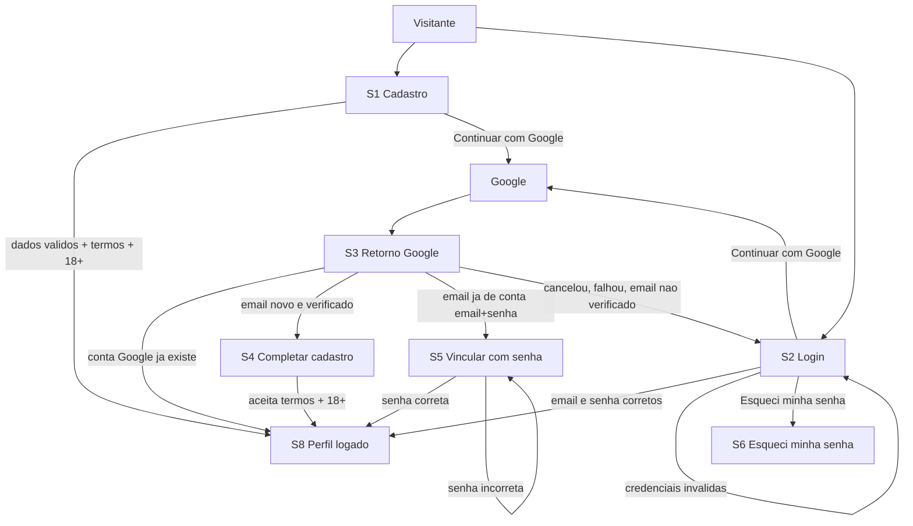
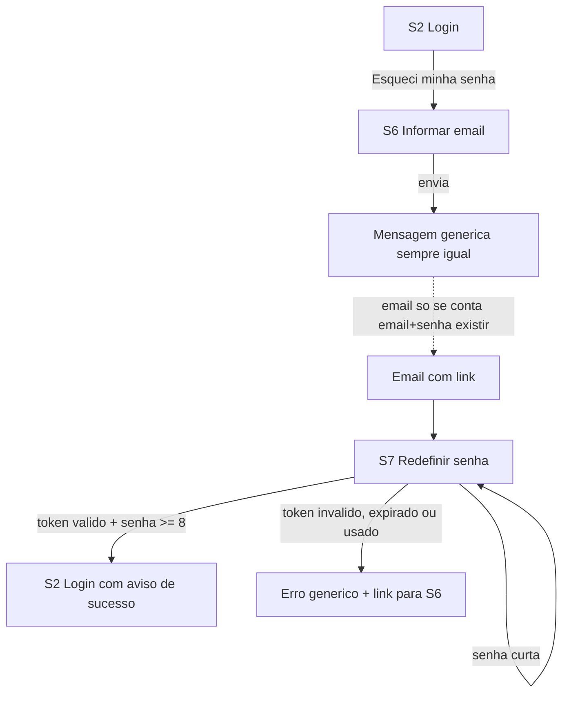
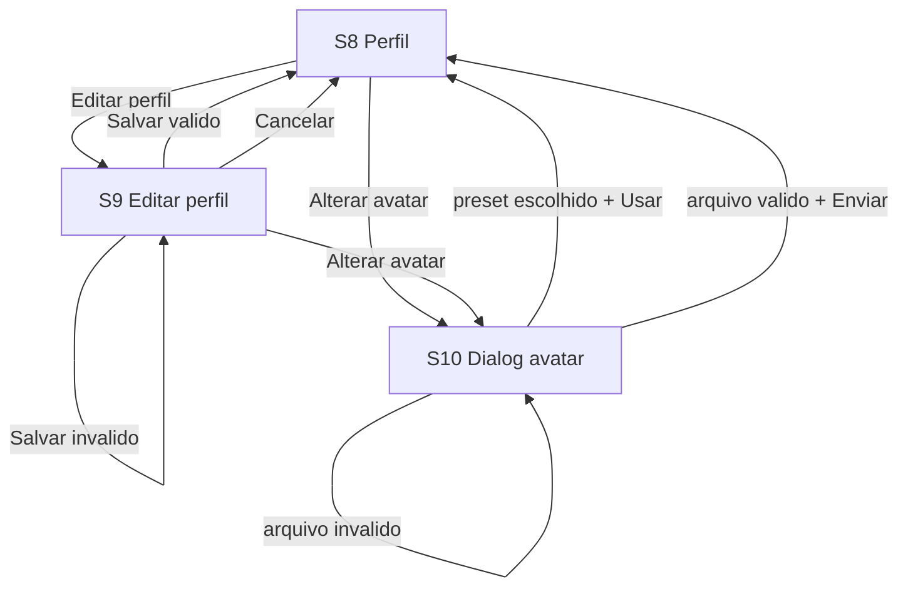
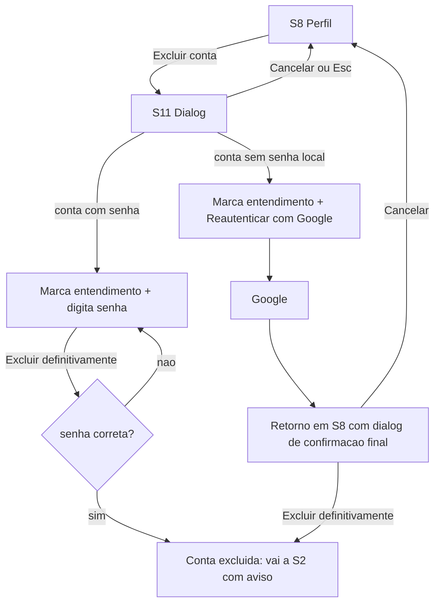

> Superseded: conteúdo consolidado em `design.md` (aprovado em 2026-10-23). Mantido só como histórico de trabalho - a fonte da verdade é o `design.md`.

# UX draft: conta-jogador

Status: Draft para o architect montar o `design.md` | Date: 2026-10-22 | Dono: designer
Fonte da verdade: `requirements.md` (aprovado, REQ-001..REQ-037, D1-D14). Tokens e componentes: `docs/design-system.md` (v0).

Este arquivo tem duas partes prontas para colar no `design.md`: **Parte A** (seção "UX") e **Parte B** (parte de telas da seção "Feature diagram"). Ao final, "Perguntas em aberto" (não colar no design.md; precisam de decisão antes de fechar o design).

---

# PARTE A - colar em `design.md` > "## UX"

## UX

### A.1 Escopo e premissas
- Web responsivo mobile-first (a partir de 320px), React + TypeScript, WCAG 2.1 AA. Sem app nativo.
- Idioma da interface: pt-BR, tratamento "você". `<html lang="pt-BR">`.
- Como ainda não existe outra feature, o destino após cadastro/login é `/perfil`. Quando houver uma home (decks), atualizar.
- As rotas abaixo são propostas de UX; o architect confirma nomes e o contrato de API.
- Termos de Uso e Política de Privacidade: o conteúdo é pendência de release (requirements); a UI apenas linka as páginas (abrem em nova aba, indicado no texto do link).
- Nenhum comportamento além do aprovado foi criado. O que a spec não define está em "Perguntas em aberto".

### A.2 Arquitetura de informação

Navegação global (AppHeader, igual em todas as telas):
- Visitante: wordmark "Deckloom" | Entrar | Criar conta.
- Jogador autenticado: wordmark | botão de avatar com nome (abre AccountMenu: "Meu perfil", "Sair").
- SkipLink "Ir para o conteúdo principal" como primeiro elemento focável.

Mapa de telas e rotas:

| ID | Tela | Rota proposta | Acesso | REQs |
|---|---|---|---|---|
| S1 | Cadastro | `/cadastro` | visitante | 001, 002, 003, 033, 034 |
| S2 | Login | `/entrar` | visitante | 004, 005, 032, 035, 009 |
| S3 | Retorno do Google (processando / erro) | `/entrar/google/retorno` | visitante | 006, 007, 008, 009 |
| S4 | Completar cadastro com Google (termos e maioridade) | `/entrar/google/concluir` | visitante vindo do Google, conta nova | 006, 033, 034 |
| S5 | Vincular Google com senha | `/entrar/google/vincular` | visitante vindo do Google, email já existente | 008, 036, 032 |
| S6 | Esqueci minha senha | `/esqueci-senha` | visitante | 028, 032 |
| S7 | Redefinir senha | `/redefinir-senha` (token no link) | visitante com link | 029, 030, 031 |
| S8 | Perfil (visualização) | `/perfil` | Jogador | 013, 016, 017 |
| S9 | Editar perfil | `/perfil/editar` | Jogador | 014, 015, 016, 017, 037 |
| S10 | Alterar avatar (dialog: galeria de presets + upload) | dialog sobre `/perfil/editar` e `/perfil` | Jogador | 018, 019, 020, 021, 022 |
| S11 | Excluir conta (dialog com reautenticação) | dialog sobre `/perfil` (+ retorno `/perfil?reautenticado=1` no caso Google) | Jogador | 023, 024, 025, 026, 027 |
| S12 | Sessão encerrada / expirada (mensagem no login) | `/entrar` com aviso | visitante | 010, 011, 012, 035 |

Regras de acesso:
- Rotas de visitante (S1, S2, S6, S7) acessadas já autenticado: redirecionam a `/perfil`.
- Rotas de Jogador (S8, S9) sem sessão válida: redirecionam a `/entrar` com aviso "Sua sessão expirou. Entre novamente." (REQ-011) e `retorno` para a rota original. Só aceitar `retorno` que seja caminho interno do app (evita open redirect).
- Logout (AccountMenu > Sair): encerra a sessão no servidor, vai a `/entrar` com aviso "Você saiu da sua conta." (REQ-010).
- O Jogador só vê e edita o próprio perfil; não existe rota com identificador de outro Jogador (REQ-013).

### A.3 Fluxos

#### F1. Visão geral de autenticação


#### F2. Google (REQ-006..009, 036)
1. Visitante clica "Continuar com Google" em S1 ou S2 (mesmo comportamento nas duas).
2. Redireciona ao Google (fluxo OAuth com `state`/PKCE é do backend).
3. Retorno em S3 mostra "Concluindo o login com Google..." (`role="status"`). Resultados:
   - Conta Google já existente: vai a `/perfil` (REQ-007).
   - Email verificado sem conta: vai a S4; a conta só é criada após aceite e maioridade (REQ-006, 033, 034). Se o visitante abandonar S4, nada foi criado.
   - Email verificado de conta email+senha sem vínculo: vai a S5 (REQ-008); só após a senha correta vincula e entra (REQ-036).
   - Cancelou, falhou ou email não verificado: volta a S2 com Alert de erro: "Não foi possível concluir o login com Google. Tente de novo ou entre com email e senha." (REQ-009). Mensagem única para os três casos.
4. Falha do provedor Google não afeta o formulário de email+senha (degradação graciosa); o botão Google continua visível e o erro é só o Alert.

#### F3. Redefinição de senha (REQ-028..032)

- Após sucesso, o Jogador volta ao login com "Senha alterada. Entre com a nova senha." Todas as sessões anteriores foram encerradas (REQ-030); a spec não manda iniciar sessão, então não inicia.
- Senha curta: erro no campo e o token continua válido (REQ-031).

#### F4. Perfil e avatar (REQ-013..022)

- O avatar é salvo de forma independente do formulário de perfil (REQ-018, 019 definem o avatar ao selecionar/enviar). Alterar o avatar em S9 não envia os demais campos e não descarta o que foi digitado.

#### F5. Exclusão de conta (REQ-023..027)

- Nada é excluído até a confirmação final com reautenticação válida (REQ-023, 026).
- Falha de reautenticação (senha incorreta ou Google cancelado): conta intacta, mensagem no dialog (REQ-026).

### A.4 Telas: wireframes, campos, estados

Convenções dos wireframes: `[ ]` checkbox, `( )` radio, `[____]` campo, `[ Botão ]`, `<h1>` título. O AppHeader é omitido (ver A.2). Largura máxima do formulário 28rem, coluna única em todos os breakpoints; a partir de `md` o cartão fica centralizado.

#### S1 Cadastro (`/cadastro`)
```
<h1> Criar conta
[ErrorSummary - só após envio com erro]
Email                    [____________________]   autocomplete=email, type=email
Senha                    [____________________] [Mostrar]   autocomplete=new-password
  Dica: mínimo de 8 caracteres.
Nome de exibição         [____________________]   autocomplete=nickname
  Dica: de 3 a 30 caracteres. Outros Jogadores podem ter o mesmo nome.
[ ] Li e aceito os Termos de Uso (abre em nova aba) e a Política de Privacidade (abre em nova aba).
[ ] Declaro ter 18 anos ou mais.
[ Criar conta ]
------------- ou -------------
[ G  Continuar com Google ]
Já tem conta? Entrar
```
Campos e regras (REQ-003, 033, 034): email obrigatório e formato válido; senha obrigatória >= 8 caracteres, sem regra de composição e sem medidor de força; nome obrigatório 3-30; as duas caixas obrigatórias.

Estados:
- Inicial: sem erros; foco no `<h1>` ao chegar.
- Enviando: botão em loading, campos somente leitura, sem duplo envio. Se > 2 s, RateLimitNotice (ver A.5).
- Erro de validação: ErrorSummary com foco + erro por campo. Mensagens:
  - Email vazio: "Informe seu email." / formato: "Informe um email válido, como nome@exemplo.com."
  - Senha vazia: "Informe uma senha." / curta: "A senha precisa ter pelo menos 8 caracteres."
  - Nome: "O nome de exibição precisa ter de 3 a 30 caracteres."
  - Termos: "Aceite os Termos de Uso e a Política de Privacidade para criar a conta."
  - Maioridade: "Confirme que você tem 18 anos ou mais para criar a conta."
- Email já em uso (REQ-002): erro no campo email: "Não foi possível usar este email. Tente outro ou entre na sua conta." Nenhuma conta alterada. (Observação para o `security`: REQ-002 aprovado já informa que o email não pôde ser usado, o que sinaliza existência do email neste ponto; a UI não adiciona nada além disso.)
- Erro de servidor/rede: Alert de erro "Não foi possível criar a conta agora. Tente de novo." com dados preservados (senha limpa).
- Sucesso: navega a `/perfil` com Alert de sucesso "Conta criada. Bem-vindo(a) ao Deckloom!". Sem passo de verificação de email (D1).
- Vazio: não se aplica.

#### S2 Login (`/entrar`)
```
<h1> Entrar
[Alert de aviso/sucesso/erro, quando houver: sessão expirada, saiu, senha alterada, conta excluída, Google não concluído]
Email   [____________________]   autocomplete=username
Senha   [____________________] [Mostrar]   autocomplete=current-password
[ ] Lembrar-me neste dispositivo por 30 dias
[ Entrar ]          Esqueci minha senha
------------- ou -------------
[ G  Continuar com Google ]
Dica fixa: Criou sua conta com o Google? Use "Continuar com Google".
Não tem conta? Criar conta
```
Regras: REQ-004 (sucesso), REQ-005 (falha genérica), REQ-035 (lembrar-me), REQ-012 (sem lembrar-me, 30 min de inatividade). A dica sobre Google é fixa (aparece sempre), para não revelar o tipo de conta.

Estados:
- Erro de campo vazio: "Informe seu email." / "Informe sua senha."
- Credenciais erradas (qualquer causa: senha errada, email inexistente, conta excluída, conta sem senha local): Alert de erro com foco: **"Email ou senha inválidos."** Mesmo texto, mesma estrutura, mesmo foco em todos os casos (REQ-005, 027). Senha limpa, email mantido.
- Atraso progressivo (REQ-032): ver A.5.
- Enviando / erro de servidor: iguais a S1 ("Não foi possível entrar agora. Tente de novo.").
- Sucesso: vai a `retorno` ou `/perfil`.
- Avisos de entrada (Alert, `role="status"` exceto sessão expirada que é `role="alert"`): "Sua sessão expirou. Entre novamente." (REQ-011/012/035) | "Você saiu da sua conta." (REQ-010) | "Senha alterada. Entre com a nova senha." (REQ-030) | "Sua conta foi excluída." (REQ-024) | "Não foi possível concluir o login com Google. Tente de novo ou entre com email e senha." (REQ-009).

#### S3 Retorno do Google (`/entrar/google/retorno`)
```
<h1> Concluindo o login com Google
(spinner) Aguarde um instante...         [role=status]
```
Estados: processando (acima); resultado redireciona (F2). Se a página for aberta sem parâmetros válidos ou o processamento falhar: redireciona a S2 com o aviso de Google não concluído. Não há formulário.

#### S4 Completar cadastro com Google (`/entrar/google/concluir`)
```
<h1> Quase lá
Você entrou com o Google como {email verificado}. Falta só confirmar:
Nome de exibição  [{nome do Google}]   (ver pergunta Q3)
[ ] Li e aceito os Termos de Uso e a Política de Privacidade.
[ ] Declaro ter 18 anos ou mais.
[ Criar conta ]      Cancelar
```
Regras: REQ-006, 033, 034. A foto do Google não é usada nem mostrada (REQ-022, D10); o avatar inicial é preset padrão. Erros iguais aos de S1. "Cancelar" volta a S2 sem criar nada. Estados: enviando, erro de validação, erro de servidor, sucesso (vai a `/perfil`).

#### S5 Vincular Google com senha (`/entrar/google/vincular`)
```
<h1> Vincular sua conta Google
Já existe uma conta Deckloom com o email {email verificado pelo Google}.
Para vincular o login com Google a ela, informe a senha da conta.
Senha   [____________________] [Mostrar]   autocomplete=current-password
[ Vincular e entrar ]     Esqueci minha senha     Cancelar
```
Regras: REQ-008, 036. O email exibido é o que o próprio visitante acabou de autenticar no Google. Estados:
- Senha vazia: "Informe a senha da conta."
- Senha incorreta: Alert de erro "Senha incorreta. O Google não foi vinculado." Nenhuma sessão, nenhum vínculo; aplica REQ-032 (A.5).
- Sucesso: vai a `/perfil` com "Google vinculado. Da próxima vez você pode entrar com o Google."
- "Cancelar": volta a S2 sem vincular.

#### S6 Esqueci minha senha (`/esqueci-senha`)
```
<h1> Redefinir senha
Informe o email da sua conta. Se existir uma conta com ele, enviaremos instruções para redefinir a senha.
Email   [____________________]
[ Enviar instruções ]      Voltar para entrar
```
Estados:
- Email vazio/formato inválido: erro de campo (mesmas mensagens de S1). Isto é validação de formato, não revela conta.
- Enviando / atraso progressivo (REQ-032): A.5.
- Sucesso **idêntico para qualquer email válido** (REQ-028): Alert `role="status"`: **"Se existir uma conta com esse email, enviaremos instruções para redefinir a senha. Confira também a caixa de spam."** O formulário permanece oculto/limpo; mesma tela, mesmo texto, mesmo tempo percebido, quer o email exista, seja só Google ou não exista, e mesmo que o envio de email falhe.
- Erro de servidor/rede: "Não foi possível processar o pedido agora. Tente de novo." (não indica existência de conta).

#### S7 Redefinir senha (`/redefinir-senha`)
```
<h1> Criar nova senha
[ErrorSummary - só após erro]
Nova senha   [____________________] [Mostrar]   autocomplete=new-password
  Dica: mínimo de 8 caracteres.
[ Salvar nova senha ]
```
Regras: REQ-029, 030, 031. Estados:
- Verificação do link: o token só é validado no envio (a spec não define consulta prévia). Se o architect oferecer validação prévia, usar a tela de erro abaixo.
- Senha curta: erro de campo "A senha precisa ter pelo menos 8 caracteres." O token continua válido; o campo é limpo e o foco volta nele.
- Token inválido, expirado ou já usado (um único texto, REQ-031): tela com `<h1>` "Link inválido ou expirado", texto "Este link de redefinição não pode ser usado. Solicite um novo." e botão "Solicitar novo link" (vai a S6). Não diz qual dos três casos.
- Sucesso: vai a S2 com "Senha alterada. Entre com a nova senha."
- Requisitos para o frontend (para o architect): remover o token da URL do histórico após lido (`history.replaceState`) e servir a página com `Referrer-Policy: no-referrer`.

#### S8 Perfil - visualização (`/perfil`)
```
<h1> Meu perfil
[Alert de sucesso quando vier de salvar/criar/vincular/avatar]
  (Avatar 96px)   Nome de exibição
  TCG favorito:   Magic: The Gathering
  Formatos preferidos:  [Modern] [Commander]      | vazio: "Nenhum formato selecionado."
  Bio:  texto ...                                  | vazio: "Nenhuma bio."
[ Editar perfil ]   [ Alterar avatar ]
-- Zona de perigo --
[ Excluir conta ]
```
Regras: REQ-013 (nunca exibir hash; só o próprio perfil), 016 (vazios aceitos). O email não faz parte da lista de campos do REQ-013 e não é exibido (ver Q6). Estados:
- Carregando: Skeleton do bloco com `aria-busy="true"`; > 2 s mostra "Carregando seu perfil...".
- Erro ao carregar: Alert de erro "Não foi possível carregar seu perfil." + botão "Tentar de novo".
- 401: vai a S2 com aviso de sessão expirada.
- Texto do usuário (nome, bio) sempre renderizado como texto, nunca como HTML; quebra de linha preservada na bio; palavras longas quebram sem rolagem horizontal.

#### S9 Editar perfil (`/perfil/editar`)
```
<h1> Editar perfil
[ErrorSummary - só após erro]
Avatar:  (Avatar 96px)  [ Alterar avatar ]
Nome de exibição        [____________________]   autocomplete=nickname
  Dica: de 3 a 30 caracteres.
Bio (opcional)          [                    ]   textarea, 4 linhas
                        [                    ]   Contador: 0 de 280
TCG favorito            [ Magic: The Gathering v ]  (select; única opção, REQ-017)
Formatos preferidos (opcional)       fieldset/legend
  [ ] Standard  [ ] Modern  [ ] Pioneer  [ ] Commander  [ ] Pauper   (lista vem do catálogo, REQ-037)
[ Salvar alterações ]     Cancelar
```
Regras: REQ-014, 015, 016, 017, 037. Estados:
- Carregando: Skeleton; erro ao carregar: igual a S8.
- Validação (mensagens, REQ-015): "O nome de exibição precisa ter de 3 a 30 caracteres." | "A bio pode ter no máximo 280 caracteres." | "Escolha um TCG favorito válido." | "Escolha apenas formatos da lista." O contador não bloqueia a digitação: acima de 280 vira erro (ícone + texto "281 de 280") para que colagens não sejam truncadas em silêncio.
- Catálogo de Formatos vazio (configuração removeu todos) ou falha ao carregar: texto "Nenhum formato disponível no momento." no lugar das caixas; salvar continua possível (REQ-016).
- Enviando: botão em loading.
- Sucesso: vai a S8 com "Perfil atualizado." (REQ-014).
- Erro de servidor: Alert "Não foi possível salvar. Tente de novo." com dados preservados.
- Cancelar volta a S8 sem salvar (v0 sem confirmação de descarte; ver Q7).
- Nome de exibição repetido é aceito, sem erro de unicidade (REQ-037).

#### S10 Alterar avatar (dialog)
```
[Dialog] Alterar avatar
  Escolha um avatar              (fieldset/legend, radiogroup)
   ( ) mago-azul  ( ) ...  (grade de presets, cada um com nome acessível)
  [ Usar este avatar ]
  ---- ou ----
  Enviar sua imagem
  Arquivo   [ Escolher arquivo ]  Nenhum arquivo escolhido
  Dica: JPEG, PNG ou WebP, até 2 MB. Removemos os metadados da imagem.
  (pré-visualização 96px após escolher)
  [ Enviar imagem ]
  [ Fechar ]
```
Regras: REQ-018, 019, 020, 021, 022 (o padrão inicial é preset). Estados:
- Preset: selecionar e "Usar este avatar"; sucesso fecha o dialog, foco volta ao gatilho e o perfil mostra "Avatar atualizado." O preset atual vem pré-selecionado quando o avatar é preset.
- Upload, validação do cliente (conveniência): tipo fora de JPEG/PNG/WebP -> "Escolha uma imagem JPEG, PNG ou WebP." | > 2 MB -> "A imagem precisa ter no máximo 2 MB." Servidor revalida por conteúdo.
- Servidor rejeita (tipo, tamanho ou conteúdo inválido, REQ-020): erro dentro do dialog "Não foi possível usar este arquivo. Envie uma imagem JPEG, PNG ou WebP de até 2 MB." O avatar atual permanece e é mostrado como tal.
- Enviando: botão loading, "Enviando imagem..."; sucesso fecha o dialog.
- Erro de rede: "Não foi possível enviar agora. Tente de novo." Avatar atual inalterado.
- Vazio: sem arquivo escolhido, "Enviar imagem" mostra erro "Escolha um arquivo para enviar." ao ser acionado.
- Sem arrastar-e-soltar no v0 (menos superfície a testar e acessível por padrão).

#### S11 Excluir conta (dialog, `alertdialog`)
Conta com senha local (REQ-023):
```
[Dialog] Excluir conta
  Esta ação é imediata e não pode ser desfeita. Vamos excluir permanentemente seus dados pessoais
  (email, nome, bio, preferências, avatar) e todos os seus decks.
  [ ] Entendo que a exclusão é definitiva.
  Senha   [____________________] [Mostrar]   autocomplete=current-password
  [ Cancelar ]   [ Excluir minha conta definitivamente ]  (botão de perigo)
```
Conta sem senha local (Google):
```
[Dialog] Excluir conta
  (mesmo texto)
  [ ] Entendo que a exclusão é definitiva.
  Para confirmar, entre novamente com o Google.
  [ Cancelar ]   [ G  Reautenticar com o Google ]
  --> após retorno do Google, S8 reabre o dialog:
  [Dialog] Confirmar exclusão
    Você confirmou sua identidade. Excluir sua conta agora?
    [ Cancelar ]   [ Excluir minha conta definitivamente ]
```
Estados:
- Caixa de entendimento desmarcada ao enviar: "Marque a caixa para confirmar que entende que a exclusão é definitiva." Senha vazia: "Informe sua senha para confirmar."
- Senha incorreta (REQ-026): "Senha incorreta. Sua conta não foi excluída." Conta intacta; aplica REQ-032 (A.5).
- Google cancelado/falhou: ao voltar a S8, Alert "Não foi possível confirmar sua identidade. Sua conta não foi excluída."
- Enviando: botão em loading, dialog não fecha por Esc durante o envio.
- Sucesso (REQ-024, 025, 027): vai a S2 (todas as sessões encerradas) com Alert "Sua conta foi excluída." Novo cadastro com o mesmo email é uma conta nova, sem aviso especial.
- Cancelar/Esc/clique fora do dialog (não fecha por clique fora no v0): conta inalterada, foco volta ao botão "Excluir conta".

### A.5 Atraso progressivo (REQ-032) e mensagens genéricas

Telas afetadas: S2 (login), S5 (vincular), S6 (esqueci senha), S11 (senha na exclusão). O atraso é uma resposta mais lenta do servidor (a spec define atraso, não bloqueio).

Comportamento de UI:
1. Ao enviar, o botão entra em loading (`aria-busy`), campos somente leitura.
2. Se a resposta passar de 2 s, o RateLimitNotice insere na região `role="status"` (polite): **"Por segurança, esta resposta está demorando um pouco mais. Aguarde, não é necessário enviar de novo."**
3. Não há contagem regressiva, nem bloqueio do formulário além do envio em andamento, nem texto que diga "muitas tentativas", "conta bloqueada" ou indique se a conta existe. O mesmo aviso aparece para qualquer causa de lentidão.
4. Ao chegar a resposta, a região é esvaziada e o resultado segue as regras da tela.
5. O timeout do cliente precisa ser maior que o atraso máximo do servidor (ver Q4); ao estourar, mostrar o erro genérico de servidor/rede, nunca "credenciais inválidas".

Tabela de mensagens genéricas (anti-enumeração) - o texto e a estrutura são idênticos entre os casos listados:

| Situação | Mensagem única | Casos que devem ser indistinguíveis na UI | REQ |
|---|---|---|---|
| Login falhou | "Email ou senha inválidos." | senha errada; email inexistente; conta excluída; conta só-Google tentando senha | 005, 027 |
| Pedido de redefinição | "Se existir uma conta com esse email, enviaremos instruções para redefinir a senha. Confira também a caixa de spam." | email com conta email+senha; só Google; inexistente; falha no envio do email | 028 |
| Link de redefinição inutilizável | "Este link de redefinição não pode ser usado. Solicite um novo." | token inválido; expirado; já usado | 031 |
| Google não concluído | "Não foi possível concluir o login com Google. Tente de novo ou entre com email e senha." | cancelado; falhou; email não verificado | 009 |
| Resposta lenta | "Por segurança, esta resposta está demorando um pouco mais. Aguarde, não é necessário enviar de novo." | qualquer causa de atraso | 032 |

Exceções aprovadas pela spec (não são anti-enumeração): cadastro com email em uso informa que o email não pôde ser usado (REQ-002); S5 e S11 podem dizer "senha incorreta" porque o visitante já está identificado (via Google / sessão).

### A.6 Critérios de acessibilidade (WCAG 2.1 AA) testáveis

Notação: **A11Y-nn** | critério WCAG | verificação que o `qa` executa | REQs. "Todas as telas" = S1..S11. Ferramentas sugeridas: teclado, leitor de tela (NVDA/VoiceOver), verificador de contraste, axe/Lighthouse como apoio (não substituem a verificação manual).

| ID | WCAG | Verificação testável | REQs |
|---|---|---|---|
| A11Y-01 | 1.3.1, 3.3.2, 4.1.2 | Todo campo (input, textarea, select, checkbox, radio, file) tem `<label>` visível associado (`for`/`id` ou envolvente); placeholder não é o único rótulo. | 001, 003, 004, 014, 015, 019, 023, 028, 030, 036 |
| A11Y-02 | 1.3.1, 3.3.1, 4.1.2 | Campo inválido tem `aria-invalid="true"` e `aria-describedby` apontando para o id do texto do erro (e da dica, se houver); ao corrigir, ambos somem. | 003, 015, 020, 031, 034 |
| A11Y-03 | 3.3.1, 1.4.1 | Erro nunca é comunicado só por cor: há ícone e texto em cada erro; remover a cor ainda deixa o erro identificável. | 003, 005, 015, 020 |
| A11Y-04 | 3.3.1, 2.4.3 | Envio com erro(s) de campo move o foco ao ErrorSummary (`tabindex="-1"`); a lista tem um link por erro; ativar o link foca o campo correspondente. | 003, 015, 031, 033, 034 |
| A11Y-05 | 3.3.3 | Toda mensagem de erro de campo diz como corrigir (ex.: limites 8 / 3-30 / 280 / 2 MB / tipos aceitos), conforme os textos da A.4. | 003, 015, 020, 031 |
| A11Y-06 | 3.3.4 | Exclusão de conta exige caixa de entendimento + reautenticação + botão de perigo em dialog; nada é excluído com apenas um clique/Enter. | 023, 026 |
| A11Y-07 | 2.1.1 | Todas as funções (cadastro, login, Google, redefinição, edição, galeria de presets, upload, exclusão, logout, menu da conta) são operáveis só por teclado, sem exigir mouse. | todos |
| A11Y-08 | 2.1.2 | Nenhuma armadilha de foco, exceto dentro de dialog modal, que mantém o Tab circular e é fechável com Esc (ou "Cancelar"/"Fechar"). | 018, 019, 023 |
| A11Y-09 | 2.4.7, 1.4.11 | Todo elemento focável mostra anel de foco visível com contraste >= 3:1 contra o fundo adjacente; nenhum `outline: none` sem substituto. | todos |
| A11Y-10 | 2.4.3, 1.3.2 | A ordem de foco por Tab segue a ordem visual/DOM (cabeçalho, conteúdo, ações); nenhum `tabindex` positivo. | todos |
| A11Y-11 | 4.1.2, 2.4.3 | Dialogs (S10, S11) têm `role="dialog"`/`"alertdialog"`, `aria-modal="true"`, `aria-labelledby` (título); ao abrir o foco entra no dialog (primeiro campo ou botão menos destrutivo); o conteúdo de fundo fica inerte; ao fechar o foco volta ao elemento que abriu. | 018, 019, 023, 026 |
| A11Y-12 | 4.1.2 | Esc cancela os dialogs, exceto durante envio em andamento (S11), em que nada fecha. | 023, 026 |
| A11Y-13 | 1.4.3 | Texto normal tem contraste >= 4,5:1 e texto grande (>= 24px, ou >= 18,66px em negrito) >= 3:1, para todos os pares de `docs/design-system.md`. | todos |
| A11Y-14 | 1.4.11 | Bordas de campo, checkbox, radio, estado selecionado do preset, botões e ícones de erro têm contraste >= 3:1 contra o fundo. | todos |
| A11Y-15 | 1.1.1 | O avatar no perfil tem alternativa textual ("Avatar: {nome do preset}" ou "Seu avatar personalizado"); cada preset na galeria tem nome acessível; a pré-visualização do upload tem alt ("Pré-visualização do avatar escolhido"); avatar decorativo ao lado do nome usa `alt=""`. | 013, 018, 019, 022 |
| A11Y-16 | 4.1.3 | Mensagens de sucesso/informação (conta criada, perfil atualizado, avatar atualizado, instruções enviadas, senha alterada, "Aguarde") estão em região `role="status"`; erros de página (sessão expirada, falha ao carregar) em `role="alert"`; leitor de tela as anuncia sem mover o foco. | 001, 010, 014, 018, 028, 030 |
| A11Y-17 | 4.1.3 | O aviso de atraso do rate limit (A.5) é inserido numa região `role="status"` já presente no DOM antes do envio e é anunciado pelo leitor de tela quando a resposta passa de 2 s. | 032 |
| A11Y-18 | 1.4.10 | Em 320px de largura CSS e com zoom de 400%, nenhuma tela tem rolagem horizontal nem perda de conteúdo ou função (dialogs rolam internamente). | todos |
| A11Y-19 | 1.4.4, 1.4.12 | Com texto ampliado a 200% e com espaçamento de texto aumentado (altura de linha 1,5, parágrafo 2x, letra 0,12em, palavra 0,16em), não há corte nem sobreposição de texto. | todos |
| A11Y-20 | 2.4.2, 2.4.6 | Cada tela tem `<title>` único ("Entrar - Deckloom", "Meu perfil - Deckloom" etc.) e exatamente um `<h1>` descritivo; níveis de título sem saltos. | todos |
| A11Y-21 | 3.1.1 | `<html lang="pt-BR">` em todas as páginas. | todos |
| A11Y-22 | 1.3.5 | Campos de identidade usam `autocomplete` correto: email `email`/`username` (login), senha `current-password` (login, S5, S11) e `new-password` (S1, S7), nome de exibição `nickname`. | 001, 004, 030, 036 |
| A11Y-23 | 2.4.1 | Existe SkipLink "Ir para o conteúdo principal" como primeiro foco, visível ao receber foco, que leva ao `<main>`. | todos |
| A11Y-24 | 2.4.4, 3.2.5 | Nomes de link fazem sentido fora de contexto ("Termos de Uso", "Política de Privacidade"); links que abrem nova aba trazem "(abre em nova aba)" no texto; abrir o link não altera o estado do checkbox. | 033 |
| A11Y-25 | 3.2.1, 3.2.2 | Foco ou alteração em campos (selecionar preset, escolher arquivo, marcar formato, marcar caixa) não envia o formulário nem muda de tela; só botões explícitos executam ações. | 014, 018, 019, 033 |
| A11Y-26 | 4.1.2 | O botão "Mostrar senha" tem nome acessível ("Mostrar senha"/"Ocultar senha") e `aria-pressed` coerente com o estado; alternar não perde o valor digitado nem o foco. | 001, 004, 023, 030, 036 |
| A11Y-27 | 1.3.1 | Grupos usam `<fieldset>`/`<legend>`: Formatos preferidos (checkboxes) e galeria de presets (radios, setas navegam, Tab entra no grupo uma vez). | 018, 037 |
| A11Y-28 | 1.3.1, 3.3.2 | O campo de bio tem contador ligado por `aria-describedby`; o leitor de tela não lê o contador a cada tecla; ao exceder 280, o erro é identificado conforme A11Y-02/03. | 015 |
| A11Y-29 | 2.1.1, 3.3.2 | O upload usa `<input type="file">` nativo com rótulo e dica de formatos/tamanho em texto; o nome do arquivo escolhido e erros de upload são lidos pelo leitor de tela (erro via A11Y-02/16). | 019, 020 |
| A11Y-30 | 3.2.3, 3.2.4 | AppHeader e AccountMenu têm mesma posição, ordem e rótulos em todas as telas; "Entrar com Google" tem o mesmo rótulo ("Continuar com Google") em S1 e S2. | todos |
| A11Y-31 | 2.2.1, 4.1.3 | Expiração de sessão (inatividade de 30 min ou 30 dias) leva ao login com aviso `role="alert"` "Sua sessão expirou. Entre novamente."; o foco chega ao aviso/`<h1>`; a UI não mostra dados do Jogador depois da expiração. | 011, 012, 035 |
| A11Y-32 | 1.4.13 | Nenhuma informação essencial depende de hover (tooltip); conteúdo exibido por foco/hover pode ser dispensado, e permanece visível enquanto necessário. | todos |
| A11Y-33 | 2.4.3, 4.1.2 | Menu da conta é botão com `aria-expanded`; abre/fecha com Enter/Espaço; Esc fecha e devolve o foco ao botão; itens são links/botões nativos focáveis em ordem. | 010, 013 |
| A11Y-34 | 2.4.3, 4.1.3 | Em transição de rota (inclusive retorno do Google, S3), o foco vai para o `<h1>` da nova tela e a mudança é perceptível a leitor de tela (título atualizado). | 006, 007, 008, 009 |
| A11Y-35 | 1.3.1 | O texto de perfil do usuário (nome, bio) é exposto como texto simples; HTML digitado aparece literalmente, sem ser interpretado; tipos de valor "vazio" exibem o texto de estado vazio, não elemento vazio. | 013, 014, 016 |
| A11Y-36 | Recomendação do projeto (além do AA da WCAG 2.1) | Alvos de toque/clique >= 44x44px; colar é permitido em todos os campos de senha; nenhum teste cognitivo no login. | todos |

Total: **36 critérios** (35 mapeados a critérios de sucesso da WCAG 2.1 A/AA e 1 recomendação do projeto, A11Y-36).

### A.7 Critérios funcionais de UX adicionais (testáveis)

| ID | Verificação | REQs |
|---|---|---|
| UX-01 | S2 mostra o texto idêntico "Email ou senha inválidos." (mesmo DOM de texto) para senha errada, email inexistente e conta excluída. | 005, 027 |
| UX-02 | S6 mostra o texto idêntico para email existente, só-Google, inexistente e falha de envio. | 028 |
| UX-03 | S7 mostra o mesmo erro para token inválido, expirado e usado; com senha curta o token continua aceito num segundo envio válido. | 031 |
| UX-04 | S1 e S4 recusam envio sem aceite dos termos e sem declaração de 18+, com erro no campo correspondente. | 033, 034 |
| UX-05 | Nenhuma tela exibe, no DOM ou na rede visível ao usuário, hash de senha; rotas de edição só carregam o perfil do Jogador autenticado. | 013 |
| UX-06 | O dropdown/lista de Formatos reflete o catálogo recebido do servidor (sem lista fixa no cliente); TCG favorito mostra apenas "Magic: The Gathering". | 017, 037 |
| UX-07 | Após erro de upload, o avatar mostrado é o anterior. Após sucesso de upload ou preset, o novo avatar aparece no perfil e no AppHeader sem recarregar a página. | 018, 019, 020 |
| UX-08 | Após exclusão confirmada, o Jogador é levado a S2 sem sessão; voltar no navegador não exibe S8/S9 com dados (revalidação no servidor). | 024, 011 |
| UX-09 | Logout leva a S2; usar "Voltar" não mostra dados do perfil. | 010, 011 |
| UX-10 | Layout em 320, 768 e 1280px: formulário em coluna única, sem sobreposição. | todos |

---

# PARTE B - colar em `design.md` > "## Feature diagram" (parte de telas)

Escopo: somente as telas desta feature (`conta-jogador`). Texto/ASCII, sem dependência de renderização externa.

```
                         +--------------------------+
                         |  AppHeader (todas telas) |
                         |  Visitante: Entrar|Criar |
                         |  Jogador: [avatar] Menu  |
                         +--------------------------+

 VISITANTE
 =========
  +-----------+  Criar conta   +--------------+
  | S2 Login  |<-------------->| S1 Cadastro  |
  +-----------+  Entrar        +--------------+
   |   |   |                        |
   |   |   +-- Esqueci minha senha ---+---> +---------------------+
   |   |                                      | S6 Esqueci senha    |
   |   |                                      +---------------------+
   |   |                                              | email com link
   |   |                                              v
   |   |                                      +---------------------+
   |   +<-- sucesso "Senha alterada" ---------| S7 Redefinir senha  |
   |                                          +---------------------+
   |
   +-- Continuar com Google (de S1 ou S2) --> [Google] --> +---------------------+
                                                           | S3 Retorno Google   |
                                                           +---------------------+
                          conta Google existente ----------> S8 Perfil
                          email novo -----------------------> S4 Completar cadastro --(aceite+18+)--> S8
                          email de conta email+senha -------> S5 Vincular c/ senha  --(senha ok)-----> S8
                          cancelou/falhou/nao verificado ---> S2 (aviso)

 JOGADOR AUTENTICADO
 ===================
  +-------------+  Editar perfil   +------------------+
  | S8 Perfil   |----------------->| S9 Editar perfil |--Salvar/Cancelar--> S8
  +-------------+                  +------------------+
    |      |                              |
    |      +--Alterar avatar--+-----------+
    |                         v
    |                  +-------------------+
    |                  | S10 Dialog avatar |  presets (radio) | upload (JPEG/PNG/WebP <= 2 MB)
    |                  +-------------------+
    |
    +--Excluir conta--> +---------------------------+  senha ok / Google reautenticado
    |                   | S11 Dialog exclusao       |------------------------------> S2 ("Conta excluida")
    |                   +---------------------------+
    +--Sair (AccountMenu) ------------------------------------------------------> S2 ("Voce saiu")

 SESSAO
 ======
  Qualquer rota de Jogador sem sessao valida --------------------------------------> S2 ("Sua sessao expirou")
```

Tabela de telas afetadas (para o `overview.html`, se produzido): S1 Cadastro, S2 Login, S3 Retorno Google, S4 Completar cadastro Google, S5 Vincular Google com senha, S6 Esqueci minha senha, S7 Redefinir senha, S8 Perfil, S9 Editar perfil, S10 Dialog de avatar, S11 Dialog de exclusão de conta (todas novas; nenhuma tela existente é alterada).

---

# Perguntas em aberto (não colar no design.md; devem ser resolvidas e depois removidas)

Nenhuma delas contradiz a spec aprovada; todas cobrem algo que a spec deixa em silêncio.

| # | Pergunta | Opções | Recomendação |
|---|---|---|---|
| Q1 | Onde o visitante dá o aceite de termos e a autodeclaração de 18+ no caminho Google (REQ-006 exige antes de criar a conta)? | (a) tela S4 após o retorno do Google, só para conta nova; (b) caixas na tela de cadastro e de login antes do clique no botão Google | (a): não pesa para quem já tem conta, e vale tanto em S1 quanto em S2. Exige estado temporário no servidor entre S3 e S4 (decisão do architect). |
| Q2 | Após reautenticação Google na exclusão, executar a exclusão direto ao voltar ou pedir uma última confirmação? | (a) segunda confirmação em dialog (desenhada acima); (b) excluir direto ao voltar do Google | (a): o retorno por redirecionamento é fácil de acionar sem querer; custa um clique. |
| Q3 | O nome inicial vindo do Google (REQ-006) pode ter menos de 3 ou mais de 30 caracteres. O que fazer? | (a) S4 mostra o campo preenchido e editável, validando 3-30 como em S1; (b) truncar/completar automaticamente (comportamento novo); (c) campo vazio quando o nome do Google não for válido | (a): reaproveita a validação existente e não inventa regra de truncamento. Requer confirmar que editar o nome em S4 é aceitável (REQ-006 só fala em "preencher a partir do Google"). |
| Q4 | Qual o atraso máximo do rate limit (REQ-032)? O servidor devolve alguma dica (ex.: tempo)? | (a) sem dica, UI usa só o aviso genérico após 2 s; (b) servidor devolve tempo de espera e UI mostra contagem | (a): evita expor a lógica do limite; o timeout do cliente precisa ser maior que o atraso máximo (valor do architect). |
| Q5 | Quantos avatares preset e quem produz a arte? (REQ-018 cita "mago-azul" como exemplo.) Qual preset é o padrão (REQ-022)? | (a) 8 a 12 placeholders neutros; (b) conjunto ilustrado próprio; (c) arte de terceiros licenciada | (a) para o MVP, trocável depois sem mudar código se catálogo for dado/configuração. Decisão de produto/marca (ver M5 no design system). |
| Q6 | O email do Jogador deve aparecer no perfil (S8)? REQ-013 não o lista. | (a) não exibir (como desenhado); (b) exibir somente leitura | (a) até haver pedido; evita expor email em tela compartilhada e respeita a spec literal. |
| Q7 | Descartar edições do perfil ao clicar "Cancelar" ou sair: pedir confirmação? Perder dados ao expirar sessão durante a edição é aceitável? | (a) sem confirmação no v0; (b) confirmação se houver alteração | (a) no MVP (perfil tem 4 campos); revisar se virar dor. |
| Q8 | Aviso de atraso após 2 s e demais tempos de UI (2 s) servem, dado p95 de 3 s do servidor? | (a) 2 s; (b) 3 s | (a): anuncia antes de o usuário achar que travou, sem aparecer na maioria das respostas normais. |
| Q9 | Marca: cor primária, tipografia, tema escuro, logotipo (ver M1-M5 em `docs/design-system.md`). | ver tabela no design system | Usar o neutro-padrão (azul, fonte do sistema, só tema claro, wordmark em texto). |
| Q10 | O botão Google deve seguir as diretrizes visuais oficiais do Google para botões de login (logotipo/cores). Quem verifica o uso do logotipo sem carregar recurso externo (arquivo local no repositório)? | (a) SVG local próprio seguindo a diretriz; (b) botão só com texto | (a), a validar na fase de implementação; o texto do botão continua "Continuar com Google" em ambos. |
